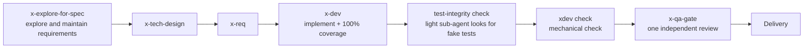

# x-dev-pipeline

[中文说明](./README_zh.md)

**Current release:** v1.0.0

> An auditable development workflow for AI coding agents: confirm requirements, write down the technical design, trace key constraints, and support delivery conclusions with real evidence.

`x-dev-pipeline` organizes development into a traceable delivery chain:

| Artifact | Owns |
|---|---|
| `spec.md` | User-visible features, acceptance scenarios, and confirmed key constraints |
| `tech-design.md` | Modules, protocols, data flows, technical decisions, and numbered test cases |
| `dev-checklist.md` | The single delivery file of a task: rows, scenario and test-case references, progress, and a closing "结果" (results) section with the case-to-test mapping, changed-line coverage, and issue handling |
| `evidence/` | Raw output: test logs, the coverage record, screenshots, manual verification notes |

Stable IDs connect requirements, design, tasks, and evidence. Everything a script can decide (IDs, statuses, whether tests pass, whether coverage is 100%) is handled by `xdev`; agents only do what a script cannot.

## Two working paths

Full requirements follow the design-first main line; small, specific changes follow a reduced task that one agent completes. Both use the same `xdev start / coverage / check`.



```text
Small tasks:
x-qdev · one task document: requirements → local design → tests → implementation → evidence
       → xdev check → one independent review when scenarios were written
```

`x-tech-design` is a required prerequisite for task decomposition. `x-verify-tech` is the method behind the review's "design and architecture constraints" lens and can also be invoked on its own.

## Main line: requirements → technical design → tasks → development

### 1. x-explore-for-spec · Explore and incrementally maintain requirements

`x-explore-for-spec` is the single requirements entry point, combining open exploration, requirement confirmation, and spec writing. Every request includes an exploration check against existing documentation, code, and concrete scenarios to establish its goal, scope, and acceptance basis. Reuse explicit decisions directly and ask about unresolved choices that affect actual outcomes.

One spec owns one block of data and is maintained over time. Add new features over time and update existing behavior in place. Which spec a change goes into is described in the [spec scope rules](skills/x-explore-for-spec/references/spec-scope.md):

```text
docs/spec/<spec-name>/spec.md
```

After confirming a useful batch of conclusions about behavior, scope, constraints, or acceptance, update the relevant parts of the owning spec. Keep conclusions, essential rationale, and observable results in the document; keep temporary reasoning in the conversation. Continue exploring open decisions and retain explicitly deferred features in the long-term backlog.

Each `featNN` represents a user-visible feature. Given/When/Then scenarios describe the normal, boundary, and error behavior needed for the current goal; THEN states an observable result. Feature and scenario IDs remain stable: append new IDs, reuse IDs for edits, and retain traceable records for removals.

The spec also records user-confirmed key constraints: rules that must hold and outcomes that must be prevented. Stable IDs such as `C1` and `C2` identify their scope, observable criteria, confirmation basis, and related scenarios. The user's requirements on how code is organized (layering, dependencies, technology choices, things not to do) are constraints too, prefixed with "架构：" (architecture); project-wide ones live in the `engineering` spec.

Constraints are only part of the task: the work is defined by the scenarios, and constraints only limit how it is done. Satisfying the constraints while leaving a scenario unfinished does not count as done.

The current selection explicitly identifies the features, scenarios, and completion criteria handed to design and development. The long-term backlog retains future work. A review batch should generally focus on up to 3 features and 10 scenarios; larger scopes can be reviewed in batches within the same spec. One spec owns one block of data; see the [spec scope rules](skills/x-explore-for-spec/references/spec-scope.md). Technical design consumes the confirmed current scope and content baseline.

### 2. x-tech-design · Write the technical design (no user sign-off needed)

Read the confirmed spec, existing code, and applicable development rules, then create a design alongside the spec:

```text
docs/spec/<spec-name>/tech-design.md
```

The design covers the features in scope and the modules they directly affect. It sets the change boundary, required interface and state constraints, and observable acceptance criteria. Developers choose the internal implementation. Every feature's main path needs Smoke coverage, and one Smoke case can cover multiple features.

Design items use stable IDs such as `D01` and `D02`. Key constraints map to mechanisms and numbered cases:

```text
spec: C1 key constraint
          ↓
tech-design: D01 mechanism → test cases T1, T2
          ↓
checklist: assignment to a specific task / task row
          ↓
checklist results: cases mapped to test functions, 100% changed-line coverage
```

Each case defines its basis, preconditions, trigger, expected and forbidden outcomes, and verification level. `tech-design.md` owns the test-case definitions; downstream artifacts reference their IDs.

The technical design does not need user sign-off; it goes straight to x-req. Only boundary trade-offs that need a user decision are asked separately. Each D rule lists the scenarios and C constraints it serves, so when requirements change, follow the IDs as described in [change sync](skills/x-tech-design/references/change-sync.md) to update D rules, test cases, task rows, and tests.

### 3. x-req · Split tasks from requirements and design

Group feats into tasks and create a development checklist for each task:

```text
docs/spec/<spec-name>/tasks/<task-name>/dev-checklist.md
```

Before decomposition, check the spec and its user confirmation record, the technical design, and answers to any trade-offs that needed a user decision. The design must cover the current feats, with mechanisms and complete test cases for all applicable key constraints.

Task rows reference functional expectations through `featNN 场景M` (feat and scenario IDs), and cite `C`, `D`, and test-case IDs in their descriptions. For example:

```text
T3 · Integration check of retry results (C1; D01; test cases T1, T2)
```

"Task row T1" belongs to the checklist; "test case T1" belongs to the technical design.

All tasks together cover every scenario in the current selected scope and every test case for applicable key constraints. Backlog items enter task decomposition when selected in a later round. Each checklist follows implementation order. The design determines the affected files, and the affected-files tree matches the files column one to one.

Rows involving authorization, persistence, migration, concurrency, or irreversible operations carry `高:<reason>` (high risk) and include smoke-or-above verification through the real path.

### 4. x-dev · Develop row by row, reach 100% coverage

x-dev executes one task at a time and follows the checklist's spec and design pointers to scenarios, constraints, mechanisms, and test-case definitions. It starts with `xdev start`, which records the code baseline (the current git commit); all coverage is measured against it.

New behavior suitable for automation follows TDD:

1. Write a test and obtain a valid red result caused by the missing or violated target behavior.
2. Implement within the declared file scope until the test passes.
3. Register the case and its test function in the checklist's case mapping table and mark the row `[x] 🟢`.

After all rows are done, run:

```bash
xdev coverage <task> --cmd "<full test command>" --report <coverage report>
```

It really runs the tests, reads the coverage report (lcov, Cobertura XML, coverage.py JSON, Go coverprofile), and computes how many code lines changed since the baseline were executed by tests; test files and documents do not count. Below 100% it lists the missed `file:line` locations, and the agent adds tests until it reaches 100%.

Coverage only shows code was executed. The main agent then sends a light sub-agent to read only the new tests and look for faking or shortcuts: re-implementing business logic inside the test, not calling project code, mocking the unit under test, asserting only that something was called, tautological assertions, swallowed failures, or data that cannot tell right from wrong. Findings are fixed and rechecked. The receipt is saved in the evidence directory and read by `xdev check`; editing tests afterwards means rerunning coverage and rechecking.

## Delivery checks: mechanical check + one independent review

| Step | What it does | Result |
|---|---|---|
| `xdev check` (x-verify-spec) | Script check: structure and IDs, requirement changes synced, every row 🟢, every scenario has a passing case, every case maps to a real test function, high-risk rows have a real-chain case, tests pass and changed-line coverage is 100%, the test-integrity check passed, and neither code nor tests changed since | Pass / fail (each item listed) |
| `x-qa-gate` | One read-only reviewer chosen by risk, looking at what a script cannot judge: requirement alignment, edge and failure paths, whether tests really prove the scenarios, design and architecture constraints (Q1 skips edge paths; Q2/Q3 cover all four) | Pass / issues found |

risk is computed by x-req from the rows: Q0 (purely technical, no scenarios) runs only `xdev check`; Q1 reviews alignment, test strength, design and architecture; Q2 adds edge and failure paths; Q3 uses full inputs and per-lens receipts.

Issues are registered (P0/P1 rows drop to `[!] 🔴`) and handed to x-fix in one batch. The main agent closes them with each issue's counterexample test, `xdev coverage`, and `xdev check`, without sending fixes back to the original reviewer; at most 3 fix rounds. Handling is recorded in the checklist's "问题与处置" section rather than in separate report files.

With multiple agents, the main agent checks each returned group by running `xdev coverage --out` on that group's branch itself (it does not copy the worker's conclusion) and sends failures back to the same worker; after all groups merge, coverage, `xdev check`, and the review run once for the whole task.

## x-qdev · A reduced flow for small tasks

x-qdev records a small change in one task document: ① requirements and changes, ② lean technical design, ③ test cases and changes, ④ implementation, ⑤ results (case mapping, coverage, issue handling). Feature text keeps living in the owning spec; the task records this change, its references, and evidence.

The only stop is the spec increment: for changes that write scenarios, the owner, scenario text, and approach are shown to the user first; after confirmation, design, implementation, document sync, and checks run continuously. A new spec, scenarios spanning two or more specs, or more than 3 source files call x-tech-design; otherwise ② stays brief. If any [risk rule](skills/x-qdev/references/risk-rules.md) answers "yes", it stops and hands over to the main line.

```text
x-qdev → xdev start → test-first implementation → xdev coverage (100%) → test-integrity check → xdev check
       → when scenarios were written: x-qa-gate (Q1) → delivery
```

## Optional: adversarial spec risk review

`x-adversarial-risk` reviews a spec's risk assumptions before task decomposition. It uses prior failure experience to construct minimal counterexamples and adds scenarios with traceable provenance to the spec.

```text
x-explore-for-spec → x-adversarial-risk → x-tech-design → x-req
```

Risk review and bug ingestion share a user-global corpus, with a caller-selected path available. Confirm any new behavior or constraints in `x-explore-for-spec` before updating the functional spec and affected design. For specs carrying the risk-version marker, a pending review status blocks x-req decomposition.

## Commands

| Command | Responsibility |
|---|---|
| `/x-explore-for-spec` | Unified requirements entry: explore and confirm behavior, keep valuable conclusions, and maintain the owning spec and current scope |
| `/x-tech-design` | Write the technical design from a confirmed spec, defining mechanisms and numbered test cases; sync by ID when requirements change |
| `/x-req` | Split tasks from the confirmed spec and technical design, assigning scenarios, constraints, and test cases |
| `/x-dev` | Execute one task test-first and reach 100% changed-line coverage |
| `/x-verify-spec` | Gate ①: run `xdev check` for the mechanical delivery check |
| `/x-verify-tech` | Check implementation against the technical design, development rules, and architecture constraints (the review's q4-design method; also usable alone) |
| `/x-qa-gate` | One risk-routed independent review |
| `/x-qdev` | Reduced single-document flow for small tasks |
| `/x-fix` | Batch-fix issues found by checks, reviews, or correctness investigations |
| `/x-cr` | Investigate correctness problems, modules, diffs, or PRs |
| `/x-adversarial-risk` | Review spec risk assumptions and add traceable counterexample scenarios |
| `/x-multi-llm-align` | Align protocols, data structures, or flows |
| `/x-audit-perf` | Independent performance audit |
| `/x-audit-style` | Independent style audit |
| `/x-audit-arch` | Independent architecture audit |

## Deterministic engine

`skills/x-dev/scripts/xdev.py` is the single CLI entry: current-format task rules live in `skills/x-req/scripts/checklist_engine.py`, development and delivery checks in `skills/x-dev/scripts/delivery.py`, and QA issue transactions in `skills/x-qa-gate/scripts/flag.py`. Legacy `spec_version: 3` contract packages are still handled by `req.py`, `validator.py`, and `verify.py`.

```text
scaffold <task-dir>               create the checklist, fill headers and the decomposition baseline
validate [task...]                structure, IDs, parallel groups, dependencies, risk
status / graph <task-dir>         progress; dispatch batches by group and dependency
impact / baseline <task-dir>      list D/T/rows/tests to sync after requirement changes; record a new baseline
start <task>                      record the code baseline (git HEAD)
coverage <task> --cmd ... --report ...   run tests, compute changed-line coverage, exit 1 below 100%
check <task>                      mechanical delivery check
verify <task-dir>                 legacy contract packages only
flag <task-dir> --task T2,T3 --severity P0 --loc src/a.py:10 --msg "..." [--new-round] [--json]
```

`<task>` is `docs/spec/<spec-name>/tasks/<task-name>/`; start / coverage / check also accept a qdev task `.md`. The historical `dev-pipeline/tasks/` directory remains a readable archive without runtime validation or orchestration. `flag` coordinates the issue ledger and `dev-checklist.md` through a durable transaction: recovery of a pending transaction returns `recovered:true`, and the caller retries the current issue.

## x-spec2 pilot metrics

`skills/pipeline-efficiency-benchmark/scripts/metrics.py` records a completed x-spec2 eval from either one explicit Codex rollout JSONL or a saved subagent completion notification. The minimum measurement contains the execution source ID, model, repository SHA, prompt hash, duration, real provider total tokens, and independently graded expectation pass rate.

```bash
python3 skills/pipeline-efficiency-benchmark/scripts/metrics.py extract \
  --timing <run-dir>/timing.json \
  --metadata <run-dir>/eval_metadata.json \
  --grading <run-dir>/grading.json \
  --output <run-dir>/measurement.json

python3 skills/pipeline-efficiency-benchmark/scripts/metrics.py aggregate-spec2 deprecated/x-spec2-workspace/iteration-2
```

Exit 0 means extraction or aggregation succeeded; exit 1 means a readable run violates the fresh-session, rubric-isolation, or paired-comparison boundary; exit 2 means usage, IO, JSON, or schema failure. A one-pair result is marked `pilot: true`: it proves the measurement flow and remains insufficient for a stable skill-effect estimate.

## Installation

The repository contains manifests for Claude Code and Codex:

```text
.claude-plugin/plugin.json
.claude-plugin/marketplace.json
.codex-plugin/plugin.json
.agents/plugins/marketplace.json
```

For Claude Code:

```bash
git clone https://github.com/KtKID/x-dev-pipeline.git ~/.claude/plugins/x-dev-pipeline
claude plugin marketplace add ~/.claude/plugins/x-dev-pipeline/.claude-plugin/marketplace.json
claude plugin install x-dev-pipeline@x-dev-pipeline --scope user
```

For Codex, add the repo entry from `.agents/plugins/marketplace.json` to your marketplace, restart Codex, and install `x-dev-pipeline` from the local plugin directory.

## Status markers

| Marker | Meaning |
|--------|---------|
| `[ ] ⏳` | Not started |
| `[ ] ▶️` | In progress |
| `[ ] 🟡` | Awaiting verification (worker returned, not merged yet) |
| `[!] 🔴` | Verification failed / P0-P1 issue downgrade |
| `[x] 🟢` | Tests passed, cases registered |
| `[x] ✅` | Done (Q0: xdev check passed; Q1–Q3: independent review passed) |
| `[ ] ↗️` | Escalated to the user or the main line |

## License

MIT
