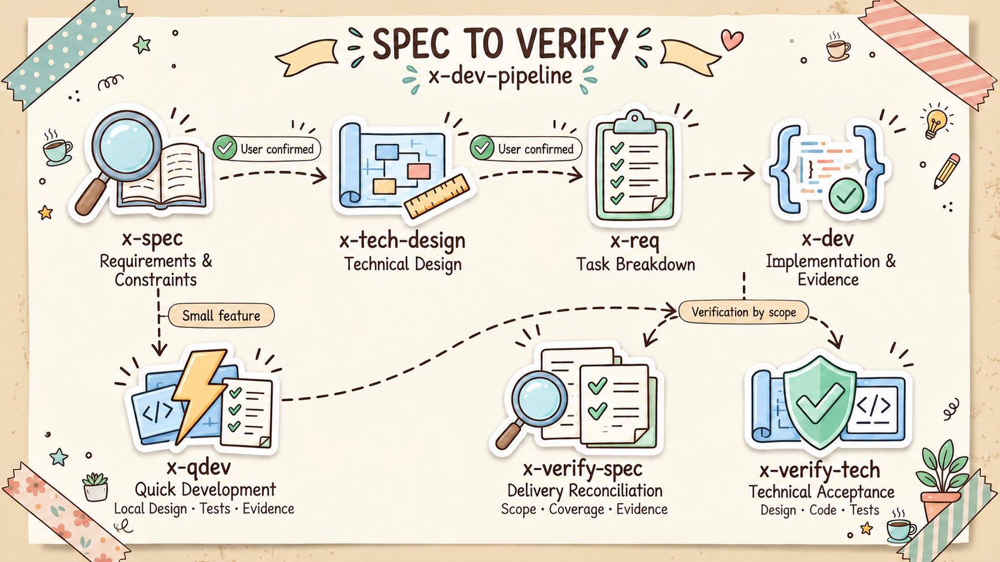

<p align="center">
  
</p>

# x-dev-pipeline

[中文说明](./README_zh.md)

**Current release:** v1.0.0

> An auditable development workflow for AI coding agents: confirm requirements and technical design, trace key constraints, and support delivery conclusions with real evidence.

`x-dev-pipeline` organizes development into a traceable delivery chain:

| Artifact | Owns |
|---|---|
| `spec.md` | User-visible features, acceptance scenarios, and confirmed key constraints |
| `tech-design.md` | Modules, protocols, data flows, technical decisions, and numbered test cases |
| `dev-checklist.md` | Execution scope, scenario and test-case references, and progress for one task |
| `dev-report.md` / qdev⑤ | Delivery summary, status, and the single test report link |
| `test-report.md` | Case details, coverage of the current code change, uncovered locations, and verification conclusions |
| `evidence/` | Collected execution metadata, raw output, coverage data, and specialized attachments |

Stable IDs connect requirements, design, tasks, and evidence. Each step can be traced to its basis, implementation location, and actual result.

## Two working paths

Full requirements follow a design-first main line; concrete small changes use a concise task record. Both paths share one test report for the current change.

```text
Full flow:
x-explore-for-spec (as needed) → x-spec → x-tech-design → user confirms design
       → x-req → x-dev
       → x-verify-spec (Gate ①) → x-qa-gate (Gate ②) → delivery

Technical acceptance:
x-verify-tech · check a task / feat / diff against confirmed design

Small task:
x-qdev · one task document: requirements → local design → tests → implementation → evidence
       → x-verify-spec / x-verify-tech
```

`x-tech-design` is a required prerequisite for task decomposition. Invoke `x-verify-tech` separately for an explicit scope, preferably after development and before final delivery. The main agent organizes subsequent work using existing confirmation records and each step's conclusions.

## Main line: requirements → technical design → tasks → development

### 1. x-spec · Write requirements and key constraints

Turn the agreed conversation into a functional spec the user can read:

```text
docs/spec/<spec-name>/spec.md
```

Each `featNN` represents a user-visible feature. Given/When/Then scenarios describe normal, boundary, and error behavior; THEN states an observable result.

The spec also records user-confirmed key constraints: rules that must hold and outcomes that must be prevented. Stable IDs such as `C1` and `C2` identify their scope, observable criteria, confirmation basis, and related scenarios.

Use `x-explore-for-spec` to group features and resolve open product decisions with interactive choices before writing the spec. `x-spec` records the agreed behavior and acceptance criteria. Technical design uses that confirmed baseline.

### 2. x-tech-design · Produce a technical design for confirmation

Read the confirmed spec, existing code, and applicable development rules, then create a design alongside the spec:

```text
docs/spec/<spec-name>/tech-design.md
```

The design covers the features in scope and the modules they directly affect. It sets the change boundary, required interface and state constraints, and observable acceptance criteria. Developers choose the internal implementation. Every feature's main path needs Smoke coverage, and one Smoke case can cover multiple features.

Design items use stable IDs such as `D01` and `D02`. Key constraints map to mechanisms and numbered cases:

```text
spec: C1 key constraint
          ↓
tech-design: D01 mechanism → test cases T1, T2
          ↓
checklist: assignment to a specific task / task row
          ↓
test-report: actual case results, change coverage, and collected evidence
```

Each case defines its basis, preconditions, trigger, expected and forbidden outcomes, and verification level. `tech-design.md` owns the test-case definitions; downstream artifacts reference their IDs.

The default design status is "awaiting user confirmation." Confirm the technical boundaries and complete the acceptance cases before recording the confirmation basis and content baseline for x-req.

### 3. x-req · Split tasks from requirements and design

Group feats into tasks and create a development checklist for each task:

```text
docs/spec/<spec-name>/tasks/<task-name>/dev-checklist.md
```

Before decomposition, check the spec, technical design, and related confirmation records. The design must cover the current feats, with mechanisms and complete test cases for all applicable key constraints.

Task rows reference functional expectations through `featNN 场景M` (feat and scenario IDs), and cite `C`, `D`, and test-case IDs in their descriptions. For example:

```text
T3 · Integration check of retry results (C1; D01; test cases T1, T2)
```

"Task row T1" belongs to the checklist; "test case T1" belongs to the technical design.

All tasks together cover every spec scenario and every test case for applicable key constraints. Each checklist follows implementation order. The design determines the affected files, and the affected-files tree matches the files column one to one.

Rows involving authorization, persistence, migration, concurrency, or irreversible operations carry `高:<reason>` (high risk) and include smoke-or-above verification through the real path.

### 4. x-dev · Develop row by row and retain evidence

x-dev executes one task at a time. It follows the checklist's spec and design pointers to read scenarios, constraints, mechanisms, and authoritative test-case definitions.

New behavior suitable for automation follows TDD:

1. Write a test and obtain a valid failing result caused by the target behavior being absent or violating its contract.
2. Implement within the declared file scope until the test passes.
3. Retain actual results and locatable evidence, then mark the task row `[x] 🟢`.

When existing code already satisfies the requirement, run the relevant cases and fill coverage gaps. Manual verification records its rationale, reproducible steps, and actual observations. Verification preserves the real processing path of the mechanism under examination.

After completing all rows, run the task's full test suite and a regression pass over existing functionality.

`dev-report.md` keeps the delivery summary, status, and a link to the single test report at `reports/<task-name>/<batch-id>/test-report.md`. The report combines change baselines, complete case details, per-file changed-line and relevant-branch coverage, uncovered source locations, and verification conclusions. Commands, execution metadata, raw output, and native coverage data live together in `evidence/`. Separate pre-existing edits from the task diff and calculate coverage against the tested source version. Explain zero-executable-change applicability and keep collection gaps visible.

## Delivery checks: record reconciliation, technical acceptance, and quality review

| Step | Core responsibility | Outcome |
|---|---|---|
| `x-verify-spec` · Gate ① | Reconcile a conventional task or qdev document's scope, coverage, baselines, execution records, and conclusions | Reconciliation passed / incomplete / failed |
| `x-verify-tech` | Check code against confirmed design and rules, and run relevant checks and tests | Passed / failed / unverified |
| `x-qa-gate` · Gate ② | Review intent, correctness, and evidence quality according to risk | Quality review passed / findings |

### x-verify-spec · Gate ① delivery reconciliation

The former `x-verify` skill is now named `x-verify-spec`.

The spec supplies expectations, req assignment records establish responsibility, and development records supply execution results. Reconciliation covers nine items:

1. **Structure and location**: readable files, consistent pointers, and uniquely identifiable scenarios.
2. **Content baselines**: current requirements, constraints, and cases correspond to the content used during decomposition and verification; changes have realignment evidence.
3. **Scenario references**: fully parse IDs, multiple references, and ranges, then validate each member.
4. **Task coverage**: actual references cover assigned scenarios, key constraints, and all applicable cases.
5. **Technical support and design references**: `None` rows have a rationale and check results; referenced D IDs exist.
6. **Result-to-evidence mapping**: each expected and forbidden outcome has an actual, locatable execution record.
7. **Manual and high-risk records**: complete manual steps and observations; real-path verification methods and results for high-risk rows.
8. **Affected-files tree**: the tree corresponds to the files column, using U/M/D markers.
9. **States and conclusions**: row states, regression results, failure records, and report conclusions agree.

Reconciliation uses existing execution records. A pass establishes closure of the delivery records; x-verify-tech performs independent technical acceptance.

Development, fixes, and verification share the [test report contract](skills/x-dev/references/test-reporting.md) and [report template](skills/x-dev/templates/test-report.md). Both verifiers and QA read the same report and evidence. The main agent merges their incremental results and receipts into that report; standalone technical verification creates or updates it. Task records retain a summary and report link.

Missing material, blockers, pending execution, or requirements awaiting clarification yield "reconciliation incomplete." Definite contradictions, coverage omissions, or execution failures yield "reconciliation failed." Return the complete findings together with their source owners.

### x-verify-tech · Technical conformity acceptance

Extract constraints from confirmed technical design and applicable rules, then locate the actual code and tests and check each constraint's implementation.

Checks cover module boundaries, protocols and runtime validation, cross-language protocol sources, data ownership, concept naming, named configuration, data flows, and state handling.

Reuse existing project checks and design cases first. Verify illegal inputs, failures, duplicates, concurrency, or recovery according to relevant risks. Within the authorized scope, a small number of targeted acceptance tests may be added.

Each evidence item identifies its design basis, code location, check method, actual result, content baseline, and limitations. Dynamic mechanisms require execution evidence; semantic judgments provide locatable code-review evidence.

The overall outcome follows these rules:

- Any applicable item fails: **failed**, retaining the unverified list as well.
- Applicable items still have evidence gaps: **unverified**.
- All applicable items pass and the scope and baseline are verifiable: **passed**.

Return evidence and gaps for findings; the main agent arranges subsequent handling.

### x-qa-gate · Gate ② risk-matched quality review

After delivery reconciliation passes, route by task risk:

| Risk | Typical scope | Review route |
|---|---|---|
| Q0/Q1 | Single-file changes, local features or fixes | Proceed directly to delivery |
| Q2 | New features, multiple files, contract or state changes | One lean tri-lens reviewer |
| Q3 | Security, irreversible writes, public protocols, concurrency or state-machine changes | One full tri-lens reviewer |

The reviewer checks each lens separately in one round:

- **q1-intent**: user intent, confirmed requirements, public contracts, and change scope.
- **q2-correctness**: illegal inputs, boundaries, failure paths, state transitions, concurrency, idempotency, and resource cleanup.
- **q3-evidence**: real paths reached by tests, assertion bases, and the ability to detect faulty implementations.

The reviewer returns candidate findings. The main agent confirms them and registers issues through `xdev.py flag`: P0/P1 downgrade the affected task rows; P2 are recorded as non-blocking issues.

x-fix handles the complete issue list in one batch, followed by focused counterexample and regression evidence. The main agent closes issues and organizes subsequent checks. A shared fix-counter governs gate repair rounds, with a maximum of three.

## x-qdev · A reduced flow for small tasks

x-qdev records local design, test-case changes, implementation, and a delivery summary in one task document. Full test and verification details live in the shared test report. The owning spec or module documentation maintains the functional definition, with a changelog linking to each change's task.

The default collaboration flow is “briefly explain the approach → record it → implement and verify continuously → report results.” The user's explicit task request authorizes the small-task scope. The agent handles functional-document updates, the local plan, tests, and both verifiers automatically. Keep the five sections proportional to the task; a simple plan can take a few lines. Staged requirement/design approval applies after moving into the full flow.

1. **① Requirements and changes**: direction, boundaries, invariants, and task authorization source; reference the owning spec's feats/scenarios/constraints or module sections, recording additions, modifications, removals, and before/after baselines.
2. **② Concise technical design**: reuse basis, local D items, public module boundaries, protocol/data impact, planned files, and applicable rules.
3. **③ Test cases and changes**: scenario/section/C/D references, preconditions, triggers, expected and forbidden outcomes, plus added, modified, removed, and reused regression cases; reference authoritative cases by path/ID and maintain local case definitions here.
4. **④ Implementation**: steps and actual affected files, with the basis for differences from the plan.
5. **⑤ Verification results**: a short conclusion, the single test report link, documentation/delivery status, and unresolved-item references. Full case details, change coverage, uncovered locations, and verifier receipts live in the test report.

```text
functional definition/changelog ↔ x-qdev (local design → case changes → implementation → evidence)
                      ├→ x-verify-spec: single-document delivery reconciliation
                      └→ x-verify-tech: local design and development-rule acceptance
```

Find a directly related or broader spec by functional responsibility, adding new behavior to an existing spec whose scope owns the change. When an owning spec is missing, update the module's README or functional documentation; when documentation is missing, add a minimal description of the affected behavior. With an owning spec, the task lives at `docs/spec/<spec-name>/tasks/task-<task-name>.md`; with module documentation, it lives at `docs/task/task-<task-name>.md`. Maintain the functional definition in its owning document, reference stable IDs or sections from the task, and link back to the task from the document's changelog.

Add feats/scenarios to the functional definition, update existing definitions for behavior changes, and retain original IDs/locations, history, and removal requirements for deleted behavior. Record the user's original request or an existing explicit decision and its scope for each change. Mark target changes as planned/in progress, then synchronize delivery status after verification passes. Track case changes separately from execution counts; feature removal includes checks of removal outcomes and retained behavior.

Ordinary local arrangements follow the current task authorization, explicit requirements, and reused design. Clarify ambiguity that materially changes results and cannot be inferred, along with key matters outside existing authorization; changes exceeding the small-task scope move to the full flow. Retain readable requirement, design, and case baselines before implementation, then collect evidence from execution.

Before delivery, self-check structure, references, coverage, conclusions, and boundaries, then explicitly invoke both verifiers. x-verify-spec reconciles the five-section document; x-verify-tech runs relevant checks against section ② or external design and the cases in section ③. Conventional task inputs remain supported. The same test report collects new executions and receipts; section ⑤ retains status and a report link. The report itemizes failures, blockers, uncovered locations, collection gaps, and unverified items.

## Optional: adversarial spec risk review

`x-adversarial-risk` reviews a spec's risk assumptions before task decomposition. It uses prior failure experience to construct minimal counterexamples and adds scenarios with traceable provenance to the spec.

```text
x-spec → x-adversarial-risk → x-explore-for-spec (for new decisions) → x-tech-design → design confirmation → x-req
```

Risk review and bug ingestion share a user-global corpus, with a caller-selected path available. Confirm any new behavior or constraints in `x-explore-for-spec` before updating the functional spec and affected design. For specs carrying the risk-version marker, a pending review status blocks x-req decomposition.

## Commands

| Command | Purpose |
|---|---|
| `/x-explore-for-spec` | Split requirements into features and settle open decisions with interactive choices before writing the spec |
| `/x-spec` | Record agreed features, GWT scenarios, and key constraints in the spec |
| `/x-tech-design` | Produce a design draft from a confirmed spec, defining mechanisms and numbered cases |
| `/x-req` | Split tasks from confirmed requirements and design; assign scenarios, constraints, and cases |
| `/x-dev` | Execute one task and record verification conclusions with locatable evidence |
| `/x-verify-spec` | Gate ①: reconcile delivery scope, coverage, baselines, execution records, and conclusions |
| `/x-verify-tech` | Verify implementation conformity to confirmed technical design and development rules |
| `/x-qa-gate` | Gate ②: review intent, correctness, and evidence quality according to risk |
| `/x-qdev` | Small-task reduced flow in one document: feats/local design/tests/implementation/evidence → both verifiers |
| `/x-fix` | Batch-fix findings from verification, review, or correctness investigation |
| `/x-cr` | Investigate correctness issues, modules, diffs, or PRs |
| `/x-adversarial-risk` | Review spec risk assumptions and add traceable counterexample scenarios |
| `/x-multi-llm-align` | Align protocols, data structures, or processes |
| `/x-audit-perf` | Run an independent performance audit |
| `/x-audit-style` | Run an independent style audit |
| `/x-audit-arch` | Run an independent architecture audit |

## Deterministic engine

`skills/x-dev/scripts/xdev.py` is the thin unified CLI for mechanical rules outside skill prose.
Its engines live with their owning skills: package validation in
`skills/x-spec/scripts/validator.py`, task planning in `skills/x-req/scripts/req.py`, verification
in `skills/x-verify-spec/scripts/verify.py`, and QA issue transactions in
`skills/x-qa-gate/scripts/flag.py`:

```text
validate [pkg...]                 validate specs, changes, and task contracts
status <task-dir> [--json]        parse checklist progress
graph <task-dir> [--json]         calculate ready work and parallel batches
instructions <artifact> --task    return task artifact instructions
scaffold <task-dir>               create only missing task artifacts
verify <task-dir> [--json]        execute evidence and reconcile Scenarios
flag <task-dir> --task T2,T3 --severity P0 --loc src/a.py:10 --msg "..." [--new-round] [--json]
```

Task commands only accept `docs/spec/<spec-name>/tasks/<task-name>/`. Historical
`dev-pipeline/tasks/` directories remain readable artifacts and have no runtime validation or
orchestration support.

As of v1.0.0, Gate ① is the x-verify-spec skill's delivery reconciliation; the verify engine remains for legacy `spec_version: 3` contract packages, while the v6 chain relies on `status` (progress) and `flag` (issue ledger). `flag` coordinates the issue ledger with the single durable `dev-checklist.md` per task through a persistent transaction: unchanged content creates no temp file, a recovered pending transaction returns `recovered:true`, and the caller retries the intended issue.

## x-spec2 pilot metrics

`skills/pipeline-efficiency-benchmark/scripts/metrics.py` records a completed x-spec2 eval from either one explicit Codex rollout JSONL or a saved subagent completion notification. The minimum measurement contains the execution source ID, model, repository SHA, prompt hash, duration, real provider total tokens, and independently graded expectation pass rate.

```bash
python3 skills/pipeline-efficiency-benchmark/scripts/metrics.py extract \
  --timing <run-dir>/timing.json \
  --metadata <run-dir>/eval_metadata.json \
  --grading <run-dir>/grading.json \
  --output <run-dir>/measurement.json

python3 skills/pipeline-efficiency-benchmark/scripts/metrics.py aggregate-spec2 deprecated/x-spec2-workspace/iteration-2
```

Exit 0 means extraction or aggregation succeeded; exit 1 means a readable run violates the fresh-session, rubric-isolation, or paired-comparison boundary; exit 2 means usage, IO, JSON, or schema failure. A one-pair result is marked `pilot: true`: it proves the measurement flow and remains insufficient for a stable skill-effect estimate.

## Installation

The repository contains manifests for Claude Code and Codex:

```text
.claude-plugin/plugin.json
.claude-plugin/marketplace.json
.codex-plugin/plugin.json
.agents/plugins/marketplace.json
```

For Claude Code:

```bash
git clone https://github.com/KtKID/x-dev-pipeline.git ~/.claude/plugins/x-dev-pipeline
claude plugin marketplace add ~/.claude/plugins/x-dev-pipeline/.claude-plugin/marketplace.json
claude plugin install x-dev-pipeline@x-dev-pipeline --scope user
```

For Codex, add the repo entry from `.agents/plugins/marketplace.json` to your marketplace, restart Codex, and install `x-dev-pipeline` from the local plugin directory.

## Status markers

| Marker | Meaning |
|--------|---------|
| `[ ] ⏳` | Not started |
| `[ ] ▶️` | In progress |
| `[!] 🔴` | Verification failed / P0-P1 issue downgrade |
| `[x] 🟢` | Verification passed |
| `[x] ✅` | Quality review passed |

## License

MIT
