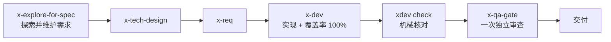

# x-dev-pipeline

[English](./README.md)

**当前版本：** v1.0.0

> 给 AI coding agent 一套可审计的开发工作流：确认需求，写清技术设计，追踪关键约束，用真实证据支撑交付结论。

`x-dev-pipeline` 把开发过程组织成一条可追溯的交付链：

| 产物 | 承载内容 |
|---|---|
| `spec.md` | 用户可感知的功能、验收场景、已确认关键约束 |
| `tech-design.md` | 模块、协议、数据流、技术决策与编号测试用例 |
| `dev-checklist.md` | 单个 task 的唯一交付文件：任务行、场景与用例回指、进度，末尾「结果」记用例对应、改动行覆盖率和问题处置 |
| `evidence/` | 原始输出：测试日志、覆盖率记录、截图、人工验证记录 |
| `docs/architecture.md` | 项目架构偏好（可选），设计、开发和审查都按它核对 |

需求、设计、任务和证据通过稳定编号关联，每一步都能追到依据、实现位置和实际结果。能用脚本判断的（编号、状态、测试是否通过、覆盖率是否 100%）全交给 `xdev`，agent 只做脚本判断不了的事。

## 两条工作路径

完整需求走设计先行的主线，具体小改动走一个 agent 做完的精简 task，两条路径用同一套 `xdev start / coverage / check`。



```text
小任务：
x-qdev · 一份 task 文档：需求 → 局部设计 → 测试 → 实现 → 证据
       → xdev check → 写了场景的再过一次独立审查
```

`x-tech-design` 是任务拆解的必经前置。`x-verify-tech` 是审查里“设计与架构偏好”那一项的方法，也可以单独调用。

## 主线：需求 → 技术设计 → 任务 → 开发

### 1. x-explore-for-spec · 探索并增量维护需求

需求入口统一为 `x-explore-for-spec`，合并开放探索、需求确认和 spec 编写。探索是每次需求的必经核对：结合现有文档、代码和实际场景明确目标、范围与验收依据；用户已明确的结论直接沿用，影响结果的实际取舍通过提问确认。

一份 spec 管一块数据，长期维护，新 feat 随时间追加，已有行为在原位置更新。需求写进哪份 spec 见 [spec 范围](skills/x-explore-for-spec/references/spec-scope.md)：

```text
docs/spec/<spec-name>/spec.md
```

每确认一批对功能定义、范围、约束或验收有价值的结论，就局部写回所属 spec。文档保留结论、必要依据和可观察结果；临时推演留在对话中。其他待决问题继续探索，用户明确保留的后续功能进入长期待办。

每个 `featNN` 对应一个用户可感知的功能，通过 Given/When/Then 场景描述本次目标所需的正常、边界和异常行为。THEN 写用户可以观察到的结果。feat 和场景编号长期稳定，新增接续编号，修改沿用原编号，移除保留可追溯记录。

spec 同时记录用户已确认的关键约束：哪些规则必须持续成立，哪些结果必须避免。约束使用稳定编号 `C1`、`C2` 等，写清适用范围、可观察判据、确认依据与关联场景。

本次选定范围明确列出交给技术设计和开发的 feat、场景及完成条件；长期待办保留后续推进状态。每轮审阅建议聚焦最多 3 个 feat、10 个场景，范围较大时分批审阅并继续更新同一份 spec。一份 spec 管一块数据，划分规则见 [spec 范围](skills/x-explore-for-spec/references/spec-scope.md)。技术设计承接本轮已确认范围与内容基线。

### 2. x-tech-design · 写技术设计（不需要用户确认）

读取已确认 spec、现有代码与适用开发规范，在 spec 同目录生成：

```text
docs/spec/<spec-name>/tech-design.md
```

技术设计聚焦本轮 feat 和直接涉及的模块，写清允许改动的范围、必须满足的接口与状态约束，以及可观察的验收结果。内部实现由开发者决定。每个 feat 的主路径必须由 Smoke 用例覆盖，多个 feat 可以共用同一条 Smoke。

设计条目使用稳定编号 `D01`、`D02` 等。关键约束映射到对应机制和编号用例：

```text
spec：C1 关键约束
          ↓
tech-design：D01 落实机制 → 用例 T1、T2
          ↓
checklist：分配到具体 task / 任务行
          ↓
checklist「结果」：用例对应到测试函数、改动行覆盖率 100%
```

每个用例定义依据、前提、触发、预期结果、禁止结果及验证层级。用例正文统一维护在 `tech-design.md`，下游通过 ID 回指。

技术设计不需要用户确认，写完直接交给 x-req；只有需要用户拍板的边界取舍才单独问。每条 D 写明回指的场景和 C，需求变化时按 [需求变化同步](skills/x-tech-design/references/change-sync.md) 顺着编号更新 D、T、任务行和测试。

### 3. x-req · 按需求和设计拆任务

按 feat 分组生成单个 task 的开发清单：

```text
docs/spec/<spec-name>/tasks/<task-name>/dev-checklist.md
```

拆解前核对 spec 及其用户确认记录、技术设计，以及需要用户拍板的取舍的答复。设计覆盖本轮 feat，适用关键约束均有机制和完整用例，才具备拆解条件。

任务行通过 `featNN 场景M` 回指功能预期，在任务说明中引用 `C`、`D` 和用例编号。例如：

```text
T3 · 集成验证重试结果（C1；D01；用例 T1、T2）
```

“任务行 T1”与“用例 T1”分别属于 checklist 和技术设计。

全部 task 合并覆盖本轮选定范围的所有场景，以及适用关键约束的全部用例。长期待办按后续选定范围继续拆解。单个 checklist 按实现顺序排列，涉及文件依据设计确定，影响文件树与文件列一一对应。

涉及鉴权、持久化、迁移、并发或不可逆操作的行标记为 `高:<依据>`，验证包含 smoke 或以上真实链路。

### 4. x-dev · 逐行开发，覆盖率到 100%

x-dev 一次执行一个 task，沿 checklist 的 spec 与设计指针读取场景、约束、机制和用例主定义。开工先 `xdev start` 记下代码基线（当前 git commit），之后所有覆盖率都和它比。

适合自动化的新行为按 TDD 执行：

1. 写测试并取得有效红灯，确认失败来自目标行为缺失或违约。
2. 在声明文件范围内实现，让测试变绿。
3. 在 checklist「结果 / 用例对应」表登记用例和测试函数，任务行标为 `[x] 🟢`。

全部行完成后运行：

```bash
xdev coverage <task> --cmd "<全量测试命令>" --report <覆盖率报告>
```

它真的跑测试，读覆盖率报告（lcov、Cobertura XML、coverage.py JSON、Go coverprofile），算出“和代码基线相比改过的代码行有几行被测试跑到”，测试文件和文档不算。不到 100% 就列出没跑到的 `文件:行`，agent 补测试再跑，直到 100%。

## 交付检查：机械核对 + 一次独立审查

| 环节 | 做什么 | 结论 |
|---|---|---|
| `xdev check`（x-verify-spec） | 脚本核对：编号与结构、需求变化已同步、每行 🟢、每个场景都有通过的用例、每个用例对应真实测试函数、高风险行有真实链路用例、测试通过且改动行覆盖率 100%、之后代码没再改 | 通过 / 不通过（列出每一项） |
| `x-qa-gate` | 按 risk 派一个只读 reviewer，看脚本判断不了的事：需求对齐、边界与失败路径、测试是否真的证明了场景、设计与架构偏好（Q1 不看边界，Q2/Q3 全看） | 通过 / 发现问题 |

risk 由 x-req 按任务行算出：Q0（纯技术、无场景）只跑 `xdev check`；Q1 审需求对齐、测试证明力、设计与架构；Q2 再加边界与失败路径；Q3 用完整输入、逐项回执。

发现问题时登记 issue（P0/P1 的行降为 `[!] 🔴`），交 x-fix 一次修完。主 agent 用每条问题的反例测试、`xdev coverage` 和 `xdev check` 关闭问题，不发回原 reviewer；修复轮数最多 3 轮。处置写进 checklist「问题与处置」，不另建报告文件。

多 agent 协作时，每组交回后由主 agent 在这组分支上自己跑 `xdev coverage --out` 核对（不照抄工人的结论），不过就打回原工人；全部合并后整体跑一次覆盖率、`xdev check` 和审查。

## x-qdev · 小任务精简路径

x-qdev 用一份任务文档记录小改动：①需求与变更、②精简技术设计、③测试用例与变化、④技术实现、⑤验证结果（用例对应、覆盖率、问题与处置）。功能正文随所属 spec 持续维护，task 记录本次变化、回指和证据。

唯一停点是 spec 增量：写了场景的改动，先把归属、场景原文和改法给用户确认，确认后连续做完设计、实现、文档同步和验收。新建 spec、场景跨两份以上 spec 或源码文件超过 3 个时调 x-tech-design，否则在②简写。按 [风险规则](skills/x-qdev/references/risk-rules.md) 有一条答“是”就停下转主线。

```text
x-qdev → xdev start → 测试先行实现 → xdev coverage（100%）→ xdev check
       → 写了场景的：x-qa-gate（Q1）→ 交付
```

## 可选：Spec 对抗性风险复核

`x-adversarial-risk` 在任务拆解前复核 spec 的风险假设，利用历史失败经验构造最小反例，将补充场景以可追溯来源写入 spec。

```text
x-explore-for-spec → x-adversarial-risk → x-tech-design → x-req
```

风险审查与 Bug 沉淀共享用户级语料，调用方可指定其他路径。新增行为或约束由 `x-explore-for-spec` 确认后回写功能 spec，同步相关设计。带风险版本标记的 spec 审查仍为 pending 时，x-req 阻断拆解。

## 命令

| 命令 | 职责 |
|---|---|
| `/x-explore-for-spec` | 统一需求入口：探索并确认行为，筛选有价值的结论，增量维护所属 spec 和本轮范围 |
| `/x-tech-design` | 基于已确认 spec 写技术设计，定义机制与编号用例；需求变化时按编号同步 |
| `/x-req` | 基于已确认 spec 和技术设计拆 task，分配场景、约束与用例 |
| `/x-dev` | 执行单个 task，测试先行，改动行覆盖率到 100% |
| `/x-verify-spec` | Gate ①：运行 `xdev check` 做交付机械核对 |
| `/x-verify-tech` | 核对实现是否符合技术设计、开发规范和架构偏好（审查的 q4-design 方法，也可单独用） |
| `/x-qa-gate` | 按风险派一次独立审查 |
| `/x-qdev` | 小任务单文档精简路径 |
| `/x-fix` | 批量修复核对、审查或正确性调查发现的问题 |
| `/x-cr` | 调查正确性问题、模块、diff 或 PR |
| `/x-adversarial-risk` | 复核 spec 风险假设，补充可追溯反例场景 |
| `/x-multi-llm-align` | 对齐协议、数据结构或流程 |
| `/x-audit-perf` | 独立性能巡检 |
| `/x-audit-style` | 独立规范巡检 |
| `/x-audit-arch` | 独立架构巡检 |

## 确定性引擎

`skills/x-dev/scripts/xdev.py` 是统一 CLI 入口：当前格式 task 的规则在 `skills/x-req/scripts/checklist_engine.py`，开发与交付核对在 `skills/x-dev/scripts/delivery.py`，QA issue 事务在 `skills/x-qa-gate/scripts/flag.py`。旧 `spec_version: 3` 契约包继续由 `req.py`、`validator.py`、`verify.py` 处理。

```text
scaffold <task-dir>               创建 checklist，自动填头部和拆解基线
validate [task...]                结构、编号、并行组、依赖、risk 校验
status / graph <task-dir>         进度；按并行组和依赖算派工批次
impact / baseline <task-dir>      需求变化列出要同步的 D/T/行/测试；同步后记新基线
start <task>                      记代码基线（git HEAD）
coverage <task> --cmd ... --report ...   跑测试，算改动行覆盖率，不到 100% 退出 1
check <task>                      交付机械核对
verify <task-dir>                 仅旧契约包
flag <task-dir> --task T2,T3 --severity P0 --loc src/a.py:10 --msg "..." [--new-round] [--json]
```

`<task>` 是 `docs/spec/<spec-name>/tasks/<task-name>/`，start / coverage / check 也接受 qdev 的 task `.md`。历史 `dev-pipeline/tasks/` 目录作为可读档案保留，不再获得运行时校验或编排支持。`flag` 通过持久事务协调 issue ledger 与 `dev-checklist.md`：pending 事务恢复返回 `recovered:true`，调用方重试本条 issue。

## x-spec2 pilot 计量

`skills/pipeline-efficiency-benchmark/scripts/metrics.py` 从一个显式 Codex rollout JSONL，或保存后的子 agent 完成通知中记录一次 x-spec2 eval。最小 measurement 包含执行来源 ID、模型、仓库 SHA、prompt 哈希、耗时、provider 返回的真实总 token，以及独立 grader 给出的断言通过率。

```bash
python3 skills/pipeline-efficiency-benchmark/scripts/metrics.py extract \
  --timing <run-dir>/timing.json \
  --metadata <run-dir>/eval_metadata.json \
  --grading <run-dir>/grading.json \
  --output <run-dir>/measurement.json

python3 skills/pipeline-efficiency-benchmark/scripts/metrics.py aggregate-spec2 deprecated/x-spec2-workspace/iteration-2
```

退出码 0 表示提取或聚合成功；1 表示可读取的样本违反 fresh-session、rubric 隔离或 paired 可比性边界；2 表示参数、IO、JSON 或 schema 错误。单个 paired run 标记为 `pilot: true`，它用于证明测量流程成立，稳定效果判断需要更多题目与重复运行。

## 安装

仓库同时提供 Claude Code 与 Codex 的 manifest：

```text
.claude-plugin/plugin.json
.claude-plugin/marketplace.json
.codex-plugin/plugin.json
.agents/plugins/marketplace.json
```

Claude Code：

```bash
git clone https://github.com/KtKID/x-dev-pipeline.git ~/.claude/plugins/x-dev-pipeline
claude plugin marketplace add ~/.claude/plugins/x-dev-pipeline/.claude-plugin/marketplace.json
claude plugin install x-dev-pipeline@x-dev-pipeline --scope user
```

Codex：把 `.agents/plugins/marketplace.json` 中的仓库条目加入 marketplace，重启 Codex 后从本地插件目录安装 `x-dev-pipeline`。

## 状态标记

| 标记 | 含义 |
|------|------|
| `[ ] ⏳` | 未开始 |
| `[ ] ▶️` | 进行中 |
| `[ ] 🟡` | 待验证（多 agent 时工人交回、还没合并） |
| `[!] 🔴` | 验证失败 / P0-P1 issue 降级 |
| `[x] 🟢` | 测试通过，用例已登记 |
| `[x] ✅` | 已完成（Q0：xdev check 通过；Q1–Q3：独立审查通过） |
| `[ ] ↗️` | 已升级给用户或主线 |

## License

MIT
