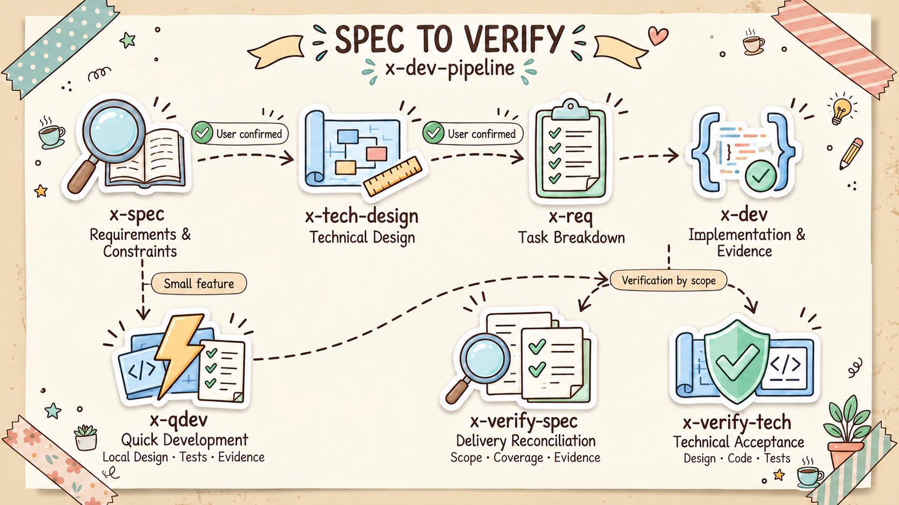

<p align="center">
  
</p>

# x-dev-pipeline

[English](./README.md)

**当前版本：** v1.0.0

> 给 AI coding agent 一套可审计的开发工作流：确认需求与技术设计，追踪关键约束，用真实证据支撑交付结论。

`x-dev-pipeline` 把开发过程组织成一条可追溯的交付链：

| 产物 | 承载内容 |
|---|---|
| `spec.md` | 用户可感知的功能、验收场景、已确认关键约束 |
| `tech-design.md` | 模块、协议、数据流、技术决策与编号测试用例 |
| `dev-checklist.md` | 单个 task 的执行范围、场景与用例回指、进度 |
| `dev-report.md` | 验证结论、真实执行证据、局限与未决问题 |

需求、设计、任务和证据通过稳定编号关联，每一步都能追到依据、实现位置和实际结果。

## 两条工作路径

完整需求走设计先行的主线，具体小改动走单文档闭环。

```text
完整主线：
x-spec → 用户确认需求 → x-tech-design → 用户确认设计
       → x-req → x-dev
       → x-verify-spec（Gate ①）→ x-qa-gate（Gate ②）→ 交付

技术验收：
x-verify-tech · 按已确认设计验收 task / feat / diff

小任务：
x-qdev · 一份 task 文档：需求 → 局部设计 → 测试 → 实现 → 证据
       → x-verify-spec / x-verify-tech
```

`x-tech-design` 是任务拆解的必经前置。`x-verify-tech` 按明确范围单独调用，建议安排在开发完成后、最终交付前。主 agent 根据已有确认记录和各环节结论组织后续工作。

## 主线：需求 → 技术设计 → 任务 → 开发

### 1. x-spec · 写需求与关键约束

把沟通结果写成用户能读懂的功能 spec：

```text
docs/spec/<spec-name>/spec.md
```

每个 `featNN` 对应一个用户可感知的功能，通过 Given/When/Then 场景描述正常、边界和异常行为。THEN 写用户可以观察到的结果。

spec 同时记录用户已确认的关键约束：哪些规则必须持续成立，哪些结果必须避免。约束使用稳定编号 `C1`、`C2` 等，写清适用范围、可观察判据、确认依据与关联场景。

agent 提出的约束、合理默认和待澄清行为进入待确认清单。用户确认当前内容后，进入技术设计。

### 2. x-tech-design · 形成待确认技术设计

读取已确认 spec、现有代码与适用开发规范，在 spec 同目录生成：

```text
docs/spec/<spec-name>/tech-design.md
```

设计覆盖以下内容：

- **模块与依赖**：职责、目录、公开入口、调用方和允许依赖。
- **数据与协议**：字段含义、数据所有者、权威存储、schema 来源与边界校验。
- **主要数据流**：入口、校验、处理、状态变化、持久化与返回，以及适用的失败、重试、并发和恢复路径。
- **规范与验证**：设计条目、关键约束机制、编号测试用例及拟取得的证据。

设计条目使用稳定编号 `D01`、`D02` 等。关键约束映射到对应机制和编号用例：

```text
spec：C1 关键约束
          ↓
tech-design：D01 落实机制 → 用例 T1、T2
          ↓
checklist：分配到具体 task / 任务行
          ↓
dev-report：实际结果与可定位证据
```

每个用例定义依据、前提、触发、预期结果、禁止结果及验证层级。用例正文统一维护在 `tech-design.md`，下游通过 ID 回指。

设计默认状态为“待用户确认”。用户确认关键架构、协议、数据归属及影响方案后，记录确认依据和内容基线，再交给 x-req。

### 3. x-req · 按需求和设计拆任务

按 feat 分组生成单个 task 的开发清单：

```text
docs/spec/<spec-name>/tasks/<task-name>/dev-checklist.md
```

拆解前核对 spec、技术设计及相关确认记录。设计覆盖本轮 feat，适用关键约束均有机制和完整用例，才具备拆解条件。

任务行通过 `featNN 场景M` 回指功能预期，在任务说明中引用 `C`、`D` 和用例编号。例如：

```text
T3 · 集成验证重试结果（C1；D01；用例 T1、T2）
```

“任务行 T1”与“用例 T1”分别属于 checklist 和技术设计。

全部 task 合并覆盖 spec 的所有场景，以及适用关键约束的全部用例。单个 checklist 按实现顺序排列，涉及文件依据设计确定，影响文件树与文件列一一对应。

涉及鉴权、持久化、迁移、并发或不可逆操作的行标记为 `高:<依据>`，验证包含 smoke 或以上真实链路。

### 4. x-dev · 逐行开发并保留证据

x-dev 一次执行一个 task，沿 checklist 的 spec 与设计指针读取场景、约束、机制和用例主定义。

适合自动化的新行为按 TDD 执行：

1. 写测试并取得有效红灯，确认失败来自目标行为缺失或违约。
2. 在声明文件范围内实现，让测试变绿。
3. 保留实际结果与可定位证据，通过后将任务行标为 `[x] 🟢`。

既有实现已满足要求时，运行相应用例并补齐覆盖；人工验证记录理由、可复现步骤和实际观察。验证保留被检查机制的真实处理路径。

全部行完成后，运行本 task 全量测试和既有功能回归。

`dev-report.md` 是用户阅读入口：逐例列全本次专项、已有功能回归及人工检查，用日常语言说明准备、操作、预期和实际结果；长列表可按功能折叠。已有覆盖率按文件列明行/分支覆盖、未覆盖位置及统计范围。命令、版本、退出码、红灯原因和原始输出作为 AI 复查附件；静默成功记录输出为空及实际退出码。失败、阻塞和待补证据逐项保留。

## 交付检查：记录对账、技术验收与质量评审

| 环节 | 核心职责 | 结论 |
|---|---|---|
| `x-verify-spec` · Gate ① | 核对常规 task 或 qdev 单文档的范围、覆盖、基线、执行记录和结论 | 对账通过 / 未完成 / 不通过 |
| `x-verify-tech` | 对照已确认设计与规范检查代码，运行相关检查和测试 | 通过 / 失败 / 未验证 |
| `x-qa-gate` · Gate ② | 按风险评审意图、正确性与证据质量 | 质量审查通过 / 发现问题 |

### x-verify-spec · Gate ① 交付对账

原 `x-verify` 已更名为 `x-verify-spec`。

它以 spec 提供预期、req 分配记录确定责任范围、开发记录提供执行结果，核对九项内容：

1. **结构与定位**：文件可读取，指针一致，场景能够唯一定位。
2. **内容基线**：当前需求、约束和用例与拆解及验证时的内容对应，变化有重新对齐依据。
3. **场景回指**：完整解析编号、多个引用和区间，逐项确认有效。
4. **task 覆盖**：实际回指覆盖分配范围内的场景、关键约束及全部用例。
5. **技术支撑与设计回指**：`None` 行有依据和检查结果，引用的 D 编号存在。
6. **结果与证据映射**：每项预期及禁止结果都有真实、可定位的执行记录。
7. **人工与高风险记录**：人工步骤和实际观察完整，高风险行有真实链路方式与结果。
8. **影响文件树**：文件树与涉及文件列对应，标记为 U/M/D。
9. **状态与结论**：行状态、回归结果、失败记录与报告结论一致。

本轮使用已有执行记录完成对账。通过表示交付记录闭合；独立技术验收由 x-verify-tech 承担。

验收按[测试报告与证据复查](skills/x-dev/references/test-reporting.md)实际读取对应执行附件，核对完整用例清单、结果、基线和适用的逐文件覆盖率；回执说明复查来源与缺口。qdev 的⑤使用同一约定。

资料缺失、阻塞、尚待执行或需求待澄清时，结论为“对账未完成”；确定的矛盾、覆盖遗漏或执行失败，结论为“对账不通过”。问题一次列全，并注明来源负责方。

### x-verify-tech · 技术符合性验收

先从已确认技术设计和适用规范提取约束，再定位实际代码与测试，逐项检查落实情况。

检查覆盖模块边界、协议与运行时校验、跨语言协议来源、数据归属、概念命名、具名配置、数据流与状态处理。

优先复用项目已有检查和设计用例，按相关风险验证非法输入、失败、重复、并发或恢复路径。授权范围内可补少量针对性验收测试。

每项证据注明设计依据、代码位置、检查方法、实际结果、内容基线和局限。动态机制通过实际执行取得证据，语义判断提供可定位的代码审查依据。

整体结论遵循：

- 任一适用项失败，整体为 **失败**，同时保留未验证清单。
- 适用项仍有证据缺口，整体为 **未验证**。
- 全部适用项通过，且范围与基线可核查，整体为 **通过**。

发现问题后输出证据与缺口，由主 agent 安排后续处理。

### x-qa-gate · Gate ② 风险匹配的质量评审

交付对账通过后，按 task 风险路由：

| 风险 | 典型范围 | 评审方式 |
|---|---|---|
| Q0/Q1 | 单文件小改、局部功能或修复 | 直接进入交付 |
| Q2 | 新功能、多文件、契约或状态变化 | 一个精简三视角 reviewer |
| Q3 | 安全、不可逆写入、公开协议、并发或状态机变化 | 一个完整三视角 reviewer |

reviewer 在单轮内分别检查：

- **q1-intent**：用户意图、已确认需求、公开契约与改动范围。
- **q2-correctness**：非法输入、边界、失败路径、状态转换、并发、幂等与资源清理。
- **q3-evidence**：测试触达的真实路径、断言依据和识别错误实现的能力。

reviewer 返回问题候选。主 agent 复核后通过 `xdev.py flag` 登记 issue：P0/P1 降级对应任务行，P2 登记为非阻塞问题。

完整问题清单交给 x-fix 批量修复，再取得聚焦反例与回归证据。主 agent 负责关闭 issue 和组织后续核查；门禁修复轮数由共享 fix-counter 管理，最多三轮。

## x-qdev · 小任务单文档缩减路径

x-qdev 用一份任务文档记录小改动的局部设计、用例变化、实现和证据，并接入公共验证。功能正文随所属 spec 或模块说明持续维护，changelog 提供每次变化的任务索引。

默认协作方式是“简短告知改法 → 落盘 → 连续实现与验证 → 汇报结果”。用户本轮明确要求就是小任务执行授权；功能文档回写、局部方案、测试和两类 verify 由 agent 自动衔接。五段按任务规模简写，简单方案可用几行说明；分阶段需求/设计审批用于转入完整主线后的任务。

1. **①需求与变更**：功能方向、边界、不变量及任务授权来源；回指所属 spec 的 feat/场景/C 或模块功能章节，记录新增、修改、删除及前后基线。
2. **②精简技术设计**：已有设计的沿用依据、本次 D 条目、模块公开边界、协议/数据影响、计划文件和规范落实。
3. **③测试用例与变化**：回指场景/章节/C/D，记录前提、触发、预期与禁止结果，以及用例新增、修改、删除和沿用回归；已有权威用例通过路径/ID 引用，局部用例正文维护在本段。
4. **④技术实现**：实现步骤与实际涉及文件，保留与计划差异的依据。
5. **⑤验证结果**：真实执行证据、内容与代码基线、回归、两类 verify 回执、结论及未决项。

```text
功能文档/变更索引 ↔ x-qdev（局部设计 → 用例变化 → 实现 → 证据）
                    ├→ x-verify-spec：单文档交付对账
                    └→ x-verify-tech：局部设计与规范验收
```

先按功能职责查找对应及上层 spec，新增行为归入职责范围匹配的既有 spec；尚无可归属 spec 时，更新所属模块 README/功能说明，文档缺失时补本次行为的最小说明。有归属 spec 时，task 位于 `docs/spec/<spec-name>/tasks/task-<task-name>.md`；模块说明承载时，位于 `docs/task/task-<task-name>.md`。需求正文在功能文档唯一维护，task 回指稳定编号或章节；功能文档的 changelog 回链 task。

新增 feat/场景补入正文，修改行为更新原定义，删除项保留原编号/定位、历史来源和移除要求。每项变化记录用户原始要求或已有明确结论及适用范围；目标变化标为待实现/变更中，验证通过后同步交付状态。用例变化和实际执行分别统计，功能删除同时验证移除结果及保留行为。

普通局部安排依据本轮任务授权、已有明确需求及沿用设计决定；影响实际结果且无法推断的需求歧义、超出授权的关键事项集中澄清，超出小任务范围则转完整主线。实现前保留需求、设计与用例的可读基线，执行后按结果取得证据。

交付前先做结构、回指、覆盖、结论与边界自检，再显式调用两类 verify。x-verify-spec 读取五段文档完成对账，x-verify-tech 根据②/外部设计和③用例运行相关检查；原有常规 task 的输入保持兼容。⑤收录本轮实际回执，失败、阻塞、缺证据或未验证项逐项保留。

## 可选：Spec 对抗性风险复核

`x-adversarial-risk` 在任务拆解前复核 spec 的风险假设，利用历史失败经验构造最小反例，将补充场景以可追溯来源写入 spec。

```text
x-spec → x-adversarial-risk → 需求确认 → x-tech-design → 设计确认 → x-req
```

风险审查与 Bug 沉淀共享用户级语料，调用方可指定其他路径。新增行为或约束经过确认，相关设计随之对齐；带风险版本标记的 spec 审查仍为 pending 时，x-req 阻断拆解。

## 命令

| 命令 | 职责 |
|---|---|
| `/x-spec` | 编写功能 spec、GWT 场景与待确认关键约束 |
| `/x-tech-design` | 基于已确认 spec 生成技术设计草案，定义机制与编号用例 |
| `/x-req` | 基于已确认需求和设计拆 task，分配场景、约束与用例 |
| `/x-dev` | 执行单个 task，记录验证结论与可定位证据 |
| `/x-verify-spec` | Gate ①：核对交付范围、覆盖、基线、执行记录与结论 |
| `/x-verify-tech` | 验收实现对已确认技术设计和开发规范的符合性 |
| `/x-qa-gate` | Gate ②：按风险评审意图、正确性与证据质量 |
| `/x-qdev` | 小任务单文档缩减路径：feat/局部设计/测试/实现/证据 → 两类 verify |
| `/x-fix` | 批量修复验证、评审或正确性调查发现的问题 |
| `/x-cr` | 调查正确性问题、模块、diff 或 PR |
| `/x-adversarial-risk` | 复核 spec 风险假设，补充可追溯反例场景 |
| `/x-multi-llm-align` | 对齐协议、数据结构或流程 |
| `/x-audit-perf` | 独立性能巡检 |
| `/x-audit-style` | 独立规范巡检 |
| `/x-audit-arch` | 独立架构巡检 |

## 确定性引擎

`skills/x-dev/scripts/xdev.py` 是机械规则的薄 CLI 入口；包校验由
`skills/x-spec/scripts/validator.py` 负责，spec task 规划由
`skills/x-req/scripts/req.py` 负责，验证由 `skills/x-verify-spec/scripts/verify.py` 负责，QA issue
事务由 `skills/x-qa-gate/scripts/flag.py` 负责：

```text
validate [pkg...]                 校验 spec、change、task 契约
status <task-dir> [--json]        解析 checklist 进度
graph <task-dir> [--json]         计算 ready task 与并行批次
instructions <artifact> --task    返回 task 产物填写规则
scaffold <task-dir>               只创建缺失 task 产物
verify <task-dir> [--json]        执行证据并对账 Scenario
flag <task-dir> --task T2,T3 --severity P0 --loc src/a.py:10 --msg "..." [--new-round] [--json]
```

task 命令只接收 `docs/spec/<spec-name>/tasks/<task-name>/`。历史
`dev-pipeline/tasks/` 目录继续作为可读档案保留，不再获得运行时校验或编排支持。

v1.0.0 起 Gate ① 改为 x-verify-spec skill 的交付对账，verify 引擎保留给既有 `spec_version: 3` 契约包；v6 链路日常使用 `status`（进度）与 `flag`（issue 台账）。`flag` 通过持久事务协调 issue ledger 与每个 task 唯一的一份 `dev-checklist.md`：内容无变化不创建临时文件，pending 事务恢复返回 `recovered:true`，调用方重试本条 issue。

## x-spec2 pilot 计量

`skills/pipeline-efficiency-benchmark/scripts/metrics.py` 从一个显式 Codex rollout JSONL，或保存后的子 agent 完成通知中记录一次 x-spec2 eval。最小 measurement 包含执行来源 ID、模型、仓库 SHA、prompt 哈希、耗时、provider 返回的真实总 token，以及独立 grader 给出的断言通过率。

```bash
python3 skills/pipeline-efficiency-benchmark/scripts/metrics.py extract \
  --timing <run-dir>/timing.json \
  --metadata <run-dir>/eval_metadata.json \
  --grading <run-dir>/grading.json \
  --output <run-dir>/measurement.json

python3 skills/pipeline-efficiency-benchmark/scripts/metrics.py aggregate-spec2 deprecated/x-spec2-workspace/iteration-2
```

退出码 0 表示提取或聚合成功；1 表示可读取的样本违反 fresh-session、rubric 隔离或 paired 可比性边界；2 表示参数、IO、JSON 或 schema 错误。单个 paired run 标记为 `pilot: true`，它用于证明测量流程成立，稳定效果判断需要更多题目与重复运行。

## 安装

仓库同时提供 Claude Code 与 Codex 的 manifest：

```text
.claude-plugin/plugin.json
.claude-plugin/marketplace.json
.codex-plugin/plugin.json
.agents/plugins/marketplace.json
```

Claude Code：

```bash
git clone https://github.com/KtKID/x-dev-pipeline.git ~/.claude/plugins/x-dev-pipeline
claude plugin marketplace add ~/.claude/plugins/x-dev-pipeline/.claude-plugin/marketplace.json
claude plugin install x-dev-pipeline@x-dev-pipeline --scope user
```

Codex：把 `.agents/plugins/marketplace.json` 中的仓库条目加入 marketplace，重启 Codex 后从本地插件目录安装 `x-dev-pipeline`。

## 状态标记

| 标记 | 含义 |
|------|------|
| `[ ] ⏳` | 未开始 |
| `[ ] ▶️` | 进行中 |
| `[!] 🔴` | 验证失败 / P0-P1 issue 降级 |
| `[x] 🟢` | 验证通过 |
| `[x] ✅` | 质量评审通过 |

## License

MIT
