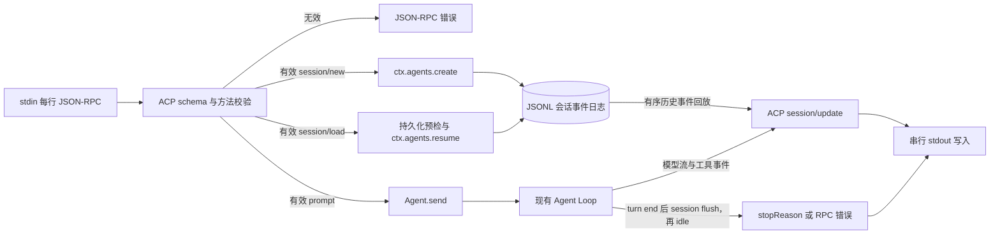
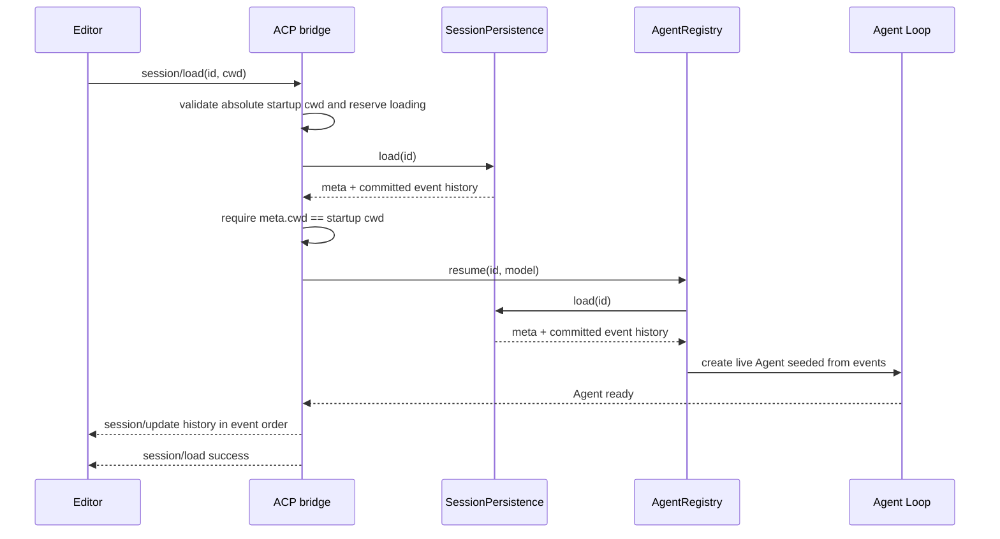

# 编辑器连接本地 DeepSeek 助手 · 技术设计

> 功能依据：[spec.md](spec.md) · 已确认基线 `ff4a5d3fb04e6bbe7ece2b989537303e5756a6c50408c311c4fbed066d7df942`
> 设计状态：待用户确认 · v1 草案
> 本轮变化：新增本地 ACP v1 stdio 插件；不修改 Harness 核心循环、会话事件格式或持久化实现。

## 需要判断的关键决策

| 选择 | 推荐及理由 | 主要代价/备选与影响 | 状态与设计依据 |
|---|---|---|---|
| ACP 接入位置 | 在 `packages/acp/src/index.ts` 写一个调用方插件，使用 `ctx.agents`、`ctx.sessionPersistence` 和现有事件；符合 Harness 的扩展边界，也沿用任务指定的 `apply(ctx, { model })` 入口。 | 单文件插件承担协议解析、状态和事件映射；当前没有 ACP package scaffold，测试以 `packages/acp/tests/` 的直接导入为准，不增加新的 Harness 核心包或跨包类型。 | 待确认 D01–D05；现有目录/入口见附录 C。 |
| 进程与会话归属 | 每个子进程只持有一个会话和一个活动 prompt；先完整校验请求，再原子预留创建/恢复操作。 | 不能复用一个进程服务多个会话或多个并发 prompt；客户端需为新会话或恢复会话启动独立进程。符合 C1、C6。 | 待确认 D02、D04。 |
| 完成响应的提交点 | 以 `agent/status` 从 running 变为 idle 作为 prompt 的结算点；该状态在 turn 结束及 JSONL flush 后发出。 | 响应会等待持久化 flush；flush 失败由 Harness 报错事件/日志暴露，现有 loop 仍把它视为已结束 turn，桥接不能声称强化了底层存储保证。符合 C4、C8。 | 待确认 D03、D04；时序见下文。 |
| ACP 边界校验 | 以本地 `eval-support/PROTOCOL.md` 定义的 ACP 子集和题面补充约束为协议来源，用随仓库提供的 `schemastery` 描述运行时校验并从 schema 推导参数类型。 | 仓库未提供 Zod 依赖；遵循现有 schema DSL，形成 R2 的明确例外，避免新增在线依赖或复制另一份协议定义。 | 待确认 D01；R2 例外记录于附录 D。 |

## 整体结构与数据归属

`apply` 捕获启动目录并安装行读取器、JSON-RPC 处理器和 Harness 事件监听。协议请求先经过 ACP schema 与方法级校验；有效 prompt 才进入 Agent inbox，真实模型和工具继续由现有 Harness 驱动。Agent 事件和 Session event 是实时更新的来源，Session event log 是恢复历史的唯一来源。响应按请求 ID 写回 stdout，诊断只写 stderr。



| 数据/职责 | 权威来源与写入方 | 读取方/派生结果 | 模块、目录与公开入口 |
|---|---|---|---|
| 协议版本、方法与更新形状 | `eval-support/PROTOCOL.md` 定义随题协议子集；题面补充版本协商和额外目录限制。ACP 插件的 schema 是受控校验实现。 | 行解析器和测试；不维护第二套公开协议文档。 | `packages/acp/src/index.ts`（计划）；协议来源 `eval-support/PROTOCOL.md` 与任务 `PROMPT.md`。 |
| 会话内容、事件顺序和历史 | `Session.events` 是内存事件源；`dsh-session-persistence-jsonl` 在 `session/flush` 后持久化。 | 实时 ACP 更新读取 `session/event` / `agent/stream-chunk`；恢复回放从恢复后 `agent.session.events` 派生。 | `dsh-session`、`dsh-session-persistence-jsonl`；桥接通过公开 `Agent.session`。 |
| Agent 生命周期和取消 | `ctx.agents` 创建/恢复 Agent；LoopAgent 拥有 inbox、AbortController 及 running/idle/disposed 状态。 | 桥接只保留当前 Agent、当前活动请求及当轮结束原因；`agent.status` 和 turn 事件驱动结算。 | `dsh-agent` 公共接口；不依赖 `dsh-agent-loop` 内部类。 |
| 工具进度 | Session event `tool/call`、`tool/result` 是实际调用与结果的权威记录。 | `tool/call` 映射开始状态，`tool/result.isError` 映射 `completed` / `failed`，同用原 `callId`。 | `dsh-session` 事件词汇；映射位于 ACP 插件。 |
| stdio 生命周期 | Node stdin/stdout 是外部传输；桥接拥有 readline 和 listener 的注册/清理。 | stdout 只写协议行；错误诊断走 stderr；stdin EOF 触发当前 Agent abort。 | `node:readline`、`node:process`；由 `ctx.effect()` 管理清理。 |

## D01：协议帧和输入校验

传输只接受 UTF-8、每行一个 JSON-RPC 2.0 对象。请求和通知共享同一个完整 schema，方法 schema 再校验 `params`；不得先发送部分 `user/message` 再发现后续 block 无效。JSON parse 错误返回 `-32700`，未知方法返回 `-32601`，无效参数及越界 session 返回 `-32602`。响应复制原请求 ID，且只包含 `result` 或 `error`。通知不产生响应。Stdout writer 负责统一 JSON 序列化和行尾，任何日志写入 stderr。

初始化按 ACP v1 版本协商规则处理：收到合法但当前不支持的版本时，返回 Agent 支持的最新版本 1；版本参数格式错误返回 invalid params。协商结果声明 `loadSession: true` 和空认证方法。`session/new` 和 `session/load` 的 `cwd` 必须是绝对路径且字符串严格等于进程启动时捕获的 `process.cwd()`；`mcpServers` 必须是空数组，`additionalDirectories` 缺省或为空数组。非空额外目录不得传入 Agent 或持久化。prompt 必须是非空数组，所有项均为非空文本；保留块顺序与文本原样，包括空白字符。拒绝在调用 `Agent.send()` 前完成。取消是通知。

### 协议结果与错误

| 请求/通知 | 校验与成功处理 | 错误/副作用边界 | 来源 |
|---|---|---|---|
| `initialize` | 合法版本号收到支持或不支持的版本时，均返回 Agent 支持的最新版本 1、可恢复能力和空认证方法。 | 版本参数格式错误返回 invalid params；不创建 Agent。 | ACP v1 Initialization 版本协商规则；PROTOCOL.md initialize 摘要。 |
| `session/new` | cwd、空 MCP servers 和空额外目录列表通过校验；无活动会话时创建一个带 cwd 元数据的会话并返回 ID。 | 已占用或创建/恢复预留中时拒绝；失败释放预留。 | PROTOCOL.md session/new；PROMPT.md 额外目录要求；C1。 |
| `session/load` | cwd、空 MCP servers 和空额外目录列表通过校验；先确认 ID 对应已提交会话的 `meta.cwd` 与本进程 cwd 一致，再调用 `ctx.agents.resume()`；按事件顺序回放，最后返回 `{}`。 | 未知 ID、其他 cwd、非空额外目录或重复/并发操作返回 request error；失败时不占用会话槽位。 | PROTOCOL.md session/load；PROMPT.md 额外目录要求；C1、C8。 |
| `session/prompt` | 验证完整 block 数组、会话 ID、session 已就绪及无 active prompt 后，原序调用 `agent.send(blocks)`。 | 无效或忙碌时不发送、不提交输入；真实模型失败在已有更新后以 RPC error 结算。 | PROTOCOL.md session/prompt；C3、C5、C6。 |
| `session/cancel` | 对匹配且正在运行的 prompt 调用 `agent.abort()`；同一取消只作用一次。 | 空闲/未知 ID 静默忽略；不因此影响其他请求。 | PROTOCOL.md session/cancel；C6。 |

`schemastery` 是当前仓库可用的运行时 schema DSL，ACP 的请求联合和参数类型从 schema 推导；方法 handler 收到的值不再另造同义 DTO。方法级验证处理需与会话状态比对的约束，例如 cwd 必须精确相同、额外目录列表为空及会话槽位可用。`PROTOCOL.md` 是其列出字段和错误语义的权威来源；题面另明确要求拒绝非空额外目录，因该字段没有出现在本地摘要中，实现 schema 同时接受可选 `additionalDirectories` 并约束为空。

## D02：单会话预留与创建/恢复

桥接状态为 `empty → creating/loading → ready → closed`。创建或恢复操作进入异步调用前同步切到 creating/loading，因此第二个重叠的有效操作能立即失败。成功后保存唯一 Agent/Session ID；失败清除预留。ready 状态拒绝所有新建/恢复请求。每个进程只允许一个活动 prompt，避免 Agent.send 的队列语义把另一个 ACP 请求延后执行。

| 当前状态 | 事件与条件 | 动作/保存结果 | 下一状态 |
|---|---|---|---|
| empty | 合法 `session/new` | 原子预留；调用 `ctx.agents.create({agentId, sessionId, meta:{cwd}, agentOptions:{model}})`。 | creating → ready |
| empty | 合法 `session/load` | 原子预留；通过 `ctx.sessionPersistence.load(SessionId(id))` 验证存在和 cwd，再调用 `ctx.agents.resume({agentId, resumeSessionId:id, agentOptions:{model}})`。 | loading → ready |
| creating/loading | 另一项 new/load 到达 | 返回 `-32602`；不调用 factory，不改变首个操作。 | creating/loading |
| ready | 另一项 new/load 到达 | 返回 `-32602`；保留原 Agent 和 Session。 | ready |
| creating/loading | 创建、预检或恢复失败 | 发送 request error，清空预留和临时引用。 | empty |
| any live state | stdin EOF 或插件 dispose | abort 活动工作、移除监听并停止读取；EOF 后不再写响应。 | closed |

Session ID 与 Agent ID 用随机 UUID 生成并彼此分开；恢复时 Agent ID 仍使用本进程随机值，Session ID 使用调用方提供值。恢复预检会读取持久化一次，然后由 `ctx.agents.resume()` 再读取一次，因为该公开 seam 当前同时负责 load、构造和启动 Agent，却不返回 metadata 预检回调。两次读取有额外 I/O 成本，避免启动跨 cwd 的 Agent；session ID 缺省 cwd 的全盘扫描由 JSONL backend 现状提供。



## D03：实时更新、工具状态和历史回放

实时文本和思考读取 `agent/stream-chunk`：`text-delta` 发送 `agent_message_chunk`，`reasoning-delta` 发送 `agent_thought_chunk`。不等待 `block-end` 才展示正文，所以分段正文在模型流入时到达。其他 chunk（block-start/end、usage、finish、tool-call-delta）不生成 ACP message update。

工具状态读取 Agent 所属 Session 的 `session/event`，先验证事件的 Session 属于本进程 Agent。`tool/call` 发送 `tool_call`，其 `toolCallId` 为 event.data.callId、title 为工具名、状态为 in-progress；`tool/result` 发送 `tool_call_update`，仍用该 callId，`isError` 为真时状态为 failed，否则 completed。事件由 Harness 在执行前/执行后依序追加；模型工具块中的 provider ID 与该 event callId 保持一致。工具失败是工具结果而非模型失败，Agent 会继续下一模型步骤。

恢复时按 `agent.session.events` 的 seq 顺序重建 ACP 更新，完整遍历只读、不调用 `send()`。`user/message` 按 text blocks 回放 user update；`assistant/chunk` 的正文/思考 delta 回放为对应 assistant update；`tool/call` 与 `tool/result` 回放为开始/终结状态。忽略未被 ACP 映射的 turn/step/usage/error 元数据。回放发生在 `session/load` 成功响应之前。`assistant/message` 不再回放，避免与已按原始 chunk 回放的正文重复；如存在无 chunk 的非文本助手消息，当前题目不承诺其展示，因为 ACP 子集只支持文本。

| 输入事件 | ACP update | 关联与顺序 |
|---|---|---|
| 新用户提交的每个 text block | `user_message_chunk` | 按原 block 顺序发送；由 Agent 后续 `user/message` 事件同步确认。 |
| `text-delta` / `reasoning-delta` | `agent_message_chunk` / `agent_thought_chunk` | 原始增量到达即发送，不合并、不交换通道。 |
| `tool/call` | `tool_call` | `toolCallId = callId`，开始状态。 |
| `tool/result` | `tool_call_update` | 相同 `toolCallId`，依 `isError` 得 `completed` / `failed`。 |
| turn 结算 | 无额外 update | 所有流和工具更新先到；prompt response 最后到。 |

用户消息更新需与用户 prompt 入队边界保持严格先后。Agent.send 会立即入队，但实际 `user/message` 在 turn/start 后追加。桥接在完成 prompt 校验且成功调用 `send()` 后发送用户内容更新；如果 `send()` 同步抛错，不发送更新，返回 request error。此映射让编辑器在等待模型时能看到自己的文本，不把它当模型回复。

## D04：prompt、并发、取消和结算

活动 prompt 记录 `{requestId, agent, sawRunning, turnEndReason, settled}`。接收有效 prompt 时先设置记录，再调用同步 `agent.send()`。监听到该 Agent 的 running 后记录开始；turn-end 保存 reason；之后等到 idle（loop 已执行 session flush）再进行唯一结算、清空 active slot。对同一 Session 第二个 prompt 在调用 send 之前拒绝；第一条继续。

| 当轮终止原因 | JSON-RPC prompt 结算 | 说明 |
|---|---|---|
| `completed` | `{stopReason:"end_turn"}` | 无 max token 截断。 |
| `max-tokens` | `{stopReason:"max_tokens"}` | 使用现有 TurnEndReason，响应前已发完当前更新。 |
| `aborted` | `{stopReason:"cancelled"}` | `session/cancel` 命中正在执行的请求。 |
| `error` | JSON-RPC error | error event 和此前 stream/tool updates 先到；从 Harness error message/code 映射，不伪装成正常 stop reason。 |
| 非预期 disposed | JSON-RPC error（连接仍开时） | 插件/context teardown 导致不可继续；stdin EOF 后无响应通道。 |

取消通知不响应。活动 prompt 存在且 Agent 对应时，桥接只调用一次 `agent.abort('ACP session/cancel')`；空闲或未知 session 的取消忽略。被取消的原 RPC request 保持 pending，待 agent idle（包括 abort 结算和 flush）后响应一次 `cancelled`。结束后释放活动槽，允许下一 prompt。EOF 时调用 abort 并等 turn idle/Agent 清理完成；readline close 后禁止继续写 stdout，避免未连接时写入产生未处理错误。

```mermaid
sequenceDiagram
    participant E as Editor
    participant B as ACP bridge
    participant A as Agent
    participant H as Agent Loop
    participant J as JSONL persistence
    E->>B: session/prompt(id, text blocks)
    B->>B: validate all; reserve active request
    B->>A: send(content)
    A->>H: queue prompt
    H-->>B: agent/status running
    loop model stream and tools
        H-->>B: text/thought delta or tool session event
        B-->>E: session/update
    end
    E-->>B: session/cancel notification (optional)
    B->>A: abort()
    H-->>B: turn/end(reason)
    H->>J: await session/flush
    H-->>B: agent/status idle
    B-->>E: prompt response exactly once
```

## D05：JSONL 持久化和重启恢复

不引入新的会话存储。新会话通过 `ctx.agents.create()` 创建，metadata.cwd 为启动目录；现有 JSONL backend 从 session-created/session-event 写头与事件，并在 Agent turn-end 后由 loop 的 `session/flush` 提交。恢复只承认 backend 返回的已提交事件（到最近完整 `turn/end`）；backend 自己负责截断未提交 crash tail。桥接不将临时 ACP 输出状态另存，也不因恢复回放调用模型。prompt 成功响应等待 idle，使 loop flush 在响应前完成。`ctx.agents.resume()` 恢复后，下一条 send 接续同一 session 的 event log 和派生消息历史。

## 验证状态与交接

本阶段完成代码/契约读取；未执行实现测试，所有新增测试均为计划。已确认的现状依据是 `docs/architecture.md`、`packages/agent/README.md`、`packages/agent-loop/README.md`、`packages/session-persistence-jsonl/README.md`、各自 `src/index.ts` / `src/types.ts` / `agent-loop/src/loop.ts` 及 `eval-support/PROTOCOL.md`。完整路径与符号在附录 C。实现后先执行定向 ACP tests，再以用户给定启动命令做真实 stdio smoke；验证命令和结果写入 x-dev 报告。主要风险是 stdio EOF 下的异步取消/清理、事件结算时序和恢复回放重复；T8–T10、T3、T15 专门承接。附录 B 列明所有 Spec 场景及其用例。

## 附录 A：协议、结构与配置

### RPC envelope 与参数形状

权威 wire 语义见 `eval-support/PROTOCOL.md`。协议子集由一行一个 UTF-8 JSON object 构成；RPC id 保留原 string/number/null 值；请求响应必须一一对应，响应恰有 `result` 或 `error`；notification 没有响应。初始化结果、session 方法及更新 variant 依该文件表格和说明实现。`mcpServers: []` 是协议字段；`additionalDirectories` 来自题面额外目录约束，schema 仅接受其缺省或空数组，不把它与 MCP 服务列表混为一谈。

| 字段/关系 | 含义与单位 | 类型、可空性及约束 | 来源或计算依据 |
|---|---|---|---|
| `id` | 关联单个 JSON-RPC request/response | 保留入站 string/number/null；notification 不带 id；不跨请求复用本地对象。 | JSON-RPC 2.0 摘要：`eval-support/PROTOCOL.md` 首段。 |
| `params.cwd` | 工作目录 | 必须为绝对路径并严格等于启动时 `process.cwd()`。 | Spec C1；`SessionStore.create` 也会拒绝相对 cwd。 |
| `params.mcpServers` | 编辑器提供的 MCP 服务集合 | 只接受空数组。 | `eval-support/PROTOCOL.md` session/new/load。 |
| `params.additionalDirectories` | 额外工作目录集合 | 如字段存在，只接受空数组；字段为题面约束，未见于本地 PROTOCOL 摘要。 | `PROMPT.md` 明确要求非空额外目录被拒绝；C1。 |
| session slot | 此 ACP 子进程唯一当前 session | empty/creating/loading/ready/closed；creating/loading 与 ready 阶段均拒绝第二次 new/load。 | Spec C1；D02。 |
| active prompt | 唯一未完成 prompt 和其请求 ID | 不超过一个；settled guard 确保最多发送一个响应。 | Spec C6；D04。 |
| update `sessionId` | 每个通知所属会话 | 固定为当前 live `agent.session.id`，不得来自 event payload 中其他 Session。 | `SessionEvent` 参数与 PROTOCOL.md。 |
| tool `toolCallId` | 一次模型工具调用的关联标识 | 取 `SessionEventMap['tool/call'|'tool/result'].data.callId`；update 复用同一 ID。 | `packages/session/src/types.ts`。 |

### 配置

| 名称 | 单位与默认值 | 选择依据及影响 | 权威位置、覆盖方式与使用入口 |
|---|---|---|---|
| `model` | 模型标识字符串；无默认值，调用方必须提供。 | 来自用户指定 `apply(ctx,{model})` 和 eval-support；无值应在 apply 输入处失败，避免模型调用时才报隐式错误。 | `apply` 参数；AgentOptions.model。 |
| startup cwd | 绝对路径字符串；apply 启动时捕获一次。 | 限定 session create/load 的 workspace，不随外部进程环境变化。 | `process.cwd()`；ACP boundary validator。 |
| session / agent IDs | UUID 字符串；每个新 session 生成一次。 | 避免进程内及持久化 ID 冲突；load 使用既有 session ID。 | `node:crypto.randomUUID()`；session create branch。 |

## 附录 B：测试用例与覆盖矩阵

测试放 `packages/acp/tests/index.spec.ts`；夹具以真实 `Context`、AgentLoop、SessionStore、JSONL backend、离线 LLM 为准，流程通过 stdin/stdout 或可隔离的 `PassThrough` 输入输出接入公开 `apply`。每个测试拥有临时目录，dispose/EOF 后确认没有后台工作遗留。测试命令计划为 `cd task && /opt/homebrew/opt/node@24/bin/node --import tsx --test packages/acp/tests/index.spec.ts`；集成验收命令为 `/opt/homebrew/opt/node@24/bin/node --import tsx eval-support/start.ts`，由独立子进程写入 JSON-RPC 行并检查 stdout、stderr 和存储事件。未实现时这些入口待验证。

### 协议和会话入口

#### T1 初始化版本 1 并创建会话

- 用例编号与依据：T1；[feat01 场景1](spec.md#feat01-创建和恢复会话)，C2。
- 为什么测：初始化版本或 capability 错误会让 ACP 客户端无法加载；协议 stdout 夹入日志会破坏行解析。
- 测试数据与准备：真实 Harness + 离线模型；依次用 `protocolVersion` 1、合法但不支持的版本号、格式错误值发送 initialize；cwd 使用临时目录绝对路径，随后发送 session/new，mcpServers 与 additionalDirectories 为空。
- 测试流程：启动子进程 → 按准备步骤依次写入 JSON-RPC 行 → 解析 stdout 的每一行 → 检查 stderr → 关闭输入。
- 预期结果与观察点：前两种 initialize 都返回 protocolVersion 1、loadSession true、authMethods 空；格式错误值返回 invalid params；new 返回 sessionId；stdout 每行均为 JSON-RPC 对象。
- 禁止结果与观察点：合法但不支持的版本号不能被当成参数格式错误；不要求登录；stdout 无启动 banner 或日志。
- 验证方式与证据：集成 smoke，待实现；记录完整命令、exit code、stdout/stderr 截取和 JSONL 路径。
- 局限：离线模型只代表固定 fixture，不代表线上 provider 行为。

#### T2 首次无效请求、重叠会话操作和已占用会话

- 用例编号与依据：T2；[feat01 场景2](spec.md#feat01-创建和恢复会话)，C1。
- 为什么测：校验过晚可能创建错误会话或让两个请求都抢占同一 process slot。
- 测试数据与准备：每行用新的子进程或清空 fixture；有效请求为 startup cwd + 空 mcpServers + 空 additionalDirectories；无效变体分别为相对/其他 cwd、非空 additionalDirectories、非空 mcpServers、未知 ID load。
- 测试流程：分别测试首次无效 new/load；用受控阻塞的 persistence load 与第二个合法 new/load 制造重叠；成功创建后再发 new/load；检查响应和 factory 调用次数。
- 预期结果与观察点：首次无效操作返回 -32602 且无会话；非空额外目录和非空 MCP servers 都被拒绝；重叠操作只有先到操作调用 factory，第二个返回 -32602；ready 后新操作返回 -32602；原会话保持有效。
- 禁止结果与观察点：失败操作没有调用 create/resume，也没有改变已占用槽位。
- 验证方式与证据：ACP unit/integration test，待实现；检验响应 ID、JSONL header 数和 factory 次数。
- 局限：cwd 验证固定为 Node 进程启动时路径，不涉及 symlink 语义。

#### T3 恢复已提交历史并继续

- 用例编号与依据：T3；[feat01 场景3](spec.md#feat01-创建和恢复会话)，C8。
- 为什么测：恢复重复调用模型、跳过历史更新或回放后不能继续都会破坏会话连续性。
- 测试数据与准备：首个 Harness 子进程发送一次普通 prompt 并等待响应/flush，保存 sessionId；第二个子进程使用同一 DSH_EVAL_STORAGE 恢复。
- 测试流程：取首轮存储中的事件和 generate 计数 → 新进程 initialize/load → 比较 load result 前的 updates → 再发新 prompt。
- 预期结果与观察点：历史用户和助手更新按 event seq 回放；load 成功前已回放；load 阶段 generate 计数不变；新 prompt 后 sessionId 不变、generate 计数增加并写入续接事件。
- 禁止结果与观察点：没有调用 `agent.send()` 重放历史；已提交历史不重复写入。
- 验证方式与证据：双子进程 smoke，待实现；记录 event seq、通知顺序、generate 行和存储目录。
- 局限：检查正常完成且已 flush 的 session；crash-tail 修复由 JSONL contract 独立覆盖。

### Prompt、更新和生命周期

#### T4 文本、增量、思考和工具状态

- 用例编号与依据：T4；[feat02 场景1](spec.md#feat02-发送文本并接收助手更新)，C3、C4。
- 为什么测：一旦将 body/thought 合并或工具 call ID 改写，编辑器便无法正确渲染对应更新。
- 测试数据与准备：`tool echo` 输入；请求 prompt 使用两个非空文本 block；fixture 产出 reasoning delta、分段 text delta、tool call/result 和最终文本。
- 测试流程：启动 smoke 子进程 → 收集所有 update 与 prompt response → 对照 session event 的 seq/callId。
- 预期结果与观察点：输入 block 顺序保留；assistant body 在 turn 中分段发送，thought 单独发送；tool_call/in-progress 在 tool event 前，update 使用同 callId 且为 completed；所有 update 先于 stopReason response。
- 禁止结果与观察点：body/thought 不串通道；工具状态不换 ID；无重复累计的正文全量块。
- 验证方式与证据：离线 integration，待实现；保存事件序列断言和 stdout 消息序号。
- 局限：离线模型 chunk 边界固定，不评估真实 provider 的分块策略。

#### T5 无效 prompt 原子拒绝

- 用例编号与依据：T5；[feat02 场景2](spec.md#feat02-发送文本并接收助手更新)，C2、C3。
- 为什么测：部分验证会让合法前缀文本先进入 Agent inbox，造成拒绝请求污染历史。
- 测试数据与准备：用已创建 session，依次发空 prompt、空文本、首段有效文本加非文本 block、未知 sessionId。
- 测试流程：每个请求独立观察 response/error → 检查 `user/message` event 数、model generate 计数和历史。
- 预期结果与观察点：每个输入都返回 -32602；无效块不进入 session，generate 计数和 user history 不因拒绝而改变。
- 禁止结果与观察点：不得发送 user_message_chunk 或部分入队的文本。
- 验证方式与证据：ACP unit/integration，待实现；断言事件日志和离线 fixture-events。
- 局限：输入只测协议声明的文本/非文本边界。

#### T6 同一会话 prompt 并发拒绝

- 用例编号与依据：T6；[feat02 场景3](spec.md#feat02-发送文本并接收助手更新)，C6。
- 为什么测：Agent.send 会排队第二条消息；ACP 层若漏掉并发限制，会把它误当成同一未完成请求。
- 测试数据与准备：首个 prompt 使用 `hang first`，等待首段 update 后提交第二个 prompt。
- 测试流程：启动 offline child → 首发 prompt → 确认已运行 → 第二次 prompt → 取消首条 → 查看全部响应和会话事件。
- 预期结果与观察点：第二条请求收到 -32602；首条直到取消前仍是唯一 active；会话中没有第二条 user/message。
- 禁止结果与观察点：第二条不进入 Agent queue，也不在首条响应后自动执行。
- 验证方式与证据：stream integration，待实现；核对 request IDs、generate event 与 event log。
- 局限：只验证单进程单 session 并发。

#### T7 正常、max_tokens 与 provider error 区分

- 用例编号与依据：T7；[feat02 场景4](spec.md#feat02-发送文本并接收助手更新)，C4、C5。
- 为什么测：把 max-tokens 当成 completed 或把 provider error 当正常 stop 会误报回复完整性。
- 测试数据与准备：分别使用 `hello`, `limit ceiling`, `error provider` 三个 fixture prompt。
- 测试流程：逐条发送并等待响应；核对响应前已经收到的 stream updates。
- 预期结果与观察点：三种结果分别是 end_turn、max_tokens、JSON-RPC error；error 保留已有正文/thought updates 并只结算一次。
- 禁止结果与观察点：model error 不返回正常 `result`；max_tokens 不映射为 end_turn。
- 验证方式与证据：offline integration，待实现；保存每个 request response 和更新序列。
- 局限：fixture 提供确定 error code，不代表 provider 全部错误码。

#### T8 运行中取消、唯一结算和继续提问

- 用例编号与依据：T8；[feat03 场景1](spec.md#feat03-取消和释放正在运行的工作)，C6。
- 为什么测：abort 后原 RPC 若重复结算、仍继续发更新或无法释放 active slot，会破坏 prompt 对应关系。
- 测试数据与准备：`hang cancel-me` 输出一段正文后等待 AbortSignal。
- 测试流程：发 prompt → 等待首条 update → 发 session/cancel notification → 等原 prompt response → 发下一条普通 prompt。
- 预期结果与观察点：fixture 记录 aborted；原 request 恰有一个 cancelled 结果；abort 后无新增 stream/tool update；第二条 prompt 正常结束。
- 禁止结果与观察点：cancel notification 无响应；原 prompt 不遗留在 active slot。
- 验证方式与证据：offline integration，待实现；比对响应计数、fixture aborted 记录及后续 generate。
- 局限：工具阶段取消的 Harness 行为沿用 agent-loop contract；本例验证模型 stream abort。

#### T9 空闲或未知 session cancel

- 用例编号与依据：T9；[feat03 场景2](spec.md#feat03-取消和释放正在运行的工作)，C6。
- 为什么测：取消通知不应改变空闲状态或误中止随后有效的 prompt。
- 测试数据与准备：创建一个有效 session；未知 ID 和有效 ID 的空闲状态。
- 测试流程：依次发未知 ID cancel、空闲 ID cancel，再发正常 prompt。
- 预期结果与观察点：取消无 RPC 响应；后续 prompt 正常得到 end_turn。
- 禁止结果与观察点：取消不调用任何 Agent abort；不产生 cancelled 结果。
- 验证方式与证据：ACP integration，待实现；检查 fixture generate 和 prompt result。
- 局限：取消未知 session 仅按本地协议的 no-op 行为测试。

#### T10 客户端断开时回收 prompt

- 用例编号与依据：T10；[feat03 场景3](spec.md#feat03-取消和释放正在运行的工作)，C7。
- 为什么测：stdin EOF 后遗留 provider 请求或工具工作会成为孤儿，保持进程资源占用。
- 测试数据与准备：子进程发 `hang disconnected`，等首个 chunk 后关闭 stdin。
- 测试流程：等待子进程退出并读取 stderr、fixture aborted 事件；检查关闭后 stdout 没有写入异常。
- 预期结果与观察点：AbortSignal 触发、child 在有界时间内退出、读取/事件 listener 清理完成。
- 禁止结果与观察点：无 abort 后仍活动的模型请求；无未处理 stdout EPIPE/写入错误。
- 验证方式与证据：子进程 integration，待实现；记录 child exit code、aborted event 和输出。
- 局限：进程 OS 强制 kill 不属于 EOF 协议关闭路径。

### 传输与失败边界补充用例

#### T11 JSON 行解析和 request/notification 响应规则

- 用例编号与依据：T11；`eval-support/PROTOCOL.md` JSON-RPC/stdio 契约，属于协议技术约束。
- 为什么测：坏帧、请求 ID 丢失或 notification 错回会导致编辑器无法匹配响应。
- 测试数据与准备：有效 initialize、畸形 JSON、未知 method、带 ID 请求、无 ID notification。
- 测试流程：逐行写入并解析输出，检查 stdout 每行；另测方法未知和无效 JSON。
- 预期结果与观察点：有效 request 原 ID 对应单一 response；bad JSON 为 parse error；未知 method 为 method-not-found；notification 无响应。
- 禁止结果与观察点：每个 request 不得既发 result 又发 error；stderr 内容不混入 stdout。
- 验证方式与证据：unit + child process smoke，待实现；记录原始行和解析结果。
- 局限：不测试多字节字符被 OS 任意切片的 Node readline 内部实现。

#### T12 恢复跨 cwd 和未知 ID 拒绝

- 用例编号与依据：T12；[feat01 场景2](spec.md#feat01-创建和恢复会话)，C1。
- 为什么测：JSONL `load(id)` 在 cwd 未知时会扫描所有 cwd bucket，桥接未预检 metadata 可能跨 workspace 恢复。
- 测试数据与准备：以 cwd A 创建并 flush session；分别以 cwd B 和未知 ID 启动恢复请求。
- 测试流程：验证 cwd B 先请求 load，随后确认没有 Agent 创建；再测未知 ID。
- 预期结果与观察点：两种情况均为 -32602；服务中无 live Agent，session 槽回到 empty。
- 禁止结果与观察点：不能因 backend 按 ID 找到其他 cwd 文件就启动跨目录 Agent。
- 验证方式与证据：双临时 cwd integration，待实现；断言 meta.cwd、agent registry、响应 ID。
- 局限：本地文件权限失败由 backend 自己的 persistence contract 承接。

#### T13 工具失败状态和恢复配对

- 用例编号与依据：Spec feat02 场景1 要求工具成功/失败态；关联 C4。与 T4 共用协议映射，作为失败技术分支补充。
- 为什么测：工具失败会由 Harness 记录为 `tool/result.isError` 并继续 turn，桥接若按模型错误处理会错误结束 prompt。
- 测试数据与准备：`tool fail <text>`，fixture tool 返回 isError。
- 测试流程：记录 tool_call/update、turn response 和下一步模型 generate。
- 预期结果与观察点：同 callId 收到 in-progress 后 failed；后续 Agent turn 可结束为 end_turn；tool failure 后仍可见的正文 update 保序。
- 禁止结果与观察点：失败工具不能标 completed，也不能被桥接提升为 RPC model error。
- 验证方式与证据：offline integration，待实现；对照 `tool/result` event 与 update。
- 局限：由离线工具 fixture 覆盖执行失败，不覆盖真实 shell 工具权限。

#### T14 夹具或桥接日志不污染 stdout

- 用例编号与依据：用户题面明确 stdout 只承载协议消息；关联 Spec 本次目标的逐行协议输出证据。
- 为什么测：任何 console/logger 输出都会使编辑器把日志误读为协议帧。
- 测试数据与准备：触发模型错误、工具错误及 EOF 清理；捕获 stdout/stderr 原始字节。
- 测试流程：对 stdout 每行 JSON parse 并要求 JSON-RPC shape；检查 stderr 可包含诊断。
- 预期结果与观察点：stdout 每个非空行都是 JSON-RPC 对象，日志只在 stderr。
- 禁止结果与观察点：无 console banner、trace、stack 或普通日志出现在 stdout。
- 验证方式与证据：child process smoke，待实现；保存通道分离断言。
- 局限：测试只覆盖 ACP 进程自身与 eval fixture 输出路径。

#### T15 事件响应先后和 flush 边界

- 用例编号与依据：Spec feat02 场景1/4 和 feat03 场景1；关联 C4、C5、C6、C8。
- 为什么测：Agent `turn-end` 早于 JSONL flush；若桥接太早响应，立即重启可能丢失已确认结果。
- 测试数据与准备：替换测试 persistence flush handler 为可控 deferred promise；普通和取消 prompt 各一次。
- 测试流程：让 turn-end 到达但 flush 保持 pending → 断言 prompt response 未到 → resolve flush、等待 idle → 观察 response。
- 预期结果与观察点：session updates 在先，flush resolve 在中，prompt response 在后；恢复可以读到已响应 turn 的完整事件。
- 禁止结果与观察点：不得在 turn-end 事件刚发时提前响应。
- 验证方式与证据：event-order unit/integration，待实现；事件 trace 记录 turn-end、flush resolve、idle 和 response 的序号。
- 局限：注入延迟只验证桥接与 persistence seam 次序，磁盘 fsync 可靠性由 JSONL backend contract 覆盖。

### 场景与用例覆盖

| spec 具体场景 | 承接用例与主定义 | 各预期/禁止结果的观察点 | 覆盖缺口 | 执行状态/证据 |
|---|---|---|---|---|
| feat01 场景1 | T1 | init result version/capabilities/auth; new sessionId; stdout frame parsing | 无 | 待实现、未执行 |
| feat01 场景2 | T2、T12 | invalid cwd/mcp/目录/unknown; overlap/occupied slot; 无 Agent 副作用 | 无 | 待实现、未执行 |
| feat01 场景3 | T3 | load update seq、generate count、后续同 session prompt | 无 | 待实现、未执行 |
| feat02 场景1 | T4、T13 | block 顺序、增量、thought、tool call/result same ID、status | 无 | 待实现、未执行 |
| feat02 场景2 | T5 | 参数错误、session event count/generate count 不变 | 无 | 待实现、未执行 |
| feat02 场景3 | T6 | 第二 request error、无第二 user event/generate | 无 | 待实现、未执行 |
| feat02 场景4 | T7、T15 | end_turn/max_tokens/RPC error；updates 与 flush 先于 response | 无 | 待实现、未执行 |
| feat03 场景1 | T8、T15 | aborted、一次 cancelled response、释放后下一 prompt | 无 | 待实现、未执行 |
| feat03 场景2 | T9 | 两类 cancel 无副作用；有效 prompt end_turn | 无 | 待实现、未执行 |
| feat03 场景3 | T10 | abort observed、child exits、writer/listener closed | 无 | 待实现、未执行 |

## 附录 C：调查、基线与追溯

### 基线与确认记录

- 项目根目录：`task/`（本轮交付工作区提供的 Harness 源码根目录）；下列仓库路径均相对此目录。
- spec：`docs/spec/acp-editor/spec.md`；SHA-256 `ff4a5d3fb04e6bbe7ece2b989537303e5756a6c50408c311c4fbed066d7df942`。
- spec 确认依据：评测操作者复核该 SHA，并明确批准其 Spec 内容基线；该确认覆盖已有 3 feat / 10 场景及全篇约束。消息来源为本轮协调器转述：“评测操作者复核……批准版本 SHA-256 为……”，另批准两项精确措辞替换后得到此内容哈希。
- 既有设计/规范：`docs/architecture.md`（代码架构现状）；`eval-support/PROTOCOL.md`（本题 ACP 子集权威摘要）；`AGENTS.md`、`packages/AGENTS.md`（项目约定）。均为可读取的仓库规范，不声称为用户确认的 ACP 产品扩展。
- 本轮覆盖范围：feat01–03 全部场景；明确不含图片、MCP 交互、审批、多会话及模型设置。
- 设计基线：本文件 v1；当前所有 D 决策待用户确认。确认前不交 x-req。

### 现状与本轮差异

| 代码/设计位置 | 已核对事实 | 本轮处理及影响 |
|---|---|---|
| `packages/acp/` | 目录没有现存源文件；任务指定入口 `src/index.ts`。 | 新增 ACP bridge 计划；不改 Harness core；用例放包内 `tests/`。 |
| `packages/agent/src/index.ts`：`AgentRegistry.create/resume` | 创建/恢复通过公开 factory seam；resume 可恢复指定持久化 ID。 | ACP 只依赖该公共接口，不依赖具体 LoopAgent。 |
| `packages/agent/src/types.ts`：Agent | `send`, `abort`, `session`, `status`；send 同步入队，abort 中止当前 step。 | prompt/取消使用该接口；不能假设 send 返回完成 Promise。 |
| `packages/agent-loop/src/loop.ts`：`runTurn`, `runStep`, `runLoop` | `agent/stream-chunk` 在 session append chunk 后同步发出；tool call/result 写入 session；turn-end 在 `session/flush` 前；idle 在 awaited flush 后。 | 桥接监听事件流，最终 RPC 结算等 idle，以覆盖 C4/C8 持久化顺序。 |
| `packages/session/src/types.ts`：`SessionEventMap` | 原始 chunks、工具开始/结果、user/assistant message 按有序 append 保存；seq 连续。 | update/history 从原有事件映射，不加并行 transcript。 |
| `packages/session-persistence-jsonl/src/index.ts`：`loadCore/findLog` | load 返回 meta + 最近 durable turn/end 的 events；无 cwd 查询会扫描 bucket。 | ACP 先检查 metadata.cwd 再 resume，防止按 ID 跨 cwd 恢复。 |
| `packages/session-persistence-jsonl/README.md` | 每个 session JSONL append-only；turn-end flush 是提交边界；load 后会修复未提交 tail。 | 复用，不改格式或 backend。 |
| `eval-support/start.ts`、`PROTOCOL.md` | 离线模型提供 stream、reasoning、tool success/failure、hang/cancel、max-tokens、provider error；协议为 stdio 单会话子集。 | 作为实现和 E2E smoke 的真实 Harness fixture；保留 eval-support。 |

### 设计与用例定位

| 稳定 ID | 中文名称与唯一主定义 | spec 场景/约束或设计来源 | 结果/证据定位与状态 |
|---|---|---|---|
| D01 | 协议帧和输入校验；本文件 D01 | C1–C5；PROTOCOL.md | T1、T2、T5、T11、T14；待实现验证 |
| D02 | 单会话预留与创建/恢复；本文件 D02 | C1、C8 | T2、T3、T12；待实现验证 |
| D03 | 实时更新、工具状态和历史回放；本文件 D03 | C3、C4、C8 | T3、T4、T13；待实现验证 |
| D04 | prompt、并发、取消和结算；本文件 D04 | C3–C7 | T5–T10、T15；待实现验证 |
| D05 | JSONL 持久化和重启恢复；本文件 D05 | C1、C8 | T3、T12、T15；待实现验证 |

### 开发规范适用性

| 规则 | 适用性、原因 | 设计落实位置 | 验证依据/阶段 |
|---|---|---|---|
| R1 模块边界 | 适用：ACP 是 Harness 插件，不应依赖 LoopAgent 内部代码。 | D01–D04 只用 `dsh-agent`、`dsh-session`、Cordis events；计划入口 `packages/acp/src/index.ts`。 | 实现后 review imports；检查依赖无环及无跨包内部路径。 |
| R2 协议优先 | 适用：stdin 是不可信协议边界。 | D01 以 `schemastery` runtime schema 验证，类型从 schema 推导，方法状态规则集中在入口校验。 | T1/T2/T5/T11；检查 schema 与 PROTOCOL.md 对齐。因本地无 Zod 包采用已有 DSL，见附录 D。 |
| R3 跨语言协议 | 部分适用：wire 格式是 JSON，但本仓库只有 TypeScript ACP consumer，没有第二语言实现。 | `eval-support/PROTOCOL.md` 定义题目给出的 wire 子集，任务题面补充初始化协商和额外目录拒绝；TS schema 是受控实现。 | T1/T2/T11；当前无生成同步链，后续若增加语言再增加生成/漂移检查。 |
| R4 数据唯一来源 | 适用：对话和恢复历史已有 JSONL source of truth。 | D03/D05 从 SessionEvent 派生 updates；不维护 transcript copy。 | T3/T4/T15 检查事件、回放及 flush。 |
| R5 概念命名 | 适用：ACP tool `toolCallId` 与 Harness `callId` 是同一调用 ID 的外部命名映射。 | D03 明确只做一次字段映射，不新建 ID。 | T4/T13 比较更新 ID 与 tool event ID。 |
| R6 具名配置 | 适用：model、startup cwd、session ID 生成策略有确定来源。 | 附录 A 配置表；不新增业务阈值或重试配置。 | 实现审查和 T1/T2/T12；UUID 不作为用户阈值。 |
| R7 数据流与状态 | 适用：创建/恢复、prompt、cancel、EOF 都有竞态与结算顺序。 | D02/D04 状态表、时序图和单 active guard。 | T2、T6、T8–T10、T15。 |
| 插件注册必须 effect-scoped（`AGENTS.md`、`packages/AGENTS.md`） | 适用：process listeners 和 Cordis listeners 要随插件 dispose 清理。 | D01/D04：`ctx.effect` 注册和拆除 readline、process/agent/session listeners。 | T10、HMR/dispose test；待实现。 |
| Agent 扩展走公开 seam，不改 loop（`AGENTS.md`、architecture） | 适用：新增 editor entry 属于 UI/integration plugin。 | 只用 `ctx.agents`、`Agent` interface、typed events；不改 loop 或 taxonomy。 | R1 import review；T4/T8/T15。 |
| 严格 TypeScript、显式 ESM 导入和文档同步（AGENTS） | 适用：新 TS 文件及对外行为均需遵守。 | 计划只写 `index.ts` + tests；更新 acp README/JSDoc 是否必要需实现时确认文件结构。 | strict typecheck、lint、`git diff --check`；待实现。 |
| Vitest colocated tests、HMR registry disposer（packages/AGENTS） | 适用：ACP plugin 有 listener registry 和 context teardown。 | `packages/acp/tests/index.spec.ts`；不新增 registry 服务，仍验证 dispose 清理。 | 定向 ACP tests；待实现。 |

### 当前设计限制

- 此设计将 session/load 的 cwd 检查安排为一次 persistence metadata 预检，后续公开 resume seam 再次读取 session。该双读是现有 API 的代价；如果实现期发现 backend 调用不稳定，须先更新 D02 让确认方审阅，不能直接跳过 cwd 预检。
- 单会话约束与“每进程只拥有一个会话”意味着一个已 ready 子进程不提供替换会话操作；新会话需新进程。此限制直接来自已确认 Spec C1。
- ACP tool title 采用 Harness tool name；本题没有用户可见工具别名。工具状态失败只代表 tool result `isError`，模型/transport 失败走 RPC error。
- EOF 后连接已关闭，原 prompt 无法收到 cancelled response；桥接的行为是 abort、等待收敛并退出。在线取消仍对原 prompt 返回 cancelled。

## 附录 D：未覆盖规则与取舍

- MCP、图片内容、审批、多个 session 和模型设置不在本题范围，按 Spec 明确范围不实现；`mcpServers` 字段只允许空数组以守住该界限。
- ACP v1 完整协议面大于本地摘要；本次只实现 `PROTOCOL.md` 列明的方法和字段，不推断额外行为。
- `R2` 默认建议 Zod；当前 `task/` workspace 无 Zod 安装/依赖，且其 schema 模式与 Harness 现有 schema DSL 不同。建议复用已有 `schemastery` 源码，不引入新 runtime package；这是局部边界 schema 选择，不是全仓 schema 标准变更。若评审要求 ACP 必须使用 Zod，需要用户确认增加本地依赖/包可用性后再实施。
