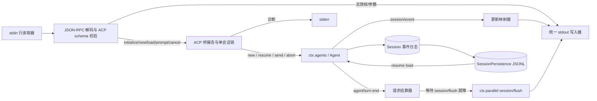
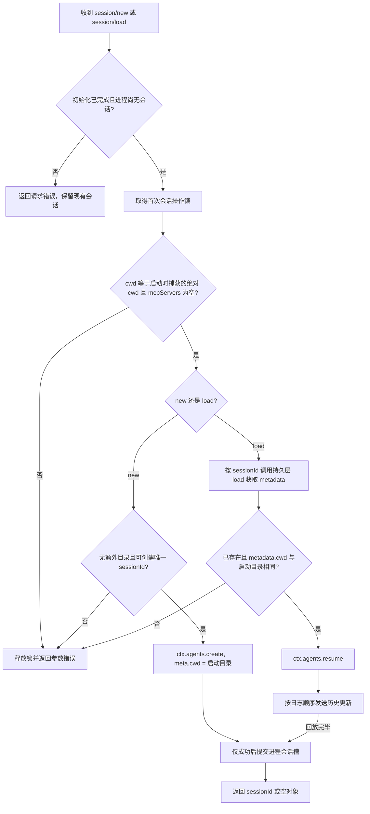
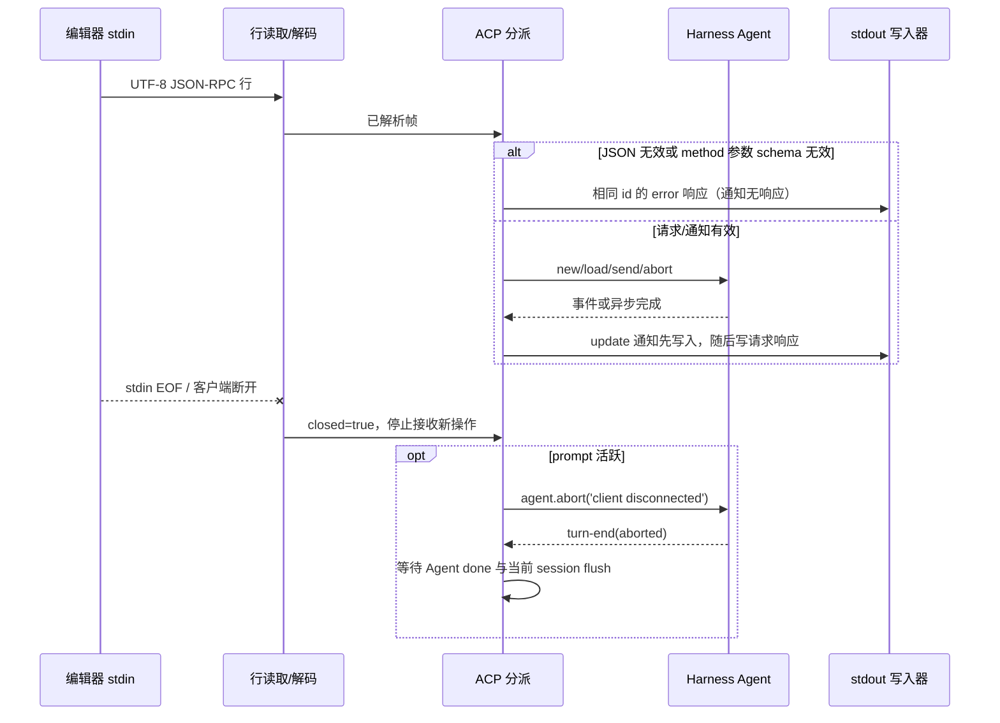
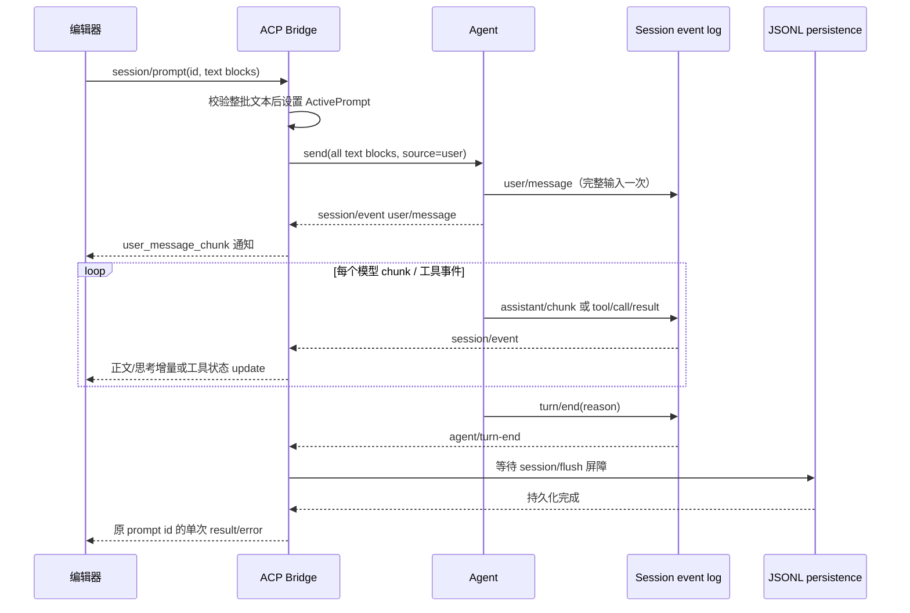
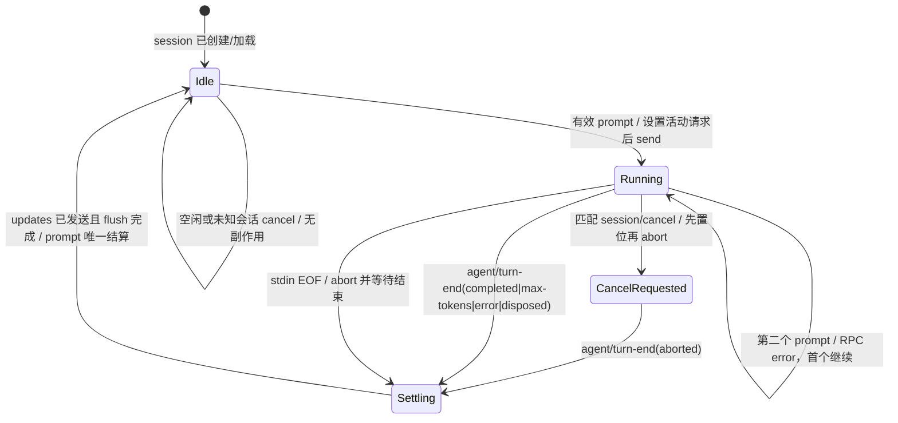

# ACP 编辑器入口 · 技术设计

> 功能依据：[spec.md](spec.md)，SHA-256 `ff4a5d3fb04e6bbe7ece2b989537303e5756a6c50408c311c4fbed066d7df942` · 已确认版本
> 确认依据：[SPEC-CONFIRMATION.md](../../../SPEC-CONFIRMATION.md)，记录为原运行 evt-005 于 2026-11-07 16:08（北京时间）复核；本轮沿用。ACP v1 合法但不支持的请求版本返回服务端最新支持版本 1，格式无效的版本参数返回参数错误。
> 设计状态：待用户确认 · 本轮新草案
> 本轮范围：只设计 `task/packages/acp/` 的 stdio ACP v1 桥接；不改 Harness 核心、Spec、离线评测支持或其他业务包。

## 需要判断的关键决策

| 选择 | 推荐及理由 | 主要代价/备选与影响 | 状态与设计依据 |
|---|---|---|---|
| ACP 边界与包职责 | 新增 `@deepseek-ai/dsh-acp` 包，`src/index.ts` 导出 `apply(ctx, { model })`；桥接只依赖 Harness 公开服务和会话事件。 | 增加一个 publish-private workspace 包及本地依赖清单；保持对 Agent Loop 实现解耦。 | 待确认；[整体结构](#整体结构与数据归属)，D01 |
| 请求校验权威 | ACP JSON-RPC 与方法参数由包内单一 schema 定义，校验后映射到 Harness 类型；保持协议输入和内部对象分离。仓库规范 R2 要求 Zod，当前源码依赖仅有 schemastery，没有 Zod。 | 遵从 R2 需要新增 Zod 依赖；若采用现有 schemastery 则违反明确的 R2。将此项作为确认前置决策，需在实现前确定依赖方案。 | **待确认/阻塞实现选型**；附录 A、R2。 |
| 单会话与并发 | 桥接维护一个进程级会话槽和异步操作锁；prompt 活跃期间仅允许一个请求，输入读取与请求执行分离以便 cancel 能立即抵达。 | 用锁保护 new/load 的异步占槽与恢复过程；请求响应 ID 及活动 prompt 需保存在桥接态。 | 待确认；[会话占槽与请求执行](#会话占槽与请求执行)，D02。 |
| 输出和生命周期 | 所有 ACP 通知/响应经一个 stdout 写入器按单行 JSON-RPC 输出；Harness 日志固定走 stderr。进程 stdin EOF 时取消活跃 Agent 并等待其退出。 | 需要统一串行化写入和对断开期间的写入失败收口；stderr 日志不能混入协议流。 | 待确认；[帧处理和断开清理](#帧处理和断开清理)，D03。 |
| 更新来源和结算 | 实时更新监听 `session/event`，请求结算监听 `agent/turn-end`；历史恢复读取已加载 Session 的事件日志按序回放。显式 cancel 标记决定 `aborted` 映射为 `cancelled`。 | session event 是同步通知，turn-end 后 Harness 还执行 `session/flush`；桥接在成功结算响应前等待当前 Session 的 flush 屏障，避免响应先于持久化。 | 待确认；[更新、终结与持久化顺序](#更新终结与持久化顺序)，D04。 |

## 整体结构与数据归属



| 数据/职责 | 权威来源与写入方 | 读取方/派生结果 | 模块、目录与公开入口 |
|---|---|---|---|
| ACP 请求、响应及通知 | 每个输入行的 JSON-RPC 对象；ACP 桥接校验，不持久化 | 桥接分派到 Harness 或统一编码输出 | 新增 `task/packages/acp/src/index.ts`，导出 `apply(ctx, { model })` |
| 当前进程会话占用 | ACP 桥接内存态（一个 `sessionId`、`cwd`、`Agent`） | new/load/prompt/cancel 分支；进程退出即释放 | 新增 ACP 包；单进程不增加第二个会话存储 |
| 对话和工具历史 | `Session.events` 为权威追加日志；Agent Loop 写入 | ACP 更新实时映射和 load 历史回放；LLM 历史由 `deriveMessages()` 推导 | 复用 `dsh-session`；类型见 `packages/session/src/types.ts` |
| 会话元数据及耐久记录 | `Session.header` 保存绝对 cwd/id；JSONL backend 保存 header、事件及 summary | `ctx.agents.resume()` 加载同一 id，恢复 Agent | 复用 `dsh-session-persistence-jsonl`，不添加 ACP 专用存储 |
| 正文、思考、工具调用、停止原因 | Harness `assistant/chunk`、`tool/call`、`tool/result`、`turn/end` 事件 | 更新映射器构造 ACP `session/update` 与 prompt 结果 | `dsh-agent` 事件协议和 `dsh-llm` `StreamChunk` 是权威来源 |

代码依赖保持单向：`dsh-acp` → `dsh-agent`、`dsh-llm`、`dsh-session`、`dsh-session-persistence`、Cordis；不依赖具体 `dsh-agent-loop` 或 JSONL 实现。桥接通过注入服务 `agents`、`sessionPersistence` 调用公开契约；Harness 主进程负责加载 Agent Loop 和 JSONL 实现。该依赖关系遵循仓库插件边界，新增目录与依赖影响仍待确认。

## 会话占槽与请求执行

<a id="session-slot"></a>

### 规则与边界



桥接在模块应用时一次捕获启动目录 `startupCwd = resolve(process.cwd())`。请求 cwd 必须为绝对路径且与该值字符串相等；这满足本题只接受启动目录的要求并避免将别的目录归一化后误接纳。`session/new` 由桥接生成随机 session id，并将 `meta.cwd` 写进 `ctx.agents.create()`；`session/load` 先通过注入的 `ctx.sessionPersistence.load(id)` 读取 `meta.cwd`，验证一致后才调用 `ctx.agents.resume()`。无法找到或解析的会话、cwd 不同、会话槽已占用均返回请求错误。

会话锁从异步持久层查询开始占用，直至 create/resume 与必要历史回放结束。只有操作全部成功才提交进程会话槽；任何失败释放临时锁且不遗留 Agent。因为协议输入可能并发抵达，new/load 必须先同步设置锁位，再进入首个 `await`。桥接必须在调用 `ctx.agents.create/resume` 前验证所有会拒绝条件，防止拒绝路径产生 Agent 或 Session 副作用。

```ts
interface BridgeState {
  initialized: boolean // initialize 成功后允许处理会话方法
  startupCwd: string // apply 时解析出的绝对启动目录
  slot?: SessionSlot // 本进程唯一持有的会话
  sessionOperation: boolean // new/load 的临时互斥锁
  prompt?: ActivePrompt // 当前 prompt 请求及其取消状态
  closed: boolean // stdin EOF 后禁止接受新的输入/通知
}

interface SessionSlot {
  sessionId: string // ACP 会话标识，同时作为 Harness SessionId
  cwd: string // 与 startupCwd 相同的绝对路径
  agent: Agent // 当前进程运行的 Agent
}

interface ActivePrompt {
  requestId: JsonRpcId // 原 prompt 请求 id，用于恰好一次响应
  sessionId: string // 绑定的唯一会话
  agent: Agent // 接收 send/abort 的 Agent
  cancelRequested: boolean // 仅显式 cancel 把 aborted 结算为 cancelled
  settled: boolean // 防止终结和 EOF 双重结算
}
```

### 具体推演

| 输入/初始状态 | 预期输出/最终状态 | 用例定位 |
|---|---|---|
| 初始化后无槽；cwd 为 `/work/app`，mcpServers=[]；提交 session/new | 创建一个 Agent，Session header.cwd 为 `/work/app`，成功响应含唯一 sessionId，槽占用 | [有效创建和初始化](#test-t1) |
| 首个有效 session/load 已等待磁盘读取时，提交第二个有效 session/new | 第二请求立即收到请求错误；第一个仍可成功，进程只有首个会话 | [并发创建/恢复与目录拒绝](#test-t2) |
| 已有会话记录 cwd=`/work/other`，当前启动目录 `/work/app` | load 返回请求错误，不恢复 Agent，槽保持空 | [并发创建/恢复与目录拒绝](#test-t2) |

## 帧处理和断开清理

<a id="frame-lifecycle"></a>

### 规则与边界



逐行读取 stdin，JSON-RPC 2.0 请求以 id 原样应答；通知没有响应。无效 JSON 可用 `id: null` 返回 parse error；无法确定 id 的坏帧按 JSON-RPC parse error 处理。已解析请求若 method 参数错误使用 Invalid params，未知方法使用 Method not found。错误码依 ACP 本地协议摘要和 JSON-RPC 2.0 约定；错误消息不包含栈。`initialize` 必须成功后才处理会话操作，协商结果固定 protocolVersion=1、`loadSession: true`、`authMethods: []`，能力只声明真实实现项。

stdout 写入器是唯一发送点：将单个完整 JSON 对象 stringify 后追加一个换行；由 Node stdout 自身保持写序，通知与请求响应不得在其他模块直接写 stdout。所有诊断日志写 stderr。请求分派不能按请求 await 串行阻塞整个输入读取循环，否则 hang prompt 会阻止 cancel 被读取；每个请求以受控异步任务执行，锁和 prompt 活跃态负责并发约束。

stdin EOF 将状态切为 closed，当前 prompt 存在时调用 Agent `abort()`，并等待 Agent 的 `done` 与 session flush 屏障。Agent Loop 的 `agent.abort()` 终止活动 step，回合以 `aborted` 关闭；断开后 stdout 已关闭时不尝试另发响应。new/load 中途 EOF 需要等待其异步操作完成并在成功创建后立即 dispose 对应 Agent fiber/清理会话；桥接实现必须保留相应 disposer 或明确用插件 fiber 统一管理创建对象。进程退出时 Cordis fiber 释放 Agent、Session 与 persistence 订阅。此资源归属细节需在代码阶段按 Cordis effect 实际句柄确认。

## 更新、终结与持久化顺序

<a id="update-settlement"></a>

### 规则与边界



桥接在调用 `agent.send()` 前一次性校验会话 id、prompt 数组非空、数组每项都是非空约束允许的文本块结构（文本字符串可为空与否由 spec 对“有内容”的约束落实为至少一个有效非空文本；拒绝时不调用 send）。校验整个数组后，保留块顺序作为 Harness `{ type: 'text', text }[]`，一次 send，避免分块发送造成多个用户事件。工具调用是 Agent Loop 内部行为，桥接不重放或自行执行工具。

映射使用一个事件主监听器，按 `sessionId` 和该 Agent Session 过滤：`user/message` 按文本原顺序发 `user_message_chunk`；`assistant/chunk` 的 `text-delta` 发 `agent_message_chunk`，`reasoning-delta` 发 `agent_thought_chunk`；不把 block-end 内容重复发送。`tool/call` 发带相同 callId 的 `tool_call`（运行状态）；对应 `tool/result` 发 `tool_call_update`，`isError` 映射 failed，否则 completed。session event 是同步追加后回调，因此序列保持日志序；先有 tool/call 再有 tool/result。工具标题使用 Harness 工具名。历史回放按 `Session.events` 原始顺序复用相同映射器，`user/message`、正文/思考 chunk、工具调用/结果生成更新；此路径只读事件，不执行 `agent.send()` 或再次调用模型。

新请求在发送前注册活动态，`agent/turn-end` 仅对同一 Agent 且同一活动请求结算。终结结果为 completed→`end_turn`、max-tokens→`max_tokens`、显式 cancel 且 aborted→`cancelled`、未请求取消的 aborted/disposed/error→RPC 错误。模型失败沿 Agent Loop 既有 error 路径产生 `turn-end(error)`；桥接用 `error` 事件中的 message/code 建立 RPC error。显式取消只接受无 id 的 `session/cancel` 通知：会话匹配且 prompt 活跃时设置 `cancelRequested=true` 后调用 abort；空闲/未知会话静默忽略。先结算的 turn-end 把 `settled` 置位，迟到 cancel 不改变结果；事件处理器不得在 settled 后发送任何 session update。

Agent Loop 已在 turn-end 后 `await ctx.parallel('session/flush', session)`，但 `agent/turn-end` 在 flush 前发出。桥接要在 turn-end 到来后显式等待 `ctx.parallel('session/flush', session)` 完成，再发送 prompt 响应；JSONL backend 按 session id 串行化重复 flush，第二次通常无待写数据。该屏障用于让成功响应意味着本轮 turn/end 已持久化。flush 失败时回合已经关闭且不能安全追加 session/error；桥接应通过 stderr 记录并返回 RPC error，保留内存历史，实际耐久状态不确定，此错误语义列为实现验证点。

### 具体推演

| 输入/初始状态 | 预期输出/最终状态 | 用例定位 |
|---|---|---|
| prompt=[text("ab"), text("cd")]；模型产生 thought、正文两段并结束 stop | 先记录并通知两块用户输入，再按模型 delta 顺序发 thought 和正文；响应 `end_turn`，History 含同一次用户输入和完整 assistant message | [文本输入校验与顺序](#test-t3)、[正文/思考/工具事件及终结顺序](#test-t4) |
| `tool fail x` 导致工具抛错 | tool_call 与同 id 的 tool_call_update failed 都先于 prompt 终结；模型后续仍可生成助手消息时按最终 turn reason 结算 | [正文/思考/工具事件及终结顺序](#test-t4) |
| prompt=`limit x` | 原请求唯一结果为 `max_tokens`；之前产生的正文/思考通知先写出 | [完成、上限、模型失败结算](#test-t7) |
| prompt=`error x` | 已有通知先写出，原请求得到 RPC error；无 end_turn/max_tokens 成功结果 | [完成、上限、模型失败结算](#test-t7) |

## 同会话并发与取消

<a id="prompt-cancel"></a>

### 状态转换



同一会话只有一个 `ActivePrompt`。第二个 prompt 在任何输入写入前返回请求错误，首个 prompt 保持运行。`Agent.send()` 本身是同步排队 API；桥接先完成所有参数校验和活动态设置，再 send，使 `agent/turn-end` 不会早于活动请求注册。cancel 通知无响应且不影响未知/空闲会话；重复 cancel 在请求尚未结算时保持同一取消态，不重复触发结果。新 prompt 只有前一个请求完成 flush 并清除活动态后才被桥接接受。

### 取消推演

| 输入/初始状态 | 预期输出/最终状态 | 用例定位 |
|---|---|---|
| `hang x` 已发出部分文本；随后匹配 cancel 通知 | Agent abort；部分更新留在事件日志；prompt 原 id 只收到 `cancelled` 一次；之后新 prompt 正常运行 | [取消、空闲取消和串行请求](#test-t6) |
| prompt 活跃时提交第二个 prompt | 第二请求 RPC error；首请求继续至原模型结果 | [取消、空闲取消和串行请求](#test-t6) |
| session 空闲或 sessionId 未知时 cancel | 无 RPC 响应、无 Agent abort；有效会话的下一条 prompt 正常处理 | [取消、空闲取消和串行请求](#test-t6) |

## 验证状态与交接

本轮执行了输入文件读取、确认哈希核对、架构/模块源码和开发规范审查；未运行实现测试、未创建业务代码、未改 Spec。所有测试安排目前为待实现验证。交接前需解决 R2 的 Zod 依赖选择，并由用户确认会话边界、flush 结果错误语义和进程关闭期间的 Agent/Session disposer 归属。逐场景用例矩阵见[附录 B](#附录-b测试用例与覆盖矩阵)，其余待确认项见附录 C。

## 附录 A：协议、结构与配置

### ACP JSON-RPC 帧和方法子集

权威外部协议摘要是本题保留的 `task/eval-support/PROTOCOL.md`（本地摘要；正式公开协议版本依据另由确认记录注明）。桥接包是 ACP wire schema 的所有者和唯一运行时校验点。Harness 的 `Agent`、`SessionEvent` 等内部类型继续由既有包所有；桥接将 wire 值经校验映射到内部类型，不在别处复制协议定义。

**计划新增结构（schema 推导类型；R2 依赖方案待确认）**

```ts
type JsonRpcId = string | number | null // 复制请求 id 到响应；通知不带 id

interface JsonRpcRequest { // 单行 JSON-RPC 2.0 请求或通知
  jsonrpc: '2.0' // 协议版本固定值
  id?: JsonRpcId // 缺省表示通知；请求 id 在响应中原样返回
  method: string // 由方法分派器校验支持范围
  params?: unknown // 先作为 wire 边界值校验，再映射为方法输入
}

interface SessionSlot { // ACP 进程唯一活动会话
  sessionId: string // ACP id 与 Harness SessionId 相同
  cwd: string // 已验证的启动目录绝对路径
  agent: Agent // 恢复/创建后供 send、abort 使用
}

type StopReason = 'end_turn' | 'max_tokens' | 'cancelled' // 当前 Spec 支持的三种 prompt 结果
```

各 method 的完整 schema 需根据本附录协议表编写在 `packages/acp/src/protocol.ts`（计划位置）并导出推导类型，`src/index.ts` 只消费其解析结果。用户无需认证，因此 initialize 返回空 authMethods；initialize 的 `protocolVersion` 类型为合法协议版本号，合法但未支持版本按确认记录返回 1，格式无效则 Invalid params。未知能力不得声明。

| 名称与用途 | 生产者 → 消费者 | 输入及约束 | 输出 | 错误行为与校验边界 | 权威来源 |
|---|---|---|---|---|---|
| `initialize` | Client → Bridge | protocolVersion；clientCapabilities | protocolVersion=1、agentCapabilities.loadSession=true、authMethods=[] | 类型/格式错误 Invalid params；合法但不支持版本返回版本 1 | 本地协议摘要；确认记录 |
| `session/new` | Client → Bridge | cwd=启动目录绝对路径；mcpServers=[] | `{ sessionId }` | 槽冲突、cwd 错、非空 MCP/目录列表均请求错误，无占槽副作用 | Spec C1；摘要 |
| `session/load` | Client → Bridge | sessionId、cwd=启动目录、mcpServers=[] | `{}`；此前发历史 session/update | 未知 id、metadata.cwd 不符、槽冲突均请求错误；不得创建 Agent | Spec C1/C8；JSONL metadata |
| `session/prompt` | Client → Bridge | 当前 sessionId；非空且仅文本的 prompt block 列表 | `{ stopReason }` | 所有字段/块在 send 前整体校验；模型错误用 RPC error | Spec C3–C6；摘要 |
| `session/cancel` | Client → Bridge | 无 id 通知；sessionId | 无响应 | 活跃匹配则 abort；空闲/未知时无副作用 | Spec C6；摘要 |
| `session/update` | Bridge → Client | sessionId 与一个映射后的 update | 通知 | stdout 关闭时记录/吞并传输失败，不继续协议写入 | 本地协议摘要 |

### ACP 更新字段

以下字段按本地协议摘要给出最小子集。其具体可选字段需与随包协议资料同步核对，避免实现自行扩张 wire shape。

```ts
interface TextUpdate { // 一段用户正文、助手正文或公开思考增量
  sessionUpdate: 'user_message_chunk' | 'agent_message_chunk' | 'agent_thought_chunk' // 更新种类
  content: { type: 'text'; text: string } // 增量文本
}

interface ToolCallUpdate { // 工具调用开始或终结
  sessionUpdate: 'tool_call' | 'tool_call_update' // 新调用或已有调用状态更新
  toolCallId: string // 对应 Harness CallId，同一次调用全程不变
  title: string // Harness 工具名
  status: 'in_progress' | 'completed' | 'failed' // 从 tool/call 与 tool/result 推导
}
```

### 配置

| 名称 | 单位与默认值 | 选择依据及影响 | 权威位置、覆盖方式与使用入口 |
|---|---|---|---|
| `model` | 模型注册名字符串；无默认值，调用方必须提供 | 与 eval-support 提供的离线模型一致；缺失/未注册在 create 前报配置错误 | `apply(ctx, { model })`；使用 `AgentOptions.model` |
| `startupCwd` | 绝对路径；启动时 `resolve(process.cwd())` 一次 | 与 Spec 限定一致，运行期 cwd 改变不迁移会话归属 | ACP `apply()` 初始化；不允许请求覆盖 |
| session id | 随机 UUID 字符串；每次 new 生成一次 | 避免撞已有 JSONL 标识；load 原样使用传入值 | ACP `session/new`；Harness `SessionId` |

## 附录 B：测试用例与覆盖矩阵

实现阶段计划新增 `task/packages/acp/tests/*.spec.ts`，围绕实际 `apply()` 和 Cordis 服务运行，Stub stdin/stdout 而保留 Agent Loop、Session Store、JSONL 真实路径；离线模型复用 eval-support fixture 的普通文本、工具成功/失败、hang、limit、error 输入语义。这里的用例是计划，未执行且不代表通过。

### 协议与会话边界

<a id="test-t1"></a>

#### T1 初始化和有效创建

- 用例编号与依据：T1；[feat01 场景1](spec.md#feat01-创建和恢复会话)，C1/C2。
- 为什么测：错误协商或创建会使编辑器无法建立符合限制的本地会话。
- 测试数据与准备：进程 cwd `/work/app`；initialize protocolVersion=1；session/new `{cwd:'/work/app',mcpServers:[]}`；空存储目录。
- 测试流程：对 `apply()` 输入逐行写 JSON-RPC；断言首个 initialize 响应字段，再取 new 返回的 id，检查 `ctx.agents.get()` 与 Session header；回收测试 fiber。
- 预期结果与观察点：协议版本 1、loadSession=true、authMethods=[]；创建一 Agent 和一个同 id Session，cwd 记录为启动目录，返回 sessionId。
- 禁止结果与观察点：不得要求认证；stdout 每行均为一个 JSON-RPC 消息且不含日志。
- 验证方式与证据：包级集成测试，待实现验证；测试文件计划 `packages/acp/tests/protocol.spec.ts`。
- 局限：本地协议摘要限定子集，正式协议工具定义的额外可选字段不在本用例内。

<a id="test-t2"></a>

#### T2 并发创建/恢复与目录拒绝

- 用例编号与依据：T2；[feat01 场景2](spec.md#feat01-创建和恢复会话)，C1。
- 为什么测：竞态或目录校验遗漏会造成第二会话、跨工作目录读取或拒绝后占槽。
- 测试数据与准备：启动 cwd `/work/app`；可控延迟的 persistence.load；两次重叠有效 new/load 请求；cwd 相对路径、其他绝对路径、非空 mcpServers、未知 id 和不同 metadata.cwd。
- 测试流程：阻塞首次 load；立刻发第二 new，观察第二响应后放开 load；分行提交各拒绝样例；检查 agents/session store 和桥接状态。
- 预期结果与观察点：首个操作可成功；重叠第二个被拒绝；有效操作完成后后续 new/load 被拒绝；未持有会话时各无效首次操作报错且允许随后有效 new；load cwd 不一致与未知 id 报错。
- 禁止结果与观察点：拒绝操作不能创建 Agent/Session、改变既有 slot 或写持久记录；MCP 和额外目录非空不能被忽略。
- 验证方式与证据：包级并发集成测试，待实现；`protocol.spec.ts`。
- 局限：模拟磁盘延迟只验证桥接互斥；JSONL 读写和 metadata 比较使用真实 persistence。

### Prompt 输入与实时更新

<a id="test-t3"></a>

#### T3 文本输入整体校验和顺序

- 用例编号与依据：T3；[feat02 场景2](spec.md#feat02-发送文本并接收助手更新)，C2/C3。
- 为什么测：逐块校验后提前 send 会让无效请求的前半部分污染历史。
- 测试数据与准备：prompt 多文本块 `alpha`、` beta`；空列表；仅空文本；混入 image；未知 sessionId。
- 测试流程：对每个输入调用 session/prompt；读取 RPC 结果、`user/message` 事件以及离线模型调用日志；有效 case 继续等待 turn-end。
- 预期结果与观察点：有效块以原顺序构成一次 send，user/message 与模型输入内容一致；空提示、非文本、未知会话均为请求错误。
- 禁止结果与观察点：拒绝用例的 session.events、模型输入和 fixture generate 日志中不得出现其任一文本块。
- 验证方式与证据：Agent Loop + 离线模型集成测试，待实现；`prompt.spec.ts`。
- 局限：模型输入记录只观察 Harness 真实 agent request，不使用 prompt 处理替身。

<a id="test-t4"></a>

#### T4 正文/思考/工具事件及终结顺序

- 用例编号与依据：T4；[feat02 场景1](spec.md#feat02-发送文本并接收助手更新)，C4。
- 为什么测：混淆 chunk、工具调用和结果会让 UI 内容重复、工具状态失配或请求先于更新结束。
- 测试数据与准备：离线模型 `tool echo` 触发工具成功、`tool fail value` 触发工具异常；模型产生 thought 与分片正文。
- 测试流程：捕获完整 stdout 顺序；对照 Session.events 中 assistant/chunk、tool/call/result 和最后 turn/end 的 seq；按 toolCallId 配对 ACP 通知。
- 预期结果与观察点：正文增量与思考增量分类正确；工具 start 与 update 的 id 相同；成功为 completed、失败为 failed；每个本应发出的更新先于该 prompt 的响应。
- 禁止结果与观察点：block-end 不重复发送正文；不能把工具失败映射成成功；不同 toolCallId 不可串联。
- 验证方式与证据：Harness 全链路集成测试，待实现；`prompt.spec.ts`。
- 局限：离线工具覆盖 Harness 工具失败路径，不代表真实 bash 工具行为。

### 请求并发、取消与连接清理

<a id="test-t6"></a>

#### T6 取消、空闲取消和串行请求

- 用例编号与依据：T6；[feat02 场景3](spec.md#feat02-发送文本并接收助手更新)、[feat03 场景1](spec.md#feat03-取消和释放正在运行的工作)、[feat03 场景2](spec.md#feat03-取消和释放正在运行的工作)，C6。
- 为什么测：取消/并发竞态会导致双重结算、后台工作遗留或首个 prompt 被第二个请求破坏。
- 测试数据与准备：先运行 `hang slow`；期间提交第二 prompt 及匹配 cancel；另外对空闲和未知 id cancel 后发送普通 prompt；重复 cancel 覆盖迟到通知。
- 测试流程：等待部分正文通知后写 cancel 行；观察 Agent abort、turn/end、原 request response 数；await response 后立即发送第二轮。
- 预期结果与观察点：第二 prompt 被拒绝且首个继续；显式取消使原请求恰好一条 `cancelled` 结果；空闲/未知 cancel 不发送 RPC 响应且后续 prompt 正常；取消完成可继续会话。
- 禁止结果与观察点：结算后不得出现迟到 update；cancel 通知无响应；不允许 Agent task 留存或双结算。
- 验证方式与证据：真实 Agent Loop 与 abort signal 集成测试，待实现；`prompt.spec.ts`、`lifecycle.spec.ts`。
- 局限：离线 hang 模型不覆盖系统信号强杀进程。

<a id="test-t8"></a>

#### T8 客户端断开清理

- 用例编号与依据：T8；[feat03 场景3](spec.md#feat03-取消和释放正在运行的工作)，C7。
- 为什么测：EOF 仅关闭输入但未等待 abort 会留下运行中的模型任务或 Agent。
- 测试数据与准备：启动 `hang disconnect` prompt 后关闭 stdin；保留 Harness Agent、Session 与 fixture aborted 事件观察器。
- 测试流程：触发 EOF；等待 apply/输入驱动器的异步 dispose 完成；检查 Agent status、loop `done`、fixture aborted 和 Fiber 存储对象。
- 预期结果与观察点：底层 signal 触发，Agent 完成 abort 并释放；关闭后无新协议写入，等待清理后无运行任务。
- 禁止结果与观察点：dispose 返回时不能仍有活跃模型工作；不得因 closed stdout 的异常跳过清理。
- 验证方式与证据：生命周期集成测试，待实现；`lifecycle.spec.ts`。
- 局限：模拟 stdin EOF 验证应用级关闭；操作系统 SIGKILL 无法执行优雅清理。

### 结束结果与恢复

<a id="test-t7"></a>

#### T7 完成、上限和模型失败结算

- 用例编号与依据：T7；[feat02 场景4](spec.md#feat02-发送文本并接收助手更新)，C5。
- 为什么测：把结束类型映射错会让编辑器将受限回复、成功回复和失败回复视作同一结果。
- 测试数据与准备：三轮有效输入普通文本、`limit x`、`error x`；离线 fixture 记录 generate 与 aborted。
- 测试流程：逐轮发送 prompt，收集其 id 对应更新及结果；比较 stopReason/error 与 turn/end.reason。
- 预期结果与观察点：普通 stop=`end_turn`；max-tokens=`max_tokens`；finish error 返回 RPC error；每轮之前产生的更新均先到。
- 禁止结果与观察点：模型失败不能产生成功 stopReason；max-tokens 不能映射 end_turn；同一请求不得重复响应。
- 验证方式与证据：离线模型集成测试，待实现；`prompt.spec.ts`。
- 局限：fixture 仅模拟提供方失败和 token ceiling，不测真实 DeepSeek API。

<a id="test-t9"></a>

#### T9 JSONL 恢复、历史回放及继续

- 用例编号与依据：T9；[feat01 场景3](spec.md#feat01-创建和恢复会话)，[feat02 场景2](spec.md#feat02-发送文本并接收助手更新)，C8。
- 为什么测：恢复若重新跑模型或遗漏 chunk 历史，会造成重复回答或编辑器视图不连续。
- 测试数据与准备：Context A 使用真实 JSONL backend 完成一轮并等待 prompt result；记录 SessionId 和 events；销毁 Context A；Context B 使用同 storage 恢复。
- 测试流程：对 Context B 发送 initialize/load；比较 load result 前的 session/update 与原 events 顺序；检查 fixture generate 日志增量；load 后发送新 prompt。
- 预期结果与观察点：历史 user/assistant 正文、思考和工具状态按事件顺序先回放，再返回 `{}`；load 不增加 generate 次数；恢复 Agent 的下一轮追加事件且可正常结束。
- 禁止结果与观察点：不得再次调用模型回放；不得接受 cwd 与启动目录不符；历史回放不能被并发 prompt 插入。
- 验证方式与证据：双 Context JSONL 集成测试，待实现；`resume.spec.ts`。
- 局限：测试本地文件 backend；SQLite backend 属于本需求外。

### 场景与用例覆盖

| spec 具体场景 | 承接用例与主定义 | 各预期/禁止结果的观察点 | 覆盖缺口 | 执行状态/证据 |
|---|---|---|---|---|
| feat01 场景1 创建本地会话 | T1 [初始化和有效创建](#test-t1) | initialize 能力、sessionId、Agent/Session 建立、authMethods、stdout 行格式 | 无计划缺口；初始化无效版本由 T2 以外的 protocol 参数案例补测 | 待实现验证；无执行证据 |
| feat01 场景2 拒绝越界或冲突会话请求 | T2 [并发创建/恢复与目录拒绝](#test-t2) | 无效 cwd/MCP/未知 id/重叠操作的 RPC error；Agent、Session、slot 无变化；首请求完成 | 第二次创建/恢复在持有 slot 后分别覆盖 | 待实现验证；无执行证据 |
| feat01 场景3 重启后恢复历史并继续 | T9 [JSONL 恢复、历史回放及继续](#test-t9) | load success 前的历史通知顺序、模型调用数、后续 prompt 和新增事件 | 运行测试提供双 Context/文件清理证据 | 待实现验证；无执行证据 |
| feat02 场景1 展示按序处理的回复和工具进度 | T3 [输入顺序](#test-t3)、T4 [更新映射](#test-t4) | 用户块顺序、正文/思考分流、tool id 对应、更新先于结算 | T4 的工具失败后是否继续最终模型轮由 fixture 结果覆盖 | 待实现验证；无执行证据 |
| feat02 场景2 原子拒绝无效输入 | T3 [文本输入整体校验和顺序](#test-t3) | 空、image 混合、未知 session 的错误及日志/模型零副作用 | 历史恢复时的通知为 T9 覆盖 | 待实现验证；无执行证据 |
| feat02 场景3 拒绝同会话并发请求 | T6 [取消、空闲取消和串行请求](#test-t6) | 第二 prompt error；首 prompt 正常继续 | 无计划缺口 | 待实现验证；无执行证据 |
| feat02 场景4 区分完成、输出上限与模型失败 | T7 [三类结束结果](#test-t7) | end_turn/max_tokens/RPC error 与通知顺序 | 无计划缺口 | 待实现验证；无执行证据 |
| feat03 场景1 取消正在运行的请求 | T6 [取消与结算](#test-t6) | underlying abort、唯一 cancelled 结果、可后续提问、无迟到通知 | 需落实显式 cancel 与其他 aborted 来源区分 | 待实现验证；无执行证据 |
| feat03 场景2 空闲取消与后续提问 | T6 [空闲/未知取消](#test-t6) | 无响应且无副作用；后续正常 prompt | 无计划缺口 | 待实现验证；无执行证据 |
| feat03 场景3 断开连接清理工作 | T8 [客户端断开清理](#test-t8) | abort signal、Agent done、fiber 释放、无关闭后写入 | 需实现中确认创建 Agent disposer 所属 Fiber | 待实现验证；无执行证据 |

## 附录 C：调查、基线与追溯

### 基线与确认记录

- Spec：`task/docs/spec/acp-editor/spec.md`，SHA-256 `ff4a5d3fb04e6bbe7ece2b989537303e5756a6c50408c311c4fbed066d7df942`，本轮只读并与确认记录哈希对照。
- Spec 确认依据：`task/SPEC-CONFIRMATION.md`；沿用原运行 evt-005 中操作者 2026-11-07 16:08（北京时间）的复核；确认覆盖该 Spec 哈希和 ACP v1 版本协商澄清。
- 设计版本与确认：新建草案，尚无用户确认；关键决策表列出的各项均待确认。自检不构成批准。
- 既有设计/规范：`task/docs/architecture.md`、`task/packages/AGENTS.md`、各相关 package README；全局开发规则见本工作区 `skills/x-tech-design/references/development-rules.md`。ACP 本地协议摘要见 `task/eval-support/PROTOCOL.md`。
- 本轮覆盖范围：feat01 场景1–3、feat02 场景1–4、feat03 场景1–3；完整索引见[覆盖矩阵](#场景与用例覆盖)。

### 现状与本轮差异

| 代码/设计位置 | 已核对事实 | 本轮处理及影响 |
|---|---|---|
| `task/docs/architecture.md` § Service map、Event-sourced sessions、Agents/loop | 现有 Harness 是 Cordis 插件微内核；Session 事件日志单一来源，JSONL 通过 flush 提交；Agent 提供 send/abort/events。 | 复用 Agent、Session、持久层公开接口；新增 ACP 外层桥，不改 loop。 |
| `task/packages/agent/src/index.ts` `AgentRegistry.create/resume` | `ctx.agents.create()` 接受 sessionId、cwd metadata 和 agent options；`resume()` 通过 persistence 恢复同 id。 | 桥接依赖 `dsh-agent` 抽象 seam，不导入 `LoopAgent`。 |
| `task/packages/agent/src/types.ts` `Agent` / Events | `send`、`abort`、status；`agent/turn-end` 和 `agent/stream-chunk` 等事件均有类型。 | 显式桥接 prompt 单并发，使用 turn end 关联一次请求。 |
| `task/packages/agent-loop/src/loop.ts` `runTurn`、`processStep` | 输入事件、chunk、tool call/result 写入 Session；turn-end 先于 awaited session flush；abort 以 aborted 关闭。 | bridge 映射事件；完成响应额外等待 flush 屏障，避免结果先于持久化。 |
| `task/packages/session/src/types.ts` SessionEventMap | 事件包括 user/message、assistant/chunk/message、tool/call/result、error、turn/end；ContentBlock 与 StreamChunk 类型由 dsh-llm 定义。 | 复用事件与类型，无额外历史 DTO 或 ACP 写入日志。 |
| `task/packages/session-persistence-jsonl/src/index.ts` 与 README | JSONL 一会话一日志，保存 session header 和事件；load 返回 meta/events，turn/end 为耐久边界。 | 使用既有后端。load 前按 metadata.cwd 校验；不新建 ACP 存储格式。 |
| `task/eval-support/PROTOCOL.md`、`start.ts` | 摘要定义 stdio 行协议与更新子集；离线 fixture 覆盖普通回复、工具成功/失败、hang、limit、模型 error。 | 测试矩阵计划复用其输入语义；保留文件不变。 |

### 设计与用例定位

| 稳定 ID | 中文名称与唯一主定义 | spec 场景/约束或设计来源 | 结果/证据定位与状态 |
|---|---|---|---|
| D01 | [ACP 插件边界与数据归属](#整体结构与数据归属) | 全部场景；C1–C8；仓库架构 | 依赖图/职责表；静态依赖审查待实现 |
| D02 | [会话占槽与请求执行](#session-slot) | feat01 场景1–3；C1/C8 | slot/lock 规则及 T1/T2/T9；待实现验证 |
| D03 | [帧处理和断开清理](#frame-lifecycle) | feat01 场景1；feat03 场景3；C2/C7 | stdio 顺序与清理流程、T1/T8；待实现验证 |
| D04 | [更新、终结与持久化顺序](#update-settlement) | feat02 场景1/2/4；C3–C5/C8 | 映射/flush/回放规则、T3/T4/T7/T9；待实现验证 |
| D05 | [同会话并发与取消](#prompt-cancel) | feat02 场景3；feat03 场景1/2；C6 | 状态图与 T6；待实现验证 |
| T1 | [初始化和有效创建](#test-t1) | feat01 场景1；C1/C2 | 包级集成；待实现验证 |
| T2 | [并发创建/恢复与目录拒绝](#test-t2) | feat01 场景2；C1 | 包级并发集成；待实现验证 |
| T3 | [文本输入整体校验和顺序](#test-t3) | feat02 场景2；C2/C3 | prompt/session/model observations；待实现验证 |
| T4 | [正文/思考/工具事件及终结顺序](#test-t4) | feat02 场景1；C4 | stdout 与 Session seq；待实现验证 |
| T6 | [取消、空闲取消和串行请求](#test-t6) | feat02 场景3；feat03 场景1/2；C6 | Agent abort/turn-end/响应数；待实现验证 |
| T7 | [完成、上限和模型失败结算](#test-t7) | feat02 场景4；C5 | turn reason 到 ACP 结果；待实现验证 |
| T8 | [客户端断开清理](#test-t8) | feat03 场景3；C7 | Agent done 与 fixture aborted；待实现验证 |
| T9 | [JSONL 恢复、历史回放及继续](#test-t9) | feat01 场景3；C8 | 双 Context、history update 与模型调用计数；待实现验证 |

### 规范落实索引

| 规则/来源 | 适用性与原因 | 设计落实位置 | 检查、测试或审查依据 | 结果/执行状态 |
|---|---|---|---|---|
| R1 模块边界 | 适用；ACP 是传输/展示桥接层，需只依赖服务接口。 | D01；`packages/acp/src/index.ts` 与计划 `protocol.ts`。 | 检查依赖不跨入 `agent-loop`、session-persistence-jsonl 实现；待实现静态导入审查。 | 现状依赖由源码审查；设计约束待确认。 |
| R2 协议优先 | 适用；stdin wire 属不可信边界，需要运行时 schema。 | 附录 A；ACP schema 计划集中于 `protocol.ts`。 | 验证 schema 推导类型与所有 method 分派一致；无效/有效输入 T1–T3。 | **冲突待决**：规范要求 Zod，当前项目无 Zod 依赖，添加依赖方案待确认。 |
| R3 跨语言协议 | 不适用；桥接与 Harness 当前均为 TypeScript，单语言边界。 | 附录 A 由 ACP 包 schema 单点维护。 | 不存在跨语言同步方向；未来新增其他语言消费者时重新评估。 | 不适用，原因已给出。 |
| R4 数据唯一来源 | 适用；会话历史和 cwd 有持久来源，桥接内存态不得另存副本。 | D01/D02/D04；Session.events、Session.header、JSONL metadata。 | 恢复后比较原始事件和回放；T2/T9；检查桥接无持久 DTO。 | 代码读查确认现有来源；待实现验证。 |
| R5 概念命名 | 适用；ACP sessionId、Harness SessionId、toolCallId 和 CallId 要一一映射。 | 附录 A 与 D04；显式映射内部/协议字段。 | 语义审查以及 T4/T9 中标识对应检查。 | 待实现验证。 |
| R6 具名配置 | 适用；model 与 cwd 是入口配置，需明确来源/值。 | 附录 A 配置表。 | apply 入参检查、启动 cwd 捕获检查；T1。 | 设计已定义；待实现验证。 |
| R7 数据流与状态 | 适用；session 生命周期、prompt、取消、EOF 均异步且有竞态。 | D02–D05 的 Mermaid 与状态图。 | T2/T6/T8/T9 真实 Agent/JSONL 集成；检查恰好一次结算及关闭 quiescence。 | 已按源码梳理当前状态与 flush 顺序；实现未运行。 |
| AGENTS.md 插件约定：Cordis effect、typed events、服务注入 | 适用；ACP 包注册 listener 和 Agent/Session 生命周期。 | D01–D04；公开 `ctx.agents` 与 event API。 | fiber dispose 后 listener/Agent/Session 无残留；T8/HMR 后续补充。 | 设计要求；待实现检查。 |
| AGENTS.md 输出与文档约定 | 适用；ACP stdio 要求 stdout 纯协议，新增包需文档与代码一致。 | D03；本地 README 计划由实现更新。 | 把诊断定向 stderr；stdout 解析测试；包 README 描述 API/协议。 | 待实现验证。 |
| eval-support 保留约束 | 适用；启动脚本和 fixture 是指定验收入口。 | 测试安排说明；未改 `task/eval-support/`。 | 检查文件保持原样并用其离线行为做集成输入。 | 只读检查；实现阶段验证。 |

### 待确认与阻塞

1. R2 明确要求 TypeScript ACP wire schema 使用 Zod；当前工作区 package.json/lock 和现有包没有 Zod。是否为新 `dsh-acp` 包新增该依赖需要在实现前定案；此设计按规范推荐 Zod。
2. Agent Loop 在 `agent/turn-end` 发出后自己等待 `session/flush`。设计建议桥接再等待同一 session flush，保证 RPC 响应代表 durable turn；需验证 Cordis parallel listener 的重复 flush 行为和 flush 失败如何编码为 RPC error。
3. 本题明确 `apply(ctx,{model})`，现有 `AgentRegistry.create()` 创建的 Session/Agent 由 Cordis fiber 管理。需在实现阶段确认 bridge 获取并持有的子 Fiber/disposer API，确保 stdin EOF 后等到 agent loop done，再释放对应资源。
4. 本地 `PROTOCOL.md` 是协议摘要而非完整规范；错误对象细节、工具更新完整字段和 session/load 的额外合法可选字段需以随包 ACP 协议资料核对。当前草案仅定义摘要明确的字段。
