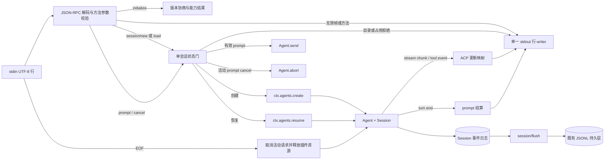
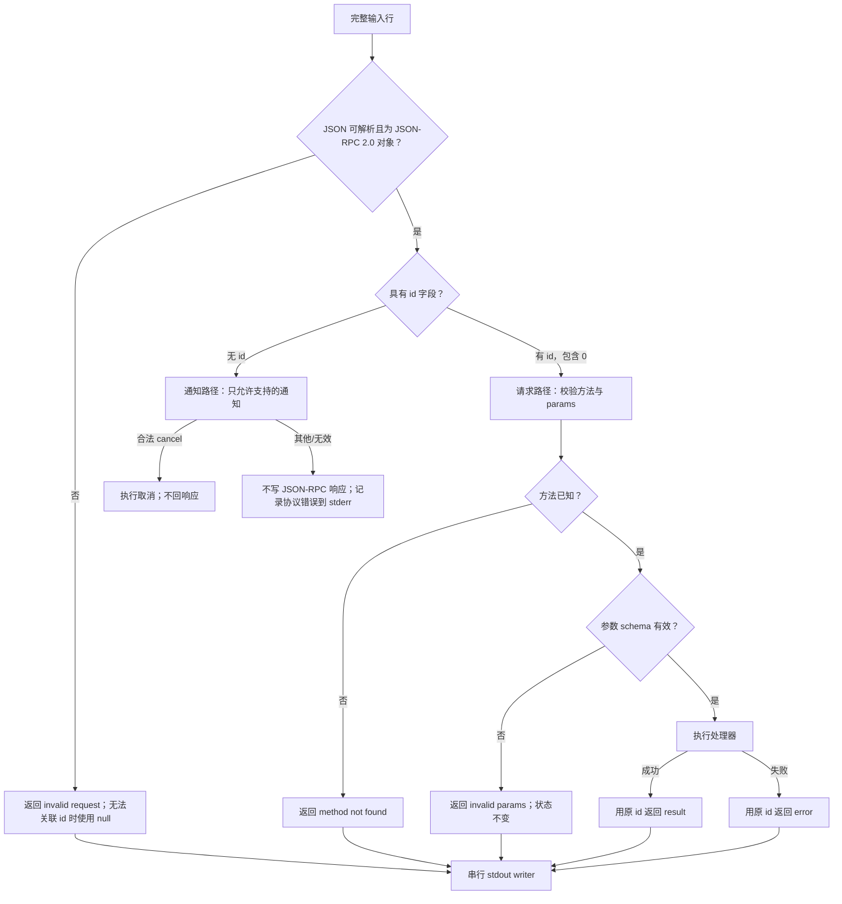
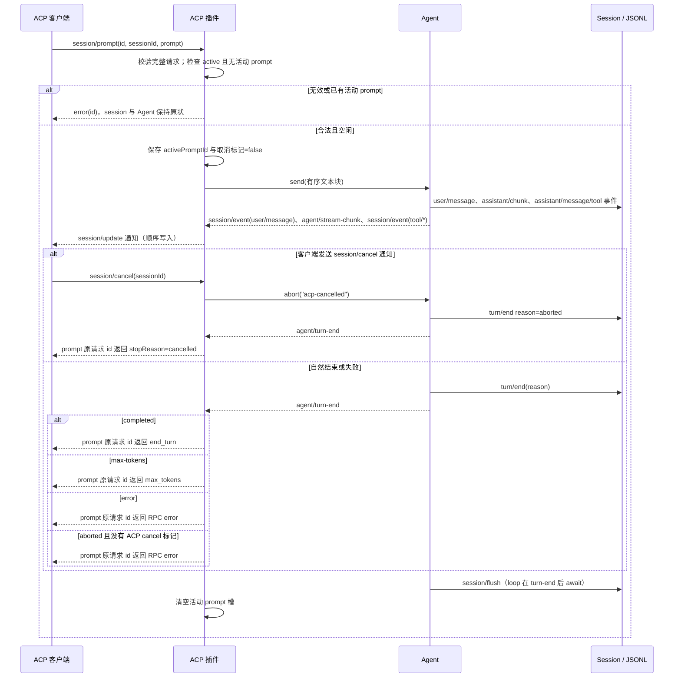
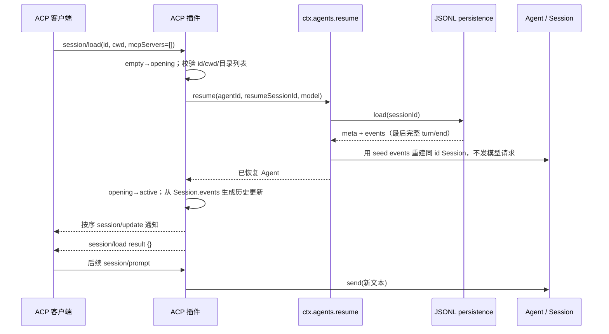

# 编辑器连接本地 DeepSeek 助手 · 技术设计

> 功能依据：[spec.md](spec.md) · 用户确认 SHA-256 `ff4a5d3fb04e6bbe7ece2b989537303e5756a6c50408c311c4fbed066d7df942`
> 确认依据：[SPEC-CONFIRMATION.md](../../../../SPEC-CONFIRMATION.md) 记录了上轮评测操作者复核、确认版本及公开 ACP v1 版本协商澄清；本轮沿用该确认。
> 设计状态：待用户确认 · v1 草案
> 本轮范围：只设计 `task/packages/acp/src/index.ts` 的 `apply(ctx, { model })` 插件；不改 Harness 核心、协议摘要或离线夹具。

## 需要判断的关键决策

| 选择 | 推荐及理由 | 主要代价/备选与影响 | 状态与设计依据 |
|---|---|---|---|
| ACP 接入边界 | 新增独立 `@deepseek-ai/dsh-acp` 插件；经 `ctx.agents` 使用工厂接口，消费 Agent 与 Session 事件。ACP 不改 agent-loop。 | 新增一个包和 stdio 适配层；需配置包入口及工作区依赖。 | 推荐，待确认；[会话与请求机制](#会话所有权与请求结算) |
| stdio 与输出顺序 | `readline` 逐行解析 stdin；单一 writer 将通知和响应各写成一行 stdout；日志留 stderr。Agent 事件同步映射为通知，`turn/end` 决定 prompt 结果。 | 一个进程只服务一个 ACP 客户端和一个会话；JSON-RPC 并发请求由桥接层显式拒绝或序列化。 | 待确认；[传输与分帧](#stdio-分帧与请求路由) |
| 并发与取消 | 桥接层持有单会话状态和活动 prompt 请求 ID；收到取消通知时只对该 Agent 调用 `abort()`，原请求依据活动标志以 `cancelled` 结算。 | Agent API 以 turn 为单位结算；reason 映射要由桥接层维护。 | 推荐，待确认；[会话与请求机制](#会话所有权与请求结算) |
| 持久化与恢复 | 使用既有 JSONL 插件和 `ctx.agents.resume()`；历史从 `Session.events` 转成 ACP 更新，模型只在后续有效 prompt 中调用。 | session/load 回放需同步完成后才应答；只有完整 `turn/end` 已提交的历史可恢复。 | 推荐，待确认；[恢复与回放](#恢复与回放) |
| 运行时协议校验 | 在 ACP 边界定义单一 JSON-RPC/方法参数 schema，校验后再转入内部类型。 | x-tech-design R2 指定 Zod；仓库包当前以 vendored Schemastery 为运行时 schema 方案，且无现成 Zod 依赖。引入 Zod 或批准仓库现有 schema 技术需要确认。 | **待确认，阻塞实现交接**；[协议定义](#附录-a协议结构与配置) |

## 整体结构与数据归属



| 数据/职责 | 权威来源与写入方 | 读取方/派生结果 | 模块、目录与公开入口 |
|---|---|---|---|
| ACP 会话标识与持有状态 | ACP 连接插件内存；由成功的 create/load 写入 | 所有后续 session 方法校验 | 新增 `packages/acp/src/index.ts`，导出 `apply(ctx, { model })` |
| 对话历史 | `ctx.sessions` 的事件日志；Agent loop 写事件 | ACP load 从加载后的 session events 派生通知；模型历史由 `Session.deriveMessages()` 派生 | `dsh-session` 的 `Session.events`、`Session.deriveMessages()` |
| 持久会话 | `ctx.sessionPersistence` 的 JSONL backend；loop 在 `turn/end` 后触发 flush | `ctx.agents.resume()` 装载 committed 事件 | 沿用 `dsh-session-persistence-jsonl`，不新建 ACP 存储 |
| 活动 prompt 与取消意图 | ACP 插件内存状态；一个会话最多一个活动 prompt | stream/tool 更新路由、cancel 与 `turn/end` 结算 | ACP 插件私有类型；由单连接 fiber 生命周期管理 |
| ACP wire 协议 | 新 ACP schema 是边界定义权威来源 | stdin decoder 校验；writer 编码通知和结果 | 计划 `packages/acp/src/protocol.ts` 或 `index.ts` 内单一定义（实现阶段择一） |

依赖保持单向：`dsh-acp → dsh-agent, dsh-session, dsh-llm` 的公开类型和 Cordis；不导入 `dsh-agent-loop` 私有实现。持久化 backend 由宿主装配。stdout 仅写 JSON-RPC；运行日志经 `ctx.logger` 写 stderr。完整依赖静态检查列于规范索引。

## stdio 分帧与请求路由

ACP 传输摘要规定每行一个 UTF-8 JSON-RPC 2.0 对象。解码、校验、分发、通知与请求结果都经过同一 writer，避免多事件监听器并发写入造成行交错。JSON-RPC 请求保留收到的 `id`；通知不产生响应；`session/update` 是服务端通知。方法参数校验失败返回 `-32602`，未知方法返回 `-32601`，无效 JSON-RPC 请求按 `-32600`，处理异常转换成 `-32603` 或该方法规定的请求错误。



版本协商遵照确认记录：`protocolVersion` 是有效整数但客户端版本不受支持时，服务端回复支持的最新版本 1；格式无效的参数返回参数错误。initialize 回报 `loadSession: true`、文本内容支持且 `authMethods: []`；只声明实际实现的能力。

### 具体推演

| 输入/初始状态 | 预期输出/最终状态 | 用例定位 |
|---|---|---|
| `initialize` 参数 `{protocolVersion: 99, clientCapabilities: {}}` | 初始化结果 `protocolVersion: 1`，状态进入 initialized | [版本协商与初始化](#协议边界和初始化) |
| `session/new` 的 `cwd` 与启动目录绝对路径相同且 `mcpServers: []` | Agent 创建成功，保存唯一活动 sessionId 并响应该 id | [新建和恢复目录边界](#会话创建恢复和目录边界) |
| `session/prompt` 的 id 为 `0`、prompt 含空数组 | 参数错误；没有 `Agent.send`，session event 数不变 | [prompt 原子校验](#prompt-校验原子性与并发) |

## 会话所有权与请求结算

每个插件实例维护 `empty | opening | active | closed` 会话状态。进入 create/load 时先同步将 `empty` 置为 `opening`，再执行异步恢复；失败回滚至 `empty`。成功后变为 `active`。此同步占位封闭并发 create/load 的竞态。active 状态拒绝任何新的 create/load，且不替换当前 Agent。所有会话方法都核对当前 `sessionId`。cwd 必须与进程启动时捕获的绝对目录字符串完全相等，`mcpServers` 必须为空数组。

prompt 请求先整体校验 sessionId、非空文本块列表及每个块的 `type === 'text'` 与 string `text`，随后一次性映射为 Harness 文本块数组并调用 `Agent.send(content)`。桥接层在调用前占有活动请求槽；槽位释放仅发生在 `turn/end` 结算或断开清理。无效请求在占槽和发送前失败，因而不会部分提交。一次 Agent turn 对应一个 ACP prompt，因为桥接层只允许一个未完成 prompt，Agent.send 的队列批处理不会合并另一 ACP 请求。



turn-end listener 只负责向 writer 提交结算响应与清空 prompt 状态；由于 agent loop 在发出 `agent/turn-end` 后才等待 `session/flush`，prompt 响应不代表磁盘 flush 已成功。当前持久化契约把 flush 失败记到 `agent/error` 和日志，且保留 buffer 供后续 flush；对话结算仍依照 turn reason。取消标记由 bridge 自己持有，用于将被 `Agent.abort()` 表示为 `aborted` 的 turn 映射成 ACP `cancelled`。未知/空闲 session cancel 不调用 abort，不改变状态，也不响应。

更新映射消费 `session/event(user/message)`、`agent/stream-chunk` 和工具 session events：新 prompt 的 `user/message` 转成 user update；text delta → `agent_message_chunk`，reasoning delta → `agent_thought_chunk`。完整 block 事件不重复发正文。工具开始/结束状态从 session event 的 `tool/call` 与 `tool/result` 生成 `tool_call` / `tool_call_update`，按 `callId` 维持 ACP `toolCallId` 对应；结果 `isError` 决定 `failed` 或 `completed`。日志 append 与 `session/event` 发射同步发生，因此 listener 可在 turn-end 前写通知；JSONL persistence 与 stdout 并行，不作为响应排序条件。

### 具体推演

| 输入/初始状态 | 预期输出/最终状态 | 用例定位 |
|---|---|---|
| prompt 文本块 `a`, `b`；模型正文增量 `Reply: a`，随后思考增量 | 一个 user message 以 `a`,`b` 顺序写入；ACP 正文与 thought 通知按 chunk 到达顺序分流 | [正文、思考和工具事件顺序](#流更新和工具关联) |
| 工具调用 `fixture-echo` 成功，或 `tool fail x` 导致失败 | 开始与终结更新的 `toolCallId` 相同；结束分别是 `completed`、`failed`，prompt 结算在更新后 | [正文、思考和工具事件顺序](#流更新和工具关联) |
| `limit x`、`error x`、`hang x` + cancel | 分别映射 `max_tokens`、RPC error、`cancelled`；取消仅结算一次且后续可再次 prompt | [prompt 结果与取消](#prompt-结果取消及断开) |

## 恢复与回放

`session/load` 先验证空闲会话槽、sessionId、cwd 及空 `mcpServers`，再调用 `ctx.agents.resume({ agentId, resumeSessionId, agentOptions: { model } })`。agent-loop 通过 persistence `load()` 读取至最后一个完整 `turn/end` 的 event log，重建相同 id 的 Session 和 agent；ACP 插件把该完整 log 中可视更新转换为 `session/update` 通知，然后才返回 `{}`。回放基于 `Session.events`，绝不调用 `send()` 或模型。正常 prompt 的回放规则只转换已提交日志：`user/message` 生成 `user_message_chunk`，assistant/chunk 中正文/思考增量生成对应 update，tool/call/result 形成工具状态；不把会话边界、step、usage、error event 转成用户消息。



回放先发通知、再发 load result，符合 spec。加载错误释放 opening 槽并返回请求错误，保证后续有效 create/load 仍可尝试。cwd 再次与启动 cwd 比较，并应与已加载 Session header 的 cwd 相等；已有日志若缺少 cwd 或跨 cwd，拒绝并不激活 session。

### 具体推演

| 输入/初始状态 | 预期输出/最终状态 | 用例定位 |
|---|---|---|
| 已持久化完成的普通会话，以相同 id/cwd 在新进程 load | 用户与助手历史按事件顺序回放；load 响应在历史更新后；无新 generate 事件；随后新 prompt 成功 | [恢复、回放与继续](#会话恢复及历史顺序) |
| 未知 id 或加载的元数据 cwd 与启动 cwd 不同 | load 返回错误；会话槽回到 empty；不创建 live agent，不调用模型 | [新建和恢复目录边界](#会话创建恢复和目录边界) |

## 连接结束与资源释放

stdin EOF/读错误使 ACP 插件停止接收输入，先对活动 Agent 发 abort，再等待已观测到的 `agent/status: running → idle`。Agent loop 在 `runTurn()` 返回前已完成 `session/flush`，单 prompt 限制保证期间没有下一条排队输入；因此这条公开状态转换作为 Agent 当前工作结束的静止信号。之后 Cordis fiber dispose 释放 Agent 注册和 Session listener。若 EOF 与异步 create/load 重叠，先将 bridge 设为 closed，等待 opening 操作结束；若它创建了 Agent，不激活该 Agent，立即按同样的取消/静止流程清理。EOF 不发送 JSON-RPC 响应。重复 EOF/dispose 幂等。Agent 公开接口没有 done promise 或独立 dispose 方法，bridge 依赖公开 `agent/status` 事件和其 loop 排序契约，不读取 `LoopAgent` 私有属性；T9 必须验证活动阶段出现 running→idle 且无残余工具任务。

```mermaid
flowchart TD
    eof[stdin EOF 或读取错误] --> stop[标记连接 closed，停止接收帧]
    stop --> running{存在活动 prompt？}
    running -->|是| abort[Agent.abort(disconnect)]
    running -->|否| dispose[释放插件 fiber]
    abort --> settle[等待 agent/status running→idle；不写 prompt 响应到已关闭流]
    settle --> dispose
    dispose --> quiescence[Agent 与 Session listener 资源清理]
```

若输出流在活动 prompt 时不可写，停止所有进一步 wire 输出，仍完成内部取消和资源回收。断连路径的落盘边界由 agent loop 的 abort turn + flush 决定；尚未到达 `turn/end` 的事件按 JSONL load 规则视为未提交尾部。

## 验证状态与交接

- 已完成只读源码调查：Agent factory、Agent 事件、Session event log、JSONL flush/load、项目目录和配置依赖均已核对；详细事实见附录 C。
- 本轮未执行实现测试或协议冒烟；没有 ACP 实现包。附录 B 用例为待实现的验证安排，不代表通过。
- 关键未解决项：R2 对 Zod 的要求与仓库现有 Schemastery/依赖基线不一致；断开清理要求的 quiescence 目前没有公开 Agent `done` 契约；tool update 的 ACP status wire 字段应以 ACP v1 schema 固定后测试。
- 设计交接：场景到用例已逐项登记。上述协议 schema 与资源静止契约确认前，本设计保持待确认，不进入任务拆解。

## 附录 A：协议、结构与配置

### JSON-RPC 与 ACP wire 类型

权威定义计划放在 ACP 包内；输入先校验为 `unknown`，schema parse 成下列内部类型。以下为准确语义草图，最终 validators 受 R2 决策影响。JSON-RPC envelope 采用其 `id` tagged union，不把缺省、`null`、数字 `0` 混为一类。

```ts
type RpcId = string | number | null

interface RpcRequest {
  jsonrpc: '2.0' // 必须精确为 JSON-RPC 2.0
  id: string | number // 请求 id；数值 0 有效
  method: string // 方法名
  params?: Record<string, unknown> // 经方法 schema 二次校验的参数对象
}

interface RpcNotification {
  jsonrpc: '2.0' // 必须精确为 JSON-RPC 2.0
  method: string // 通知名
  params?: Record<string, unknown> // 通知参数
}

interface RpcError {
  code: number // JSON-RPC 标准或 ACP 方法错误码
  message: string // 面向调用方的稳定错误说明
  data?: unknown // 可选结构化诊断；不包含堆栈或本地敏感路径
}

interface PromptTextBlock {
  type: 'text' // 本题唯一支持的 ACP 内容类型
  text: string // 有序地映射到 dsh-llm TextBlock
}

interface SessionPromptParams {
  sessionId: string // 必须等于当前唯一活动会话 id
  prompt: [PromptTextBlock, ...PromptTextBlock[]] // 非空且所有块通过校验后整体提交
}

interface SessionCreateParams {
  cwd: string // 必须等于进程启动时捕获的绝对工作目录
  mcpServers: [] // 本题固定为空
}

interface ActivePrompt {
  rpcId: string | number // 对应唯一尚未结算的 prompt 请求
  sessionId: string // 当前会话标识
  cancelRequested: boolean // 本插件收到有效活动 cancel 后设 true
  terminalWritten: boolean // 防止 abort/turn-end/EOF 竞态重复结算
}

type BridgeState =
  | { kind: 'empty' } // 尚未创建或加载 session
  | { kind: 'opening'; operationId: string | number } // create/load 占位，防止异步竞态
  | { kind: 'active'; agent: Agent; sessionId: string; cwd: string; prompt?: ActivePrompt }
  | { kind: 'closed' } // 连接已断开，禁止进一步写 wire 输出
```

`Agent` 从 `@deepseek-ai/dsh-agent` 导入；其他 ACP 结构属于新增 wire 协议类型。单一 sessionId 是 bridge state 的权威值；Agent.id 是 registry 的 handle，不与 sessionId 混用。cwd 初值在插件启动时捕获，session metadata 仍由 `dsh-session` 的 SessionHeader 所有。`CreateAgentOptions.meta.cwd` 写入 header，JSONL persistence 使用它分桶。

### ACP 更新类型与映射字段

ACP v1 update 的确切嵌套 shape 以随题协议摘要和确认 Spec 为约束；协议 schema 必须覆盖所有输出。建议使用以下映射表，协议字段拼写在实现前与官方 ACP v1 定义核对：

| Harness 来源 | ACP 更新类型 | 关键字段与规则 |
|---|---|---|
| `user/message` 内容文本 | `user_message_chunk` | sessionId；text content block |
| `StreamChunk.text-delta` | `agent_message_chunk` | sessionId；仅新增 delta 文本 |
| `StreamChunk.reasoning-delta` | `agent_thought_chunk` | sessionId；仅公开 reasoning delta |
| `tool/call` | `tool_call` | `toolCallId = String(callId)`；title/name；开始状态 |
| `tool/result` | `tool_call_update` | 同一 toolCallId；`isError ? failed : completed` |
| `agent/turn-end` completed/max-tokens/aborted | prompt result | `end_turn` / `max_tokens` / cancel 标志为真时 `cancelled` |
| `agent/turn-end` error | JSON-RPC error | 原 prompt id；不把模型失败伪装成正常 stopReason |

工具状态映射必须校准 ACP v1 对 `status`、`rawInput`/`rawOutput` 和 update variant 的确切 schema；以 schema 生成或校验 wire object，避免从文档猜字段。更新与响应的 writer 调用先后是同步通知先入队、turn-end 再结算；writer 保持 FIFO。

### API 与事件

| 名称与用途 | 生产者 → 消费者 | 输入及约束 | 输出 | 错误行为与校验边界 | 权威来源 |
|---|---|---|---|---|---|
| `apply(ctx, { model })` | 宿主 → ACP bridge | model 必须为 harness 已注册适配器名；启动 cwd 从 `process.cwd()` 捕获 | 注册 stdin reader、事件监听和 agent/session fiber | 配置错误或依赖缺失在启动时失败；日志走 stderr | 计划 ACP `src/index.ts` |
| `initialize` | ACP client → bridge | protocolVersion 有效整数；clientCapabilities 对象 | protocolVersion、agentCapabilities.loadSession、authMethods | 无效参数 `-32602`；有效但不支持版本按确认记录回报最新版本 1 | `task/eval-support/PROTOCOL.md`、SPEC-CONFIRMATION |
| `session/new` / `session/load` | client → bridge | cwd 绝对且匹配启动 cwd；mcpServers 必须为空；load id 需已存在且 cwd 匹配 | new `{sessionId}`；load `{}`（历史通知先行） | 占用、未知 id、目录冲突返回请求错误且状态不变/回滚 | spec C1、C8 |
| `session/prompt` | client → Agent | 非空 text-only list；sessionId 当前匹配；无其他活动 prompt | turn-end 后 end_turn / max_tokens；模型失败 error | 整体校验先于 `send`；busy 或无效输入不产生部分事件 | spec C3–C6 |
| `session/cancel` | client notification → Agent | 当前 session id；仅活动 prompt 生效 | 无直接 RPC 回复；原 prompt 请求结算 cancelled | 空闲/未知 session 无操作；通知绝不返回响应 | spec C6 |
| `agent/stream-chunk`, `agent/turn-end` | Agent → bridge | 只处理当前活动 Agent | session/update 或原 prompt 请求结算 | bridge listener 捕获 writer 异常并进入断连清理；不抛入 loop | `packages/agent/src/types.ts` |
| `session/event`, `session/flush` | Session / loop → JSONL plugin | typed SessionEvent；flush 在 turn end 后 awaited | 追加并持久化 event log | flush 失败按现有 loop 报告，不改写终结 reason | `packages/session/src/index.ts`; JSONL package |

### 配置

| 名称 | 单位与默认值 | 选择依据及影响 | 权威位置、覆盖方式与使用入口 |
|---|---|---|---|
| `model` | 字符串；无默认值，调用方必须提供 | 入口不能猜模型；沿用问题指定宿主配置 | `apply(ctx, { model })`；交给 `ctx.agents.create/resume` 的 `agentOptions.model` |
| `startupCwd` | 绝对路径字符串；插件启动时捕获 `process.cwd()`，无覆盖 | 与每会话 cwd 比较，避免进程后续工作目录变化放大接入范围 | ACP bridge 私有初始化常量 |
| `activePrompt` | 0 或 1 个槽位；上限 1 | 来自 spec 单会话单未完成 prompt 约束，不是可调业务阈值 | ACP bridge 状态；不暴露配置 |

## 附录 B：测试用例与覆盖矩阵

所有用例均为实现阶段安排，计划放在 `task/packages/acp/tests/*.spec.ts`，使用真实 ACP bridge 和真实 Agent loop；模型可用离线脚本 adapter。输出读取从 child process stdout 按行 JSON parse，存储从独立 DSH_EVAL_STORAGE 下的 JSONL 观察。尚无实现，所有判据状态为待实现验证。

### 协议边界和初始化

<a id="协议边界和初始化"></a>

#### 用例 T1：版本协商、能力声明与 JSON-RPC 路由

- 用例编号与依据：T1；feat01 场景1；C2；确认记录的 ACP v1 Version negotiation 澄清。
- 为什么测：初始化能力或 id/通知处理错误会阻止编辑器建立有效连接或产生无效响应帧。
- 测试数据与准备：离线 ACP child process；分别发送 protocolVersion 1、有效未支持整数 99、格式错误字符串、id 为 0 的请求、无 id 的 cancel 通知和未知方法请求。
- 测试流程：按[分帧图](#stdio-分帧与请求路由)逐行写入；逐行解析 stdout；检查 stderr 不含协议行。
- 预期结果与观察点：v1 initialize 返回版本 1、loadSession=true、authMethods=[] 且不要求登录；版本 99 也返回服务端最新版本 1；id 0 原样回显；未知方法返回错误；通知没有响应；版本格式错误返回 params error。
- 禁止结果与观察点：不接受非 text 内容能力声明；stdout 不出现日志、堆栈或多行 JSON 对象。
- 验证方式与证据：实现后 vitest bridge integration；记录 stdout 帧、stderr 分类、断言结果；待实现验证。
- 局限：协议 decoder 可以使用构造帧；需另加 child stdin/stdout 真实分帧冒烟确认换行实现。

### 会话创建恢复和目录边界

<a id="会话创建恢复和目录边界"></a>

#### 用例 T2：有效创建和单会话目录约束

- 用例编号与依据：T2；feat01 场景1、场景2；C1、C2。
- 为什么测：cwd、mcpServers 或并发占位检查遗漏会允许进程跨项目或取得第二个会话。
- 测试数据与准备：固定临时启动 cwd；发送合法 new、非绝对 cwd、不同绝对 cwd、非空 mcpServers、未知 load、两个挂起的 create/load 及成功后再次 create/load。
- 测试流程：按[会话状态规则](#会话所有权与请求结算)逐种输入触发；首个创建通过可控 persistence 阻塞窗口保持 opening，再提交第二个操作。
- 预期结果与观察点：合法 new 返回 sessionId，启动 cwd 记录入 Session.header；每种拒绝响应 RPC error；opening 重叠第二操作被拒，首操作可完成；已 active 后拒绝新会话且原 sessionId 不变。
- 禁止结果与观察点：拒绝操作不得调用 factory、留下 Session 或持久化元数据；stdout 不出现第二个 success。
- 验证方式与证据：bridge + in-memory context / instrumented persistence，断言 factory 调用、session store、返回帧；待实现验证。
- 局限：cwd 是字符串相等校验，不做 realpath/symlink 解析；Spec 要求启动目录绝对路径，不要求路径规范化语义。

#### 用例 T3：恢复前置条件失败并释放 opening 状态

- 用例编号与依据：T3；feat01 场景2；C1、C8。
- 为什么测：异步 load 失败后若仍占用会话槽，合法 create/load 会永久受阻。
- 测试数据与准备：未知 sessionId；已存在但 header.cwd 不同或缺失的会话；合法有效 persisted session 作为恢复回退输入。
- 测试流程：依次提交失败 load 后立即提交合法 load/create；读取 registry/session store 和 RPC 行。
- 预期结果与观察点：错误 load 不创建 Agent；opening 回滚至 empty；后续合法操作成功；加载 cwd 与启动 cwd 两处不一致均拒绝。
- 禁止结果与观察点：不得把跨目录会话激活；不得在失败 load 后残留 agent registry entry。
- 验证方式与证据：恢复插件测试；断言 persistence.load 和 agents.resume 的调用/状态；待实现验证。
- 局限：文件权限和损坏日志异常使用 persistence contract 测试覆盖，ACP 层验证统一错误映射。

### prompt 校验原子性与并发

<a id="prompt-校验原子性与并发"></a>

#### 用例 T4：有效文本顺序与拒绝输入原子性

- 用例编号与依据：T4；feat02 场景1、场景2；C2、C3。
- 为什么测：宽松内容解析或逐块发送会使混合内容的请求留下部分 user event。
- 测试数据与准备：有效块 `[{text:"first"},{text:"second"}]`；空 prompt；text 与 image 混合；未知 sessionId。
- 测试流程：对每个拒绝输入记录 Session.events 长度，发送请求，再检查 user/message 内容及 provider generate 输入。
- 预期结果与观察点：有效请求一次 send，user/message 依序包含 first、second；空、混合或未知会话返回 RPC error，session log 与模型调用数量不变。
- 禁止结果与观察点：无效请求不允许提交前缀块；Agent 不得收到 image/非 text block。
- 验证方式与证据：ACP bridge + 真 Agent loop + ScriptedModel；检查 JSONL events 和模型输入事件文件；待实现验证。
- 局限：边界 decoder schema 不替代 dsh-session JSON serialization 验证。

#### 用例 T5：单 prompt 槽位拒绝并发请求

- 用例编号与依据：T5；feat02 场景3；C6。
- 为什么测：同一 Agent.send 队列会把两个请求合并进一个 turn，使 ACP 无法分别结算。
- 测试数据与准备：首 prompt 使用 `hang first` 保持活动；同时提交第二个 prompt。
- 测试流程：从首请求开始直到输出部分回复，发送第二请求；确认错误后取消首请求并等结算。
- 预期结果与观察点：第二请求立即错误；Harness 仅记录首 prompt 的 user/message；首请求仍能取消并结算一次。
- 禁止结果与观察点：第二请求不得进入 Agent inbox 或出现在模型输入；首请求不得被第二请求替换。
- 验证方式与证据：实时 stdout、Session.events、fixture generate log；待实现验证。
- 局限：同一进程多 ACP 客户端不在范围内；测试一个 child process 的并发 JSON-RPC 输入。

### 流更新和工具关联

<a id="流更新和工具关联"></a>

#### 用例 T6：正文、思考与工具状态顺序

- 用例编号与依据：T6；feat02 场景1、场景4；C4。
- 为什么测：事件映射或写入并发会把思考并入正文、丢工具终态，或让终结响应先于更新。
- 测试数据与准备：离线模型输入 `tool echo` 产生 tool round、reasoning/text 增量、tool result；再运行 `tool fail x`。
- 测试流程：按[活动 prompt 时序图](#会话所有权与请求结算)收集所有更新和 prompt response 的 stdout 行；比较序号和 toolCallId。
- 预期结果与观察点：正文对应 agent_message_chunk，Fixture thought 对应 agent_thought_chunk；tool_call 与 tool_call_update 引用同 id，终态分别 completed/failed；每条应有更新在 prompt response 前。
- 禁止结果与观察点：reasoning 不出现在正文；同一工具调用不生成不同 id；response 不早于终态更新。
- 验证方式与证据：真 Agent loop、离线模型和真实工具注册；比较 ACP 输出序列与 Session `assistant/chunk`, `tool/call`, `tool/result` 序号；待实现验证。
- 局限：fixture_tool 名称和 ACP title 映射验证真实 wire 字段，具体 status shape 需先确认 schema。

#### 用例 T7：结束原因映射与模型失败更新顺序

- 用例编号与依据：T7；feat02 场景4；C4、C5。
- 为什么测：把模型失败、正常完成、上限结束归并为一种 ACP stopReason 会改变调用方行为。
- 测试数据与准备：`hello`、`limit hello`、`error hello` 三次 prompt；error 在 fixture 已产生部分回复后发生。
- 测试流程：逐次提交并等待同 id 请求完成；检查每次之前的通知和 RPC terminal frame。
- 预期结果与观察点：结果分别 end_turn、max_tokens、RPC error；错误之前产生的更新先出现；下一次请求在错误后仍可运行。
- 禁止结果与观察点：模型失败不得返回成功 stopReason；max-tokens 不映射成普通 completed；不得丢弃先到的增量。
- 验证方式与证据：child process stdout、loop turn-end reason、fixture generate log；待实现验证。
- 局限：provider 真实错误由离线 adapter 覆盖；此任务验收离线行为。

### prompt 结果取消及断开

<a id="prompt-结果取消及断开"></a>

#### 用例 T8：活动取消、空闲取消和后续恢复提问

- 用例编号与依据：T8；feat03 场景1、场景2；C6。
- 为什么测：中止模型只影响底层工作；若桥接层重复结算或错误占槽，后续提示无法继续。
- 测试数据与准备：`hang first` 等待取消；空闲取消；未知 session cancel；随后 `hello again`。
- 测试流程：读取部分正文后发不带 id 的 session/cancel；随后发空闲和未知取消，再提交后续 prompt。
- 预期结果与观察点：活动 prompt 返回 cancelled 一次，fixture 记录 aborted；cancel 通知自身无响应；空闲/未知 cancel 不打断后续有效 prompt；后续返回 end_turn。
- 禁止结果与观察点：取消后的 assistant/tool update 不越过取消结算；不得将取消映射为模型 error；不影响其他/未知 session 状态。
- 验证方式与证据：stdout 排序、fixture-events.jsonl、Session.turn/end 与 turn count；待实现验证。
- 局限：ACP cancel 无 request id，靠当前唯一活动 prompt 槽匹配。

#### 用例 T9：stdin EOF 时取消并回收活动 Agent

- 用例编号与依据：T9；feat03 场景3；C7。
- 为什么测：只请求 abort 而未等待资源静止会让无人管理的模型/工具任务遗留。
- 测试数据与准备：child process 持有 `hang active`，观察部分回复后关闭 stdin；另测 idle EOF 与重复 dispose。
- 测试流程：按[断开流程图](#连接结束与资源释放)关闭 stdin；等待进程自然退出/清理信号；核对活动 Agent、model signal 和工具任务。
- 预期结果与观察点：活动底层请求收到 abort；Agent 和 ACP listeners 释放；idle 与重复 EOF 清理幂等；连接关闭后无新的 stdout 行。
- 禁止结果与观察点：进程退出后不能留活跃 fixture task；不得向已断连接写 terminal response。
- 验证方式与证据：隔离 child process pid/exit、fixture aborted marker、fiber disposal state；待实现验证。
- 局限：Agent 接口无公开 done promise；需通过 Cordis fiber dispose 完成契约或受控退出等待证明 quiescence，若无法稳定观测则此条保持实现阻塞。

### 会话恢复及历史顺序

<a id="会话恢复及历史顺序"></a>

#### 用例 T10：跨进程恢复历史、避免模型重放并继续对话

- 用例编号与依据：T10；feat01 场景3；C8。
- 为什么测：resume 若用 send 重建历史会再次产生模型副作用，或若没有加载 committed events 则对话断裂。
- 测试数据与准备：进程 A 用 DSH_EVAL_STORAGE 完成 `hello`，记录 sessionId 并正常结束；进程 B 使用相同存储加载该 id，再发送 `next`。
- 测试流程：读取第二进程的历史 update、load response 和 generate log；按[恢复时序图](#恢复与回放)检查顺序。
- 预期结果与观察点：历史用户/助手更新先于 load result；load 阶段 generate 调用数为 0；next 成为后续有效模型输入；session id 相同，事件 seq 连续。
- 禁止结果与观察点：load 不创建新 session id，不触发模型；历史不含未提交 crash tail。
- 验证方式与证据：两个 child process、JSONL 文件、generate fixture event 和 ACP stdout 帧；待实现验证。
- 局限：只验证最后完整 turn/end 提交的正常完成会话；恢复错误见 T3，底层 crash-tail 行为沿用 persistence contract。

### 场景与用例覆盖

| spec 具体场景与适用约束 | 承接用例与主定义 | 入口、图节点及用例数据行/断言 | 覆盖缺口 | 执行状态/证据 |
|---|---|---|---|---|
| feat01 场景1；C2 | T1 [协议边界和初始化](#协议边界和初始化) | initialize → init result；T1 初始化能力断言 | R2 validator 技术决策待确认 | 待实现验证 |
| feat01 场景2；C1 | T2 [会话创建恢复和目录边界](#会话创建恢复和目录边界)、T3 [恢复前置条件失败](#会话创建恢复和目录边界) | state gate；T2 各 cwd/mcpServers/opening/active 数据，T3 unknown/cross-cwd 数据 | Agent dispose quiescence 待证明 | 待实现验证 |
| feat01 场景3；C8 | T10 [会话恢复及历史顺序](#会话恢复及历史顺序) | load → events → updates → response → next prompt | ACP wire update schema 待固定 | 待实现验证 |
| feat02 场景1；C3、C4 | T4 [prompt 校验原子性与并发](#prompt-校验原子性与并发)、T6 [流更新和工具关联](#流更新和工具关联) | prompt validate/send；stream/tool event → session/update；T4 有序块、T6 text/thought/tool | ACP wire tool 字段待确认 | 待实现验证 |
| feat02 场景2；C2、C3 | T4 [prompt 校验原子性与并发](#prompt-校验原子性与并发) | validator error → no send；T4 空、混合、unknown 数据 | 无已知场景缺口 | 待实现验证 |
| feat02 场景3；C6 | T5 [prompt 校验原子性与并发](#prompt-校验原子性与并发) | activePrompt gate；T5 hang + second request | 无已知场景缺口 | 待实现验证 |
| feat02 场景4；C4、C5 | T6 [流更新和工具关联](#流更新和工具关联)、T7 [prompt 结果取消及断开](#prompt-结果取消及断开) | tool terminal before response；turn-end reason mapping；T7 normal/limit/error | ACP wire error code 需 schema 固定 | 待实现验证 |
| feat03 场景1；C6 | T8 [prompt 结果取消及断开](#prompt-结果取消及断开) | cancel → abort → turn-end → cancelled once；T8 active hang | Agent quiescence 契约待实现验证 | 待实现验证 |
| feat03 场景2；C6 | T8 [prompt 结果取消及断开](#prompt-结果取消及断开) | idle/unknown cancel no-op → later prompt；T8 空闲与未知数据 | 无已知场景缺口 | 待实现验证 |
| feat03 场景3；C7 | T9 [prompt 结果取消及断开](#prompt-结果取消及断开) | EOF → abort → dispose → quiescence；T9 活动和 idle 数据 | Agent 无公开 done；清理确认是交接阻塞 | 待实现验证 |

## 附录 C：调查、基线与追溯

### 基线与确认记录

- Spec：`task/docs/spec/acp-editor/spec.md`；SHA-256 `ff4a5d3fb04e6bbe7ece2b989537303e5756a6c50408c311c4fbed066d7df942`。本轮只读核对，没有修改。
- Spec 确认依据：`SPEC-CONFIRMATION.md` 明确记录上轮评测操作者于 2026-11-07 16:08（北京时间）确认该哈希版本、源记录 evt-005，并复用 ACP v1 版本协商澄清。
- 既有技术设计：该目录初始没有 `tech-design.md`；本文件为新建 v1 草案。
- 公共范围：根 `PROMPT.md`；线协议与离线夹具说明为 `task/eval-support/PROTOCOL.md`、`start.ts`。项目实际源码位于 `task/`。
- 开发规范：`skills/x-tech-design/references/development-rules.md`；项目规则：`task/AGENTS.md`、`task/packages/AGENTS.md`、`task/docs/architecture.md`。

### 现状与本轮差异

| 代码/设计位置 | 已核对事实 | 本轮处理及影响 |
|---|---|---|
| `task/packages/agent/src/index.ts`：`AgentRegistry.create/resume` | 工厂从公开 `ctx.agents` 创建 caller-supplied session id 或恢复持久会话；`resume` 异步加载 JSONL 并重建 Agent | 设计作为 ACP 唯一创建/恢复接口；不依赖 LoopAgent |
| `task/packages/agent/src/types.ts`：`Agent`, Events | Agent 提供 `send`, `abort`, session；公开 stream-chunk、turn-end 生命周期事件；不公开 driver done promise | 设计将事件作为传输与结算信号；断连 quiescence 需要额外验证 |
| `task/packages/agent-loop/src/loop.ts`：`runTurn`, flush | turn/end 与 `agent/turn-end` 先发生，之后 loop await `session/flush`；失败独立记录 | ACP 在 turn-end 后结算 wire response；将 durability 与 prompt stop reason 分开 |
| `task/packages/session/src/index.ts` / `types.ts` | Session 是 append-only typed event log；`deriveMessages()` 从 message 与 tool result 派生模型历史；header 保存 cwd | 回放转换原 event log；不做模型重放或二次 message store |
| `task/packages/session-persistence-jsonl/src/index.ts` | JSONL backend 按 SessionHeader cwd 分桶，durable load 返回至最后完整 turn/end；flush buffer 由 `session/flush` drain | 沿用现有 backend；对 cwd 再校验，恢复后可继续 append |
| `task/eval-support/PROTOCOL.md` / `start.ts` | 定义 ACP v1 子集及离线普通回复、tool success/fail、hang/cancel、limit、error 输入 | 用于接口及测试计划；fixture 保持不变 |
| `task/packages/acp/` | 当前目录/实现不存在；公共题指定未来 `src/index.ts` 与 `apply(ctx,{model})` | 只提议新增包，无源代码改动 |

### 设计定位

| 稳定 ID | 中文名称与唯一主定义 | spec 场景/约束或设计来源 | 结果/证据定位与状态 |
|---|---|---|---|
| D01 | [stdio 分帧与请求路由](#stdio-分帧与请求路由) | C2–C5；ACP JSON-RPC 2.0 摘要 | T1 stdout 帧与路由观察；待实现 |
| D02 | [会话所有权与请求结算](#会话所有权与请求结算) | C1、C3–C7 | T2、T4–T9；待实现 |
| D03 | [恢复与回放](#恢复与回放) | C1、C8 | T3、T10；待实现 |
| D04 | [连接结束与资源释放](#连接结束与资源释放) | C7 | T9；Agent public quiescence contract 缺口 |
| 用例 T1–T10 | [唯一用例定义](#附录-b测试用例与覆盖矩阵) | feat01–feat03 全部九个场景及 C1–C8 | 附录 B 覆盖矩阵；全部待实现验证 |

### 规范落实索引

| 规则/来源 | 适用性与原因 | 设计落实位置 | 检查、测试或审查依据 | 结果/执行状态 |
|---|---|---|---|---|
| R1 模块边界 | 适用；ACP 作为独立 Cordis 插件，依赖公开 agent/session 接口 | D01–D04；整体结构 | 评审新增 imports 只来自公开 package exports；`yarn lint`/依赖边界检查若存在则复用；目前未实现，待查静态循环及越界 | 设计建议；待实现验证 |
| R2 协议优先 | 适用；stdio JSON-RPC/ACP 是不可信运行时边界；R2 要求 Zod，当前 repo 用 Schemastery 且无可见 Zod 依赖 | 附录 A wire types；关键决策第 5 行 | 确认单一 schema、派生类型、有效/无效帧 T1/T2/T4/T6；schema 技术选型未决 | **待确认；阻塞实现** |
| R3 跨语言协议 | 不适用；本轮 ACP bridge 为 TypeScript 单语言，无第二语言协议表示 | 附录 A | 无跨语言产物，不生成同步文件 | 不适用；单语言 |
| R4 数据唯一来源 | 适用；会话历史和 cwd 已由 Session/log/header 持有 | 整体结构、D02、D03 | T4/T10 比较 ACP 输出与 Session.events/JSONL；禁止新增 message store | 代码路径已只读核对；待实现验证 |
| R5 概念命名 | 适用；rpc id、agent id、session id、toolCallId 语义不同 | 附录 A 类型与 API 表 | T1/T6/T10 检查映射与同一调用标识；代码审查名称映射 | 设计区分已建立；待实现验证 |
| R6 具名配置 | 适用；model 来源与 cwd 固定时点需显式 | 附录 A 配置表 | 检查 apply 参数及初始化位置；T2/T10 验证 model 与 cwd 使用 | 设计建议；待实现验证 |
| R7 数据流与状态 | 适用；create/load、prompt、cancel、EOF 均包含异步与状态竞态 | D01–D04 Mermaid；附录 B | T2/T3/T5/T8/T9/T10 检查 opening、活动槽、取消只结算一次、load 顺序和静止 | 图审完成；实现验证待执行 |
| 项目：Cordis 贡献走 `ctx.effect` 且返回 disposer | 适用；ACP 注册事件和输入生命周期需要可卸载 | D01、D04 | T9 重复 EOF/dispose；检查每个 listener/routing reader 可被移除 | 实现阶段核对 |
| 项目：Agent loop 插件扩展而非改 loop | 适用；bridge 消费现有公开事件和 Agent seam | 整体结构、D02 | import 审查不得依赖 LoopAgent 私有字段；T6/T8/T9 使用 public events/API | 源码契约已核对；实现阶段检查 |
| 项目：跨包 import 只用 package 名；严格类型与事件 union 规则 | 适用；新增包与 Harness 交互 | 整体结构、附录 A | `yarn typecheck`, lint；switch 对 extensible union 不加 assertNever | 计划；未执行 |
| 项目：统一文档与实际行为 | 适用；新增 `apply`、ACP wire schema、配置和错误行为需要同步说明 | API 表与 wire 定义 | package README/JSDoc、doc-sync；实现阶段安排 | 计划；未执行 |
| 项目：外部输入不可信 | 适用；stdin 帧和 prompt 内容由客户端提供 | D01、D02、附录 A validators | T1/T4 无效 JSON、未知方法、空/混合输入；stdout 只输出协议行 | 计划；未执行 |

