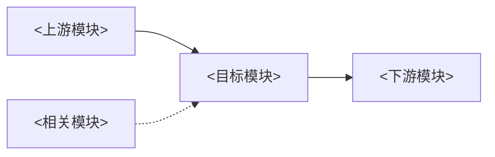

<!-- 仅服务声明 spec_version: 3 的旧契约包（由 scripts/req.py 的 scaffold --with-diagram 生成）。当前格式的 task 不用本模板，模块边界写在 tech-design 的「范围与模块边界」表。 -->
# <TASK_NAME> · 影响边界图

<!--
填写后删除本注释和占位节点。
- 节点名来自 spec.md“影响边界与不变量”表的“模块”列，每个模块恰好一个节点。
- 连线表达上游 → 目标 → 下游；相关模块用虚线连接。
- 图只投影边界与依赖，不增加新的模块或设计事实。
-->

