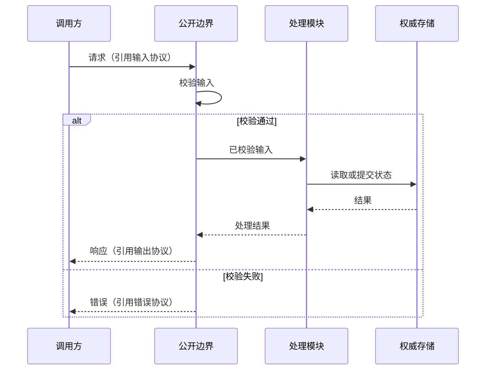

# <spec 名称> · 技术设计

<!-- 主 agent 在 spec 确认后继续编写，以本轮新增/修改的功能名称组织正文，用大白话就近讲清方案、理由、数据流转、失败处理和测试预期；必要术语首次解释。简单改动删除无关的图/结构/协议小节并简述依据，未变设计链接原出处，需求正文留在 spec。稳定 ID 仅用于追溯元数据/附录，沿用已有编号和锚点；中文名称与链接承担阅读说明。填写后删除提示与空示例，保留有效定位锚点及追溯记录。 -->

> spec: <项目相对路径>/spec.md
> spec 基线: <版本/内容摘要或哈希及可读取的基线来源>
> spec 确认依据: <用户结论、来源与对应范围/版本>
> 设计状态: 待用户确认
> 设计版本: <本轮可识别基线>
> 既有设计/规范: <路径与状态；无则注明>
> 本轮范围: <本轮新增/修改的 feat；未变部分沿用出处>

## 本轮设计差异

<现有代码/设计的可定位依据；本轮新增、修改和沿用什么。跨功能共用定义只写一处，其他功能以中文名称和链接引用。>

<!-- 为每个新增/修改的 feat 重复以下功能节，替换成实际名称；各节使用唯一锚点。已有文档重组时保留原定位，避免后续引用悬空。 -->

## <功能名称>（featNN）

<回指 spec 中本功能的准确场景/约束来源；只说明本轮设计范围，不复制需求或 GWT 正文。>

<a id="feature-plan"></a>

### 方案与理由

<怎么做、为什么这样做、沿用与新增什么；关键选择的备选、代价、兼容/迁移影响和待用户确认项。>

### 职责、数据流与失败处理

<具体模块/目录、公开入口、调用方与单向依赖；从入口和边界校验到处理、状态变化/持久化、返回的数据路径，数据由谁负责。按相关风险说明失败、重复、并发、取消、恢复的处理与禁止结果；列循环/越界检查依据。>

#### 调用顺序（按需）

<!-- 仅当顺序有助于理解时保留；简单改动用文字即可。可按需改用 flowchart 表达数据流；图中调用/返回箭头不代表代码依赖，涉及依赖时说明单向关系。 -->



### 关键新增/变化数据结构与配置（按需）

<重要结构/字段的含义、适用约束（可空性、单位、标识、关系和不变量）、数据所有者与权威存储；派生值及缓存/索引/快照的更新、失效、重建策略；具名配置的单位、默认值依据和实际使用位置。未变部分只引用原 schema/设计。>

<新结构可选择项目实际语言写设计示意，注明正式实现计划位置与权威来源；落地后改为正式 schema 引用，避免多份维护。以下示例按需选一种并替换为实际字段，不预设业务概念。>

```typescript
// 仅为设计示意；正式 schema 位置和所有者在本功能说明中明确。
import { z } from "zod";

export const BoundarySchema = z.object({
  value: z.string(),
});
export type Boundary = z.infer<typeof BoundarySchema>;
```

```python
# 仅为设计示意；选择 Python 时使用，不要求同时维护两种语言。
from pydantic import BaseModel


class Boundary(BaseModel):
    value: str
```

### API、事件或网络协议（按需）

<先用大白话讲本功能为什么需要这个接口/事件/协议；已有未变定义只链接原出处，不强造协议。>

| 名称与功能用途 | 生产者 → 消费者 | 输入及约束 | 输出 | 错误行为与校验边界 | 权威来源 |
|---|---|---|---|---|---|
| <中文名称；帮助本功能完成什么> | <实际模块> | <schema/字段引用及重要语义> | <正常结果或事件> | <失败如何传播、用户/调用方如何处理；对应场景> | <路径/符号/所有者；跨语言时生成同步及漂移检查> |

### 测试场景与预期

<!-- 主定义就近放在最相关的功能节；已有用户具体场景回指 spec，只展开测试安排。每个场景使用描述性中文名称及唯一锚点，稳定用例编号登记到附录。 -->

<a id="feature-test-case"></a>

#### <描述性中文场景名>

- 依据：<spec 场景/已确认约束和本功能设计的名称、链接；ID 在追溯附录定位>
- 前提与触发：<初始状态、操作及相关故障注入>
- 预期结果：<本功能应观察到什么>
- 禁止结果：<绝不能发生什么>
- 验证方式与证据：<拟用 unit/smoke/集成/e2e/人工/审查、观察点与证据位置；未执行如实注明>
- 局限：<替身边界、未覆盖项或具体不适用依据；不能替换被验证机制>

#### 本功能引用的共享测试（按需）

- [<共享场景的中文名称>](#shared-test-case)：<说明该主定义中哪些预期/禁止结果验证本功能，指向对应断言/观察点及本功能证据；尚无证据如实注明。只经过本功能的流程不能算作验证结果。>

## 共享测试场景（按需）

<!-- 已在某功能节定义的共享场景只链接该主定义，删除此处重复占位。需要单独放置时在此定义一次，其他功能以中文名称和链接引用。共享模块/协议也优先链接原定义；多对多关系不要求串成一个巨型 E2E。 -->

<a id="shared-test-case"></a>

### <共享场景的描述性中文名称>

<按上面的场景字段写唯一主定义，并明确各相关功能实际要验证的预期/禁止结果和断言/观察点。优先选择能观察目标行为的测试层级，依据和证据不能由总绿灯或流程经过代替。>

## 待确认与交接

<汇总功能旁的待确认问题、阻塞、验证局限及相关链接，不重复维护决策正文。主 agent 用大白话讲解并组织用户确认；记录真实确认结论、来源、范围和版本。设计草案完成不代表批准，关键条目未确认不能交给 req；重大设计变更先重新确认。提供 spec/设计基线及以下追溯记录供后续引用。>

## 附录：追溯与验证依据

<!-- 本附录是索引；设计/测试正文仅在上面的功能节或共享节定义。保留已有 D、用例 T、C/Scenario ID 及有效定位，不重排或复用；“用例 T1”与 checklist 任务行 T1 分别定位。证据必须对齐实际输入和代码基线，计划验证不冒充已执行。 -->

| 稳定 ID | 中文名称与唯一主定义位置 | spec 场景/已确认约束来源 | 适用 feat 与各自验证结果定位 | 验证方式、证据位置与状态 |
|---|---|---|---|---|
| D01 | [<功能方案的中文名称>](#feature-plan) | <准确场景回指；约束原 ID/章节链接> | <本轮适用 feat；引用正文落实位置> | <机制检查/审查依据与实际状态> |
| 用例 T1 | [<测试场景的中文名称>](#feature-test-case) | <如 featNN 场景M、C1；设计 D01 的定位> | <每个适用 feat 的结果/禁止结果及断言/观察点链接，不另抄主定义> | <拟验证层级/真实证据与基线；未执行/局限> |

### 规范落实索引

<!-- R1–R7 及项目附加规则逐条登记适用性；具体落实可在功能旁说明，此处回指。 -->

| 规则/来源 | 适用性与原因 | 功能/设计落实位置 | 检查、测试或审查依据 | 结果/执行状态 |
|---|---|---|---|---|
| <R 编号或项目规则路径> | <适用/不适用及具体原因> | <中文名称与链接；稳定设计 ID> | <静态检查/测试判定或审查证据> | <已执行结果/待实现验证> |
