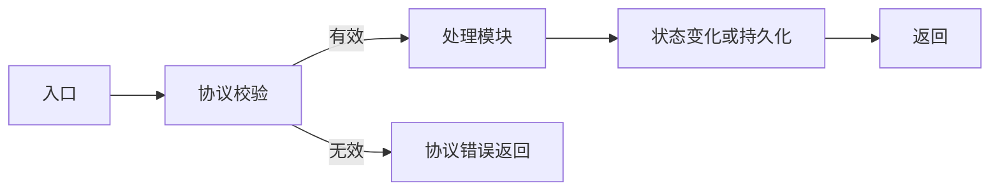
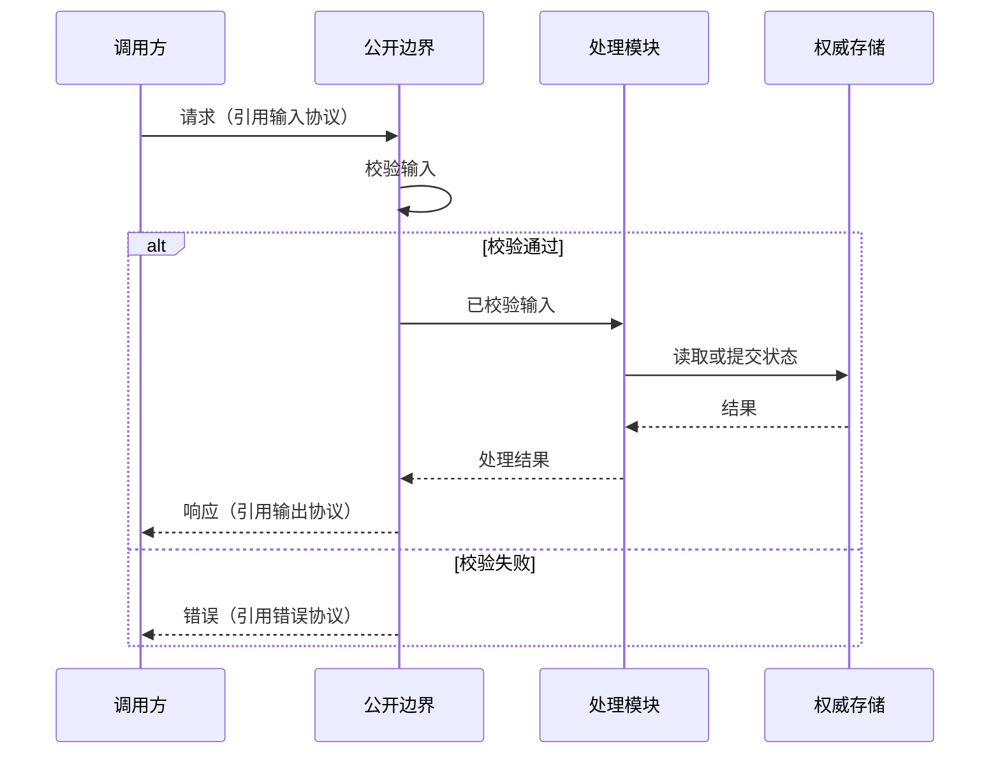

# <spec 名称> · 技术设计

<!-- 填写后删除本注释、占位符和空示例。小改动以设计差异填写，未变部分引用基线。D 编号稳定且不重复，表格可按实际结构调整，不复制 spec 的功能正文。图及代码示例按需选用并改为实际设计，不必全部保留。 -->

> spec: <项目相对路径>/spec.md
> spec 基线: <版本/内容摘要或哈希及可读取的基线来源；用于后续差异比较>
> spec 确认依据: <用户结论、来源与对应范围/版本>
> 设计状态: 待用户确认
> 设计版本: <本轮可识别基线>
> 既有设计/规范: <路径与状态；无则注明>
> 本轮范围: <完整设计或差异及涉及场景>

## 1. 现状与设计差异

<现有模块/技术栈及可定位的代码证据；本轮沿用和改变什么，新增/替换的理由及兼容/迁移影响。>

## 2. feat 与场景设计映射

| feat | 准确场景回指 | 设计编号/参与模块 | 协议/结构引用 | 主要流程/特殊处理 | 验证方式 |
|---|---|---|---|---|---|
| featNN | featNN 场景M | <D 编号与模块> | <路径/符号或设计条目> | <主流程及适用的失败/并发/重试等差异> | <检查/测试类型和判定> |

<本轮每个 feat 及相关场景均有映射。普通场景可以共用一行主设计；特殊场景按实际需要补条目。feat 不等于模块，不要求每场景一模块或一张图；共享定义只写一处并回指。沿用设计时标明来源。>

## 3. 模块与单向依赖

| 设计编号 | 模块/目录 | 职责 | 公开接口与调用方 | 允许依赖/边界 |
|---|---|---|---|---|
| D01 | <路径> | <职责> | <公开入口、输入输出/协议引用、调用方> | <依赖方向和禁止越界处> |

<列出实际依赖方向及循环/内部访问的检查依据；未变模块引用现有设计，不补无关目录。>

## 4. 数据、协议与配置

| 设计编号 | 结构/关键字段 | 语义与约束 | 数据所有者与权威存储 | 协议权威源与使用方 |
|---|---|---|---|---|
| D02 | <结构、字段> | <含义、可空/单位/标识/关系/不变量等适用项> | <写入方、值来源和存储位置> | <schema 路径、校验边界、消费者> |

<派生值及依据；缓存/索引/快照如需存在，说明理由、更新、失效、重建、一致性。跨语言时指定唯一权威协议与生成/同步/漂移检查。概念命名引用权威定义，必要别名说明边界映射。>

### 公开协议

| 协议/设计编号 | 生产者 → 消费者 | 输入 | 输出 | 错误 | 校验边界 | 权威来源 |
|---|---|---|---|---|---|---|
| <接口/消息及 D 编号> | <模块> | <schema 符号及关键语义> | <schema 符号及关键语义> | <错误协议/分类及相关场景> | <何处验证、失败如何传播> | <正式 schema 路径/所有者；跨语言时生成同步方式> |

### 重要数据结构（按需）

<已有 schema 只引用路径/符号及重要字段语义或本轮差异，不复制完整声明。新结构可选下列一种语言示意，改为实际字段及约束；示例的 value 字段不预设任何业务概念。标注“设计示意”，写明正式 schema 的计划位置和权威来源，落地后用正式引用替代，避免两处独立维护。>

```typescript
// 仅为设计示意；正式 schema 位置和所有者在上表明确。
import { z } from "zod";

export const BoundarySchema = z.object({
  value: z.string(),
});
export type Boundary = z.infer<typeof BoundarySchema>;
```

```python
# 仅为设计示意；选择 Python 时使用，不要求同时维护两种语言。
from pydantic import BaseModel


class Boundary(BaseModel):
    value: str
```

### 具名配置

| 配置/常量 | 含义与单位 | 默认值及依据 | 权威位置/覆盖方式 |
|---|---|---|---|
| <具名配置> | <语义、单位> | <默认值；涉及未定业务行为则阻塞> | <路径与使用边界> |

## 5. 主要场景数据流

### D03 · <流程名称>（回指：featNN 场景M）

<入口 → 协议/权限等边界校验 → 处理模块 → 状态变化与持久化/提交点 → 返回。列出相关协议/数据/模块编号。>

<按本流程需要说明异步完成、幂等键/重复请求、并发控制、部分失败、重试与恢复；不适用项说明原因。其他边界/异常场景可合并引用，但保持路径可追踪。>

### 可选 Mermaid 图

<按需选 flowchart 表达数据流/模块依赖，或 sequenceDiagram 表达调用顺序；替换为实际角色并回指场景/设计编号。以下 flowchart 是数据流，箭头不代表代码 import；若画依赖图则标明箭头为“依赖于”并检查单向无环。调用返回箭头也不构成代码依赖。角色可按实际模块合并，不据此强建模块。>





## 6. 关键选择与待确认问题

| 设计编号 | 决策/问题 | 推荐方案及理由 | 备选、代价与影响 | 确认状态/依据 |
|---|---|---|---|---|
| D04 | <架构/协议/数据归属等关键决策> | <推荐与依据> | <备选、兼容/迁移/维护影响> | 待用户确认 |

<如有功能歧义，写明场景回指、需要澄清的行为及阻塞条目；不以技术假设替用户决定。普通实现细节不逐项审批。>

## 7. 规范落实与验证

<!-- R1–R7 每条及项目附加规则各一行；不适用说明理由，适用规则给出落实位置。 -->

| 规则/来源 | 适用性与原因 | 设计条目/落实位置 | 检查、测试或审查依据 | 结果/执行状态 |
|---|---|---|---|---|
| <R 编号或项目规则路径> | <适用/不适用及原因> | <D 编号、路径/符号> | <静态检查/测试判定或审查证据> | <已执行结果/待实现验证> |

## 8. 影响与交接摘要

<覆盖的场景、主要设计差异、阻塞/待确认项、验证限制。spec 若有变化，列出受影响 D 编号和已有任务路径/编号；未拆任务则注明。纯措辞变动记录无需重做的依据。>

<设计默认待确认。只有用户实际确认关键条目后，记录结论、来源与对应版本，提供 spec 和设计的路径/基线、约束与阻塞供 req 拆解引用；本文件完成或子 agent 返回不代表用户批准。>
