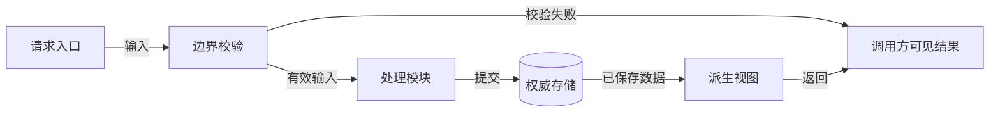

# <spec 名称> · 技术设计

<!-- 主文按技术问题和共用机制组织，关键决策前置。文字解释取舍，图表展示关系与规则，具体例子支持人类推演。Spec 的功能、场景及 GWT 保留在原文，附录登记覆盖关系。按实际复杂度选择和合并小节；简单改动采用短表/文字与直接例子。填写后删除提示和空示例，保留已有稳定 ID、有效锚点及追溯记录。 -->

> 功能依据：[spec.md](spec.md) · <已确认版本>
> 设计状态：待用户确认 · <设计版本>
> 本轮变化：<简述技术变更范围；完整基线、确认来源与调查证据见附录>

## 需要判断的关键决策

<!-- 开头以一屏可扫读为目标。每行是一项影响架构、数据归属、成本或兼容性的选择；普通局部实现由开发者决定。重大风险与取舍在此可见，细节链接到机制。 -->

| 选择 | 推荐及理由 | 主要代价/备选与影响 | 状态与设计依据 |
|---|---|---|---|
| <要决定什么> | <推荐怎么做，依据是什么> | <成本、兼容/迁移、可靠性影响；有实际备选时简述取舍> | <待确认/已确认及来源；链接对应机制> |

## 整体结构与数据归属

<简述现有结构、本轮沿用与新增部分；调查明细链接附录。主路径覆盖入口、校验、处理、状态或持久化到返回，标出影响结果的失败边界。>

<!-- 选择适合的数据流图；单步改动可用短表/文字。图中节点使用实际或计划模块，箭头标明数据含义；代码依赖另写单向关系。 -->

| 数据/职责 | 权威来源与写入方 | 读取方/派生结果 | 模块、目录与公开入口 |
|---|---|---|---|
| <核心数据或处理职责> | <存储与所有者；协议定义见附录> | <谁消费、推导出什么> | <实际/计划路径与符号；沿用或新增> |

<允许的单向依赖、关键失败时保留的状态；相关机制链接下文。>

<!-- 以下机制节按实际技术问题重复，标题如“整理许可与取消”“时间区间如何累计”。共用机制只写一处，附录关联其支撑的多个功能/场景。每节使用唯一锚点，重组旧文保留已有定位。 -->

## <技术问题或机制名称>

<要解决的技术问题、方案与依据；引用开头的决策。说明关键数据含义、不变量和结果的适用范围，详细字段/接口链接附录。>

### 规则与边界

<!-- 根据问题选一种或组合：顺序/异步提交用 Mermaid 时序图；生命周期用状态图/转换表；多条件分类用决策表；计算用短伪代码/公式与时间图。保留影响正确性的条件、优先级、默认结果、提交边界和关键阈值，详细约定放附录。删除不适用的示例表。 -->

| 当前状态 | 事件与条件 | 动作/保存结果 | 下一状态 |
|---|---|---|---|
| <明确状态> | <触发事件及守卫条件> | <处理动作、提交或保留什么> | <确定状态> |

| 优先级（适用时） | 条件组合 | 分类/处理结果 | 边界依据 |
|---|---|---|---|
| <冲突时的判断顺序> | <可检查的条件，含相关阈值/默认分支> | <确定结果> | <规则来源或理由> |

### 具体推演

<!-- 针对该机制选正常路径和会改变结论的边界/失败例，例子给出具体值或事件序列；计算结果带数值与单位。输入夹具维护一份，此处展示最小必要投影，正式用例引用同一输入/预期。样例属于设计预期，执行状态另行记录。 -->

| 输入/初始状态 | 事件或计算步骤 | 预期输出/最终状态 | 用例定位 |
|---|---|---|---|
| <具体数据与初始状态> | <按上述规则可推演的顺序或运算> | <确定数值、分类、返回值或保存结果> | [<用例中文名>](#feature-test-case) |
| <关键边界或故障条件> | <导致结果变化的步骤> | <与该条件对应的确定结果> | <对应编号用例及链接> |

<简述这些例子验证了哪些边界；协议/配置明细链接附录。>

## 验证状态与交接

<简述已执行检查和证据、仍待验证的关键风险、阻塞及影响。分别记录场景用例安排、实际执行与结果判定；逐场景矩阵链接附录。确认入口在开头，真实确认结论和版本记入附录；关键条目及完整测试安排就绪后交 req。>

## 附录 A：协议、结构与配置

<!-- 完整定义与权威引用集中于此，主文保留影响判断的语义与边界。未变定义沿用原出处；新结构标明设计示意及正式实现计划位置，落地后引用正式 schema。只展开本轮变化，按需删减。 -->

### <数据结构或协议名称>

<用途、所有者、权威存储及 schema 路径/符号；实际定义或待实现状态。可按项目语言使用简短 schema 示意，跨语言表示注明生成/受控同步方向和漂移检查。>

| 字段/关系 | 含义与单位 | 类型、可空性及约束 | 来源或计算依据 |
|---|---|---|---|
| <字段或关系名> | <精确语义> | <标识、唯一性、有效范围、不变量> | <权威来源/推导输入> |

<派生值、缓存/索引/快照的更新、失效、重建与一致性策略；详细序列化和兼容规则按需说明。>

### API、事件或网络协议（按需）

| 名称与用途 | 生产者 → 消费者 | 输入及约束 | 输出 | 错误行为与校验边界 | 权威来源 |
|---|---|---|---|---|---|
| <接口/事件名称> | <实际模块> | <schema/字段引用> | <正常结果或事件> | <错误如何传播和处理> | <路径/符号/所有者> |

### 配置（按需）

| 名称 | 单位与默认值 | 选择依据及影响 | 权威位置、覆盖方式与使用入口 |
|---|---|---|---|
| <具名配置> | <明确单位和值> | <理由与适用边界> | <路径/符号> |

## 附录 B：测试用例与覆盖矩阵

<!-- 完整测试主定义在此维护，按机制或验证目标分组。每个 spec 场景至少有一条编号用例承接全部预期及适用禁止结果，允许多对多；需求/GWT 回指 spec。主文推演引用这些用例，已有 ID 与锚点持续有效。 -->

### <技术机制或验证目标>

#### <描述性中文用例名>

- 用例编号与依据：<沿用稳定用例 ID；准确的 spec 场景链接及适用 C/D；纯技术约束用例给出规范/设计来源和适用范围>
- 为什么测：<这组数据、条件和步骤能暴露的具体错误及后果>
- 测试数据与准备：<必要字段/具体输入、初始状态、构造方式与隔离环境；主文已有输入/预期时引用该例，完整夹具维护一份>
- 测试流程：<准备 → 调用入口 → 真实处理/故障注入 → 检查 → 清理/复位；定位入口路径/符号、被测路径与结果读取处，待实现入口标计划位置；人工/审查给出操作路径>
- 预期结果与观察点：<逐个对应来源场景的预期，写明中间/最终状态、返回值或记录的断言位置；关联主文推演>
- 禁止结果与观察点：<适用禁止结果与断言位置>
- 验证方式与证据：<unit/smoke/集成/e2e/人工/审查；实际或计划测试文件/命令、证据路径及基线；待实现验证/未执行/已执行结果>
- 局限：<外部依赖替身边界、未覆盖项或不适用依据；被验证机制保留真实执行路径>

<!-- 多种独立边界或故障可拆用例，或使用下表逐行给出可独立断言的数据；共用流程在用例中只写一次。 -->

| 数据行 | 具体输入/故障 | 预期结果 | 对应断言/观察点 |
|---|---|---|---|
| <行编号> | <单独可复现的条件> | <确定结果> | <定位> |

#### <共享用例名称，按需保留>

<按上述字段给出唯一主定义，各来源场景分别指定预期/禁止结果与实际观察点。已有主定义使用链接引用。>

### 场景与用例覆盖

<!-- 逐个登记本轮 spec 全部场景，完整列出承接用例与缺口，供 req 检查。此表为索引，用例的理由、数据、流程和判据在上面维护。覆盖安排与执行状态分别记录。 -->

| spec 具体场景 | 承接用例与主定义 | 各预期/禁止结果的观察点 | 覆盖缺口 | 执行状态/证据 |
|---|---|---|---|---|
| <featNN 场景M/既有 ID/准确章节链接> | <全部用例 ID、中文名与链接> | <对应主定义中的结果/观察点> | <具体缺项或已安排完整> | <待实现/未执行/已执行结果及证据> |

## 附录 C：调查、基线与追溯

### 基线与确认记录

- spec：<项目相对路径、版本/内容摘要或哈希及可读取的基线来源>
- spec 确认依据：<实际用户结论、来源、范围及对应版本>
- 设计版本与确认：<设计基线；实际已确认条目/范围/来源与剩余待确认项>
- 既有设计/规范：<权威路径及状态；无则注明>
- 本轮覆盖范围：<新增/修改的 feat 和场景回指；未变部分沿用出处>

### 现状与本轮差异

| 代码/设计位置 | 已核对事实 | 本轮处理及影响 |
|---|---|---|
| <文件/符号/章节> | <当前证据> | <沿用/修改/新增及对应机制；调用方、依赖与迁移影响> |

### 设计与用例定位

<!-- 保留既有 D、用例 T、C/Scenario ID 和有效定位；“用例 T1”与 checklist 任务行 T1 分别定位。主文与附录定义使用同一权威来源。 -->

| 稳定 ID | 中文名称与唯一主定义 | spec 场景/约束或设计来源 | 结果/证据定位与状态 |
|---|---|---|---|
| D01 | [<机制名称>](#feature-plan) | <准确场景回指及适用 C> | <机制审查/验证位置及状态> |
| 用例 T1 | [<用例名称>](#feature-test-case) | <准确场景回指；适用 C/D 或纯技术规范来源> | <各场景观察点、证据及执行状态> |

### 规范落实索引

| 规则/来源 | 适用性与原因 | 设计落实位置 | 检查、测试或审查依据 | 结果/执行状态 |
|---|---|---|---|---|
| <R1–R7 或项目规则，逐条登记> | <适用/不适用及原因> | <中文名与链接；稳定设计 ID> | <判据/观察点/审查证据> | <已执行结果/待实现验证> |
